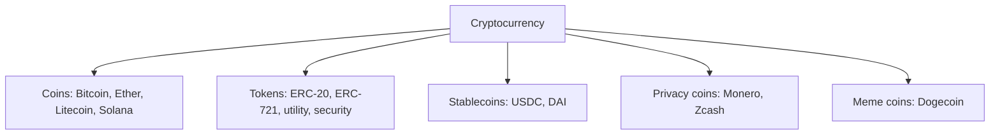

**In simple words:** A cryptocurrency is digital money on a blockchain with no central issuer. It comes in several types, each made for a different need. <Cite id="class-bt-m5" loc="slide 2" />

**Definition:** a cryptocurrency can be used for transactions only in the digital world and must be converted into real currency to buy goods. It has no central issuing authority and uses a decentralized system to record transactions and issue new units. <Cite id="class-bt-m5" loc="slide 2" />

**Types:**

1. **Bitcoin.** Founded in 2009 by Satoshi Nakamoto; the most widely accepted and traded; a decentralized digital currency sent peer to peer. <Cite id="class-bt-m5" loc="slide 9" />
2. **Ether.** Native cryptocurrency of Ethereum; each account has an ETH balance; smallest unit is Wei. <Cite id="class-bt-m5" loc="slide 9" />
3. **Litecoin.** A peer-to-peer coin nearly identical to Bitcoin that uses a script in its proof-of-work and makes payment easier. <Cite id="class-bt-m5" loc="slide 10" />
4. **Stablecoins.** Values designed to stay stable relative to assets like the U.S. dollar. <Cite id="class-bt-m5" loc="slide 10" />
5. **Solana.** A competitor of Ethereum focused on speed and cost-effectiveness. <Cite id="class-bt-m5" loc="slide 10" />
6. **Others.** Privacy coins (Monero, Zcash), meme coins (Dogecoin) and tokens. <Cite id="cryptocurrencies-tokens-gfg-coins-tokens" />

| Type | Own blockchain | Example | Use |
|---|---|---|---|
| Coin | Yes | BTC, ETH, LTC | Money, pay fees |
| Token | No | USDT, LINK | Access, ownership, voting |
| Stablecoin | Usually a token | USDC, DAI | Steady payments |

<Cite id="cryptocurrencies-tokens-wiki-crypto" /> <Cite id="cryptocurrencies-tokens-wiki-stablecoin" />

**Extend in the exam (add these to reach 10 marks):**

- **Uses.** Mining and staking rewards, gas fees, peer-to-peer payments, smart-contract execution, governance voting, collateral in DeFi. <Cite id="class-bt-m5" loc="slide 11" /> <Cite id="class-bt-m5" loc="slide 13" />
- **Token kinds.** Utility (access), security (ownership under law), governance, NFT. <Cite id="cryptocurrencies-tokens-gfg-security-token" /> <Cite id="web-bt-2-wiki-security-token" />
- **Stablecoin types.** Fiat-backed, crypto-backed, algorithmic.
- **Risks.** Price swings, hacks, scams, lost keys, unclear regulation. <Cite id="class-bt-m5" loc="slide 40" />

**Conclusion:** Cryptocurrencies range from money (coins) to application assets (tokens) to price-stable coins.
