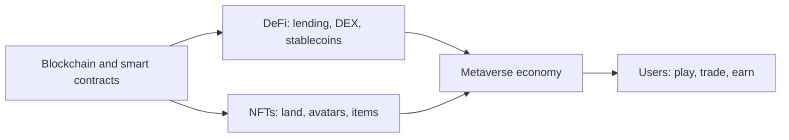

**In simple words:** DeFi is banking without a bank, using smart contracts. The Metaverse is a shared 3D digital world where blockchain proves who owns what. <Cite id="class-bt-m5" loc="slide 46" /> <Cite id="class-bt-m5" loc="slide 52" />

**DeFi (decentralized finance).** An umbrella term for financial services on public blockchains, mainly Ethereum. Users earn interest, borrow, lend, trade and buy insurance, faster and without paperwork or a third party. They use dapps with just a wallet. <Cite id="class-bt-m5" loc="slide 46" /> <Cite id="class-bt-m5" loc="slide 48" />

- **Uses:** lending, loans, peer-to-peer trading, saving and derivatives. <Cite id="class-bt-m5" loc="slide 49" />
- **Benefits:** open, pseudonymous, flexible, fast, transparent. **Downsides:** fluctuating fees, high volatility, own tax records. <Cite id="class-bt-m5" loc="slide 50" /> <Cite id="class-bt-m5" loc="slide 51" />

**Metaverse.** A virtual universe of interconnected digital spaces, environments and assets; persistent, immersive and interactive. <Cite id="class-bt-m5" loc="slide 52" /> Key ideas: digital continuity, interoperability, user agency, persistence, immersive interaction, economy and socialization. <Cite id="class-bt-m5" loc="slide 53" /> <Cite id="class-bt-m5" loc="slide 55" /> Blockchain stores NFT ownership and a virtual economy runs on cryptocurrency and NFTs. <Cite id="class-bt-m5" loc="slide 59" /> <Cite id="class-bt-m5" loc="slide 60" />

**Link:** in a virtual world a user can buy land as an NFT with tokens, use it as collateral for a DeFi loan and earn rent in stablecoins. <Cite id="cryptocurrencies-tokens-gfg-metaverse" />

**Conclusion:** DeFi gives the metaverse its money services and NFTs give it ownership. <Cite id="smart-contracts-wiki-defi" />
