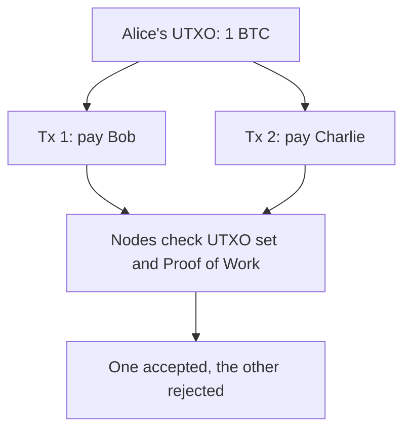

**In simple words:** The UTXO model keeps unspent pieces of earlier payments instead of balances. Because a piece can be spent only once, and Proof of Work fixes the order, the same coin cannot be spent twice. <Cite id="wallets-utxo-double-spending-learnmeabitcoin-utxo" />

**UTXO model.** UTXO means Unspent Transaction Output: a record of unspent cryptocurrency left after a transaction, like change from a cash purchase. <Cite id="class-bt-m5" loc="slide 96" /> <Cite id="class-bt-m5" loc="slide 97" />

1. **Inputs** point to earlier UTXOs and carry a signature; **outputs** create new UTXOs. <Cite id="class-bt-m5" loc="slide 102" />
2. A UTXO is spent whole, and the extra returns as **change**.
3. *Example:* Alex pays Julia 5.10 BTC using UTXOs of 5 and 0.2 BTC; Julia gets 5.10, Alex gets 0.09 as change, 0.01 is the fee. <Cite id="class-bt-m5" loc="slide 99" />

**Double spending:** using the same digital currency more than once. Alice sends 1 BTC to Bob and also to Charlie; both transactions compete, and the network confirms only one. <Cite id="class-bt-m5" loc="slide 107" /> <Cite id="class-bt-m5" loc="slide 108" /> <Cite id="class-bt-m5" loc="slide 109" />

**How Bitcoin solves it:**

1. **Unique IDs.** Each UTXO has a transaction ID and output index, so it is traceable.
2. **One-time use.** A used UTXO is marked spent and cannot be reused.
3. **Validation.** Nodes check the inputs are still unspent. <Cite id="class-bt-m5" loc="slide 113" />
4. **Consensus (Proof of Work).** Only one version of history is accepted; the longest chain wins. <Cite id="bitcoin-gfg-pow" />
5. **Confirmations.** More blocks on top make a reversal costly. <Cite id="consensus-mining-btcwiki-confirmation" />

| Point | UTXO (Bitcoin) | Account (Ethereum) |
|---|---|---|
| Stores | Unspent outputs | Balance per account |
| Double spend stopped by | UTXO spent once | Nonce per transaction |

**Extend in the exam (add these to reach 10 marks):**

- **Attacks.** Race attack, Finney attack, 51% attack. <Cite id="class-bt-m5" loc="slide 111" /> <Cite id="wallets-utxo-double-spending-btcwiki-double-spending" />
- **Mechanisms list.** Consensus, transaction verification, UTXOs, public ledger, chain of blocks, confirmations. <Cite id="class-bt-m5" loc="slide 112" />
- **Why waiting helps.** With 6 confirmations an attacker with 10 percent power succeeds about 0.02 percent of the time. <Cite id="blockchain-fundamentals-nakamoto" loc="§11" />
- **Limit.** A 51% attacker can still rewrite recent blocks.

**Conclusion:** UTXO makes each coin spendable once, and Proof of Work makes the order of spending hard to change. <Cite id="wallets-utxo-double-spending-gfg-prevent-double" />
