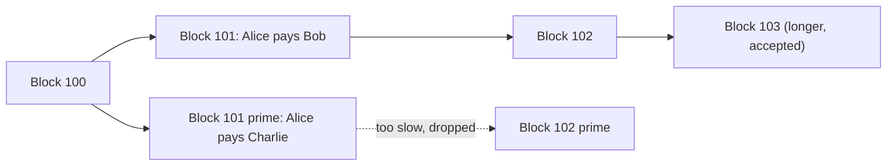

**In simple words:** Digital files can be copied, so someone could spend the same coin twice. A blockchain stops this because all nodes keep one ordered, verified ledger and accept only one of the two payments. <Cite id="wallets-utxo-double-spending-gfg-double-spending" />

**What it is:** double spending means spending the same digital currency twice or more to get several services. It is a technical flaw because currency is just a file that can be copied. <Cite id="class-bt-m5" loc="slide 105" />

**Example:**

1. Alice has 1 BTC and sends it to Bob; the transaction waits for confirmation.
2. Meanwhile she sends the same 1 BTC to Charlie.
3. Both transactions compete in the network, which sees them at different times.
4. The network confirms one (say Bob's); Charlie's is invalidated.
5. The blockchain records only one. <Cite id="class-bt-m5" loc="slide 107" /> <Cite id="class-bt-m5" loc="slide 109" />

**How it can be attempted:** race attack (two conflicting transactions to different nodes), Finney attack (a pre-mined block with a conflicting transaction), 51% attack (majority computing power to reverse transactions). <Cite id="class-bt-m5" loc="slide 111" />

**How blockchain prevents it:**

1. **Consensus.** Proof of Work lets one chain win; the first transaction in it is valid.
2. **Transaction verification.** Nodes check signatures and balance.
3. **UTXO check.** A spent output cannot be used again. <Cite id="class-bt-m5" loc="slide 113" />
4. **Public ledger and chain of blocks.** Everyone sees the same history; changing a block breaks all later blocks.
5. **Confirmations.** More blocks give more safety. <Cite id="class-bt-m5" loc="slide 112" /> <Cite id="consensus-mining-btcwiki-confirmation" />

**Extend in the exam (add these to reach 10 marks):**

- **Proof of Work detail.** A miner finds a nonce so the block hash is below a target; redoing the work of many blocks needs over 50% of hash power. <Cite id="bitcoin-gfg-pow" />
- **Numbers.** With 10% attacker power, success after 6 confirmations is about 0.02%. <Cite id="blockchain-fundamentals-nakamoto" loc="§11" />
- **Attack table.** Race, Finney and 51% attacks, each defended by waiting for confirmations. <Cite id="wallets-utxo-double-spending-btcwiki-double-spending" />
- **Without a blockchain.** A bank would reject the second payment; Bitcoin has no bank, so the network does this. <Cite id="web-bt-2-wiki-double-spending" />

**Conclusion:** Double spending is stopped by a public, ordered and verified ledger, not by a trusted middleman. <Cite id="wallets-utxo-double-spending-ibm-double-spend" />
