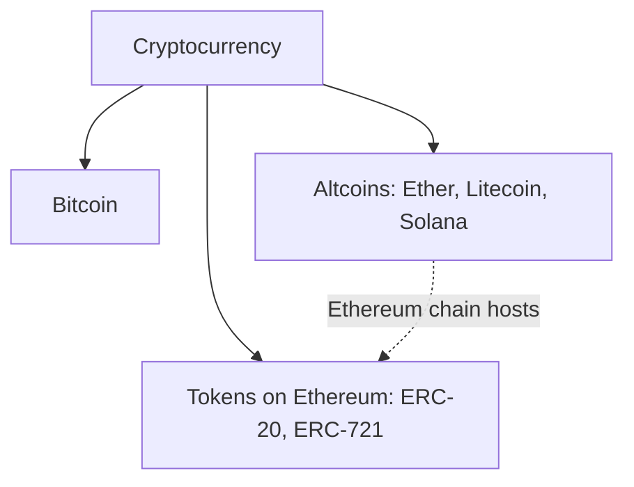

**In simple words:** Bitcoin is the first cryptocurrency. Altcoins are all other coins with their own blockchain. Tokens are made on top of an existing blockchain. <Cite id="cryptocurrencies-tokens-gfg-coins-tokens" />

**Bitcoin.** Founded in 2009 by Satoshi Nakamoto; the most widely accepted and traded; a decentralized digital currency moved peer to peer. It is mined by solving puzzles and used for payment and store of value. <Cite id="class-bt-m5" loc="slide 9" /> <Cite id="class-bt-m5" loc="slide 3" />

**Altcoins.** Every cryptocurrency except Bitcoin, with its own blockchain. *Examples:* Ether (native coin of Ethereum), Litecoin (nearly identical to Bitcoin, easier payments), Solana (speed and low cost). <Cite id="class-bt-m5" loc="slide 9" /> <Cite id="class-bt-m5" loc="slide 10" />

**Tokens.** Digital assets created with smart contracts on an existing chain, for example ERC-20 tokens. They are tradable, give a stake or use of a service, and do not need a new blockchain. <Cite id="class-bt-m5" loc="slide 34" /> <Cite id="class-bt-m5" loc="slide 18" /> Kinds: utility, security, governance and NFT tokens. <Cite id="web-bt-2-wiki-security-token" />

| Point | Bitcoin | Altcoin | Token |
|---|---|---|---|
| Own blockchain | Yes | Yes | No |
| Created | Mining (Proof of Work) | Mining or staking | Smart contract |
| Purpose | Digital money, store of value | Faster payments, apps | Access, ownership, voting |
| Example | BTC | ETH, LTC | USDT, LINK, NFTs |

<Cite id="cryptocurrencies-tokens-wiki-crypto" /> <Cite id="web-bt-sol-b-gfg-crypto-types" />

**Extend in the exam (add these to reach 10 marks):**

- **Why altcoins exist.** To improve speed, cost or features beyond Bitcoin.
- **Token standards.** ERC-20 gives common functions, so wallets support all tokens. <Cite id="cryptocurrencies-tokens-eth-erc20" /> <Cite id="class-bt-m5" loc="slide 20" />
- **Coin versus token rule.** If it has its own blockchain it is a coin; if it runs on another, it is a token.
- **Fundraising.** Tokens are sold in ICOs and STOs. <Cite id="class-bt-m5" loc="slide 31" /> <Cite id="class-bt-m5" loc="slide 44" />

**Conclusion:** Bitcoin is the original coin, altcoins are other coins, and tokens are assets built on existing blockchains.
