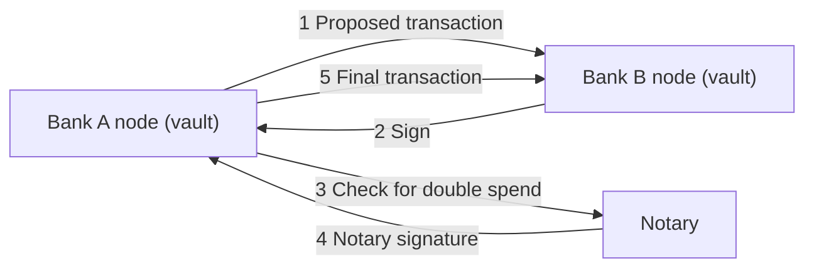

**In simple words:** A case study takes one real platform and shows the problem, the solution, the use and the result. Here it is **R3 Corda**, a blockchain for banks and regulated businesses. <Cite id="class-bt-m4" loc="slide 86" />

**Background and problem.** Independent organizations must agree on the same version of the truth without giving up control of their own data. Each bank keeps its own books, so the same deal sits in many places and is matched by hand. Sensitive deals cannot go on a public chain where all can see them. <Cite id="class-bt-m4" loc="slide 90" /> <Cite id="class-bt-m4" loc="slide 87" />

**Solution (Corda's design):**

1. **Nodes with vaults.** Each organization keeps its own private data. <Cite id="class-bt-m4" loc="slide 94" />
2. **States.** Immutable facts; a change consumes the old state and creates a new one. <Cite id="class-bt-m4" loc="slide 97" />
3. **Contracts and flows.** Contracts check the rules (tied to legal text); flows let nodes agree step by step. <Cite id="class-bt-m4" loc="slide 99" /> <Cite id="class-bt-m4" loc="slide 100" />
4. **Notary.** Confirms inputs were not spent before, preventing double spending. <Cite id="class-bt-m4" loc="slide 95" />
5. **Verified identity.** Every participant is a known legal entity. <Cite id="class-bt-m4" loc="slide 102" />

**Use cases:** syndicated loans, bond issues and securities settlement; trade finance letters of credit; insurance claims between insurers and reinsurers; healthcare data exchange; supply-chain ownership transfers. <Cite id="class-bt-m4" loc="slide 109" /> <Cite id="class-bt-m4" loc="slide 110" />

**Benefits:**

| Benefit | Why |
|---|---|
| Privacy | Data goes only to parties and those with a need to know |
| Scalability | Traffic only between counterparties |
| Compliance | Verified identity, legal prose, regulator observer nodes |
| Less reconciliation | One shared record replaces bilateral matching |
| Finality | The notary signature makes the deal irrevocable |

<Cite id="class-bt-m4" loc="slide 88" /> <Cite id="class-bt-m4" loc="slide 89" /> <Cite id="class-bt-m4" loc="slide 105" />

**Extend in the exam (add these to reach 10 marks):**

- **Limits.** Smaller community than Ethereum, needs a trusted network operator, not for open public coins. <Cite id="corda-ripple-quorum-xoriant-corda" />
- **Another case.** IBM Food Trust (Hyperledger Fabric): Walmart traced mangoes to the farm in about 2.2 seconds instead of nearly 7 days. <Cite id="hyperledger-fabric-ibm-fabric" />
- **Lesson.** A blockchain need not copy Bitcoin; Corda trades global broadcast for privacy. <Cite id="corda-ripple-quorum-corda-tech-wp" />
- **Roll-out.** The network operator manages identity, notaries and CorDapps. <Cite id="class-bt-m4" loc="slide 102" />

**Conclusion:** Corda shows how a blockchain can be shaped for business: private, legally linked and efficient. <Cite id="corda-ripple-quorum-corda-intro-wp" />
