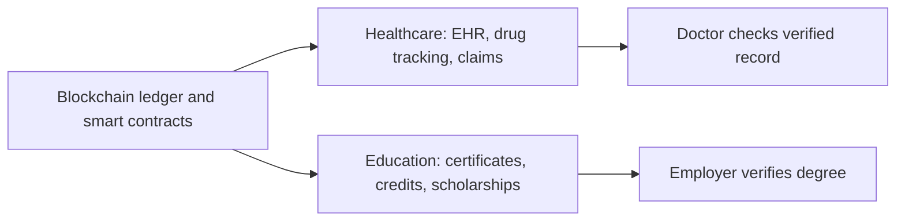

**In simple words:** Blockchain gives hospitals and universities one trusted record that is hard to alter and easy to verify. Smart contracts can run steps such as claim payments or scholarships by themselves. <Cite id="class-bt-m6" loc="slide 11" /> <Cite id="class-bt-m6" loc="slide 3" />

**Healthcare:** blockchain securely manages patient records, medical data, prescriptions, insurance information and healthcare transactions. <Cite id="class-bt-m6" loc="slide 11" />

1. **Electronic health records.** Stored and shared securely.
2. **Secure sharing.** Authorized doctors, hospitals, labs and patients get the data they need. <Cite id="class-bt-m6" loc="slide 11" />
3. **Patient data ownership.** Patients control who can access their information. <Cite id="class-bt-m6" loc="slide 12" />
4. **Record integrity.** Unauthorized changes are difficult.
5. **Drug supply chain and counterfeit prevention.** Medicines are tracked from maker to patient. <Cite id="class-bt-m6" loc="slide 12" />
6. **Insurance claims and clinical trials.** Duplicate or fraudulent claims fall; trial records are transparent. <Cite id="class-bt-m6" loc="slide 13" />
7. **Smart contracts.** Automate claim processing when conditions are met.

*Example:* a patient visits different hospitals; authorized providers see verified information instead of separate records. **Advantages:** secure records, data integrity, controlled sharing, drug traceability, faster insurance, transparency, coordination. <Cite id="class-bt-m6" loc="slide 13" /> <Cite id="class-bt-m6" loc="slide 14" />

**Education:** blockchain securely stores and verifies records, certificates, degrees and achievements. <Cite id="class-bt-m6" loc="slide 3" />

1. **Digital certificates.** Each degree has a unique blockchain record.
2. **Verification.** Employers check it directly without manual processes.
3. **Prevention of fake certificates.** Records are hard to alter. <Cite id="class-bt-m6" loc="slide 4" />
4. **Academic records.** Marks, grades and courses are kept securely.
5. **Credit transfer.** Completed courses are verified between institutions.
6. **Student identity.** A digital identity to access services.
7. **Scholarships.** Smart contracts release money when conditions are met. <Cite id="class-bt-m6" loc="slide 5" />
8. **IP protection.** Research is time-stamped to show ownership.

*Example:* a university issues a B.E. certificate on blockchain and an employer verifies it from the record. **Advantages:** no fake certificates, easy verification, less paperwork, transparency, quick credit transfer. <Cite id="class-bt-m6" loc="slide 6" />

| Point | Healthcare | Education |
|---|---|---|
| Main record | Patient history | Certificate, marks |
| Main gain | Safe sharing, drug traceability | No fake degrees |
| Smart contract use | Claims | Scholarships |

**Extend in the exam (add these to reach 10 marks):**

- **Hash on chain.** For health data keep the full record off chain and store only its hash, because of privacy laws.
- **Real example.** Blockcerts is an open standard for blockchain certificates. <Cite id="blockchain-applications-blockcerts" />
- **Challenges.** Privacy rules, adoption by all institutions and integration with old systems. <Cite id="web-bt-sol-b-gfg-applications" />

**Conclusion:** Blockchain makes healthcare and education more secure, transparent and efficient. <Cite id="class-bt-m6" loc="slide 14" />
