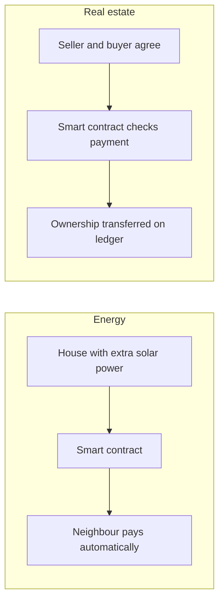

**In simple words:** In energy, blockchain lets people trade power directly and pay automatically. In real estate, it keeps property records safe and automates the transfer. <Cite id="class-bt-m6" loc="slide 7" /> <Cite id="class-bt-m6" loc="slide 15" />

**Energy:** blockchain manages generation, distribution, trading and payments in a decentralized way. <Cite id="class-bt-m6" loc="slide 7" />

1. **Peer-to-peer trading.** A home with extra solar power sells it to a neighbour.
2. **Renewable energy trading.** Solar and wind output is recorded and traded.
3. **Smart-contract payments.** Payment runs when energy is supplied. <Cite id="class-bt-m6" loc="slide 8" />
4. **Transparent transactions and usage tracking.** Production and consumption are recorded.
5. **EV charging.** Sessions, energy used and payment are recorded.
6. **Renewable energy certificates.** Issued and tracked clearly. <Cite id="class-bt-m6" loc="slide 9" />
7. **Microgrids.** Local communities coordinate solar, batteries and other resources.

*Example:* in a society with solar panels, one house sells extra electricity to another and a smart contract processes the payment. **Advantages:** decentralized trading, transparency, automated payments, better tracking, support for renewables, fewer intermediaries. <Cite id="class-bt-m6" loc="slide 9" /> <Cite id="class-bt-m6" loc="slide 10" />

**Real estate:** blockchain keeps secure records of ownership, transactions, agreements and payments. <Cite id="class-bt-m6" loc="slide 15" />

1. **Ownership records and transfer.** Tamper-resistant, digital.
2. **Smart contracts.** Automate a sale when conditions are satisfied. <Cite id="class-bt-m6" loc="slide 16" />
3. **Less paperwork.** Documents and intermediaries are reduced.
4. **Property history and fraud prevention.** Past deals are easy to verify.
5. **Digital payments.** Support payments linked to the sale.
6. **Tokenization.** A property is split into tokens so ownership or investment can be divided into smaller units, subject to law. <Cite id="class-bt-m6" loc="slide 17" />

*Example:* the ownership record, agreement, payment status and transfer details are on blockchain; when conditions are met, a smart contract starts the ownership transfer. **Advantages:** secure records, faster deals, less paperwork, less fraud, automated agreements, easier verification, fewer intermediaries. <Cite id="class-bt-m6" loc="slide 18" />

| Point | Energy | Real estate |
|---|---|---|
| Asset | Electricity | Property |
| Key idea | P2P trading | Digital ownership transfer |
| Smart contract | Payment on supply | Transfer on conditions |
| Special idea | Microgrid | Tokenization |

**Extend in the exam (add these to reach 10 marks):**

- **Challenges.** Energy needs smart meters and grid rules; land law must accept digital records and tokenization depends on law. <Cite id="web-bt-sol-b-gfg-applications" />
- **Why blockchain.** Many parties, need for trust, and costly paperwork today. <Cite id="blockchain-applications-gfg-industries" />
- **Extra use.** Energy certificates and property history help auditors and buyers.

**Conclusion:** Blockchain makes energy trading and property deals more transparent, secure and efficient. <Cite id="class-bt-m6" loc="slide 10" /> <Cite id="class-bt-m6" loc="slide 18" />
