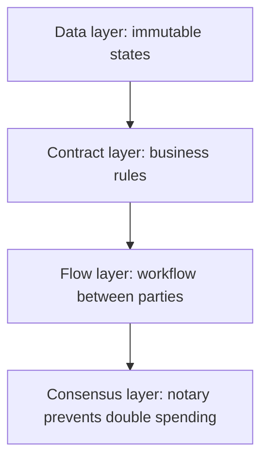

**In simple words:** Corda is a business blockchain by R3 that shares a deal only with the parties in it. <Cite id="class-bt-m4" loc="slide 86" />

**Definition:** Corda is a permissioned distributed ledger platform designed for businesses and regulated financial institutions, developed by R3, with strict data privacy and verified legal identities. <Cite id="class-bt-m4" loc="slide 86" /> <Cite id="corda-ripple-quorum-corda-intro-wp" />

**Core components:**

1. **Nodes** with a private **vault** and CorDapps. <Cite id="class-bt-m4" loc="slide 93" />
2. **Notary service:** confirms inputs are unspent, which prevents double spending. <Cite id="class-bt-m4" loc="slide 95" />
3. **States:** immutable shared facts, consumed and replaced. <Cite id="class-bt-m4" loc="slide 97" />
4. **Contracts:** Kotlin or Java rules for valid changes. <Cite id="class-bt-m4" loc="slide 99" />
5. **Flows:** automated steps between nodes. <Cite id="class-bt-m4" loc="slide 100" />

**Uses:** financial services, trade finance, insurance, healthcare and supply chain. <Cite id="class-bt-m4" loc="slide 109" /> **Difference:** unlike Ethereum or Fabric it has no global network where everyone sees every transaction. <Cite id="class-bt-m4" loc="slide 90" />

**Conclusion:** Corda gives need-to-know sharing with legal fit. <Cite id="corda-ripple-quorum-xoriant-corda" />
