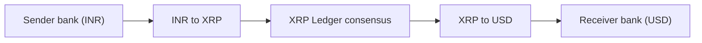

**In simple words:** Ripple is a company and payment network that moves money across borders in seconds using the XRP Ledger and XRP. <Cite id="class-bt-m4" loc="slide 72" />

**Definition:** Ripple is a financial technology company that provides a global payment and settlement network using blockchain, aiming at fast, secure and cost-effective cross-border payments. XRP is its native digital asset, used as a bridge currency. <Cite id="class-bt-m4" loc="slide 72" /> <Cite id="class-bt-m4" loc="slide 74" />

**Working:** validators compare proposed transactions with the latest ledger and a majority must accept them (the XRPL needs about 80 percent of the trusted list). <Cite id="class-bt-m4" loc="slide 80" /> <Cite id="corda-ripple-quorum-xrpl-consensus" />

**Features:** fast settlement, low fees, high throughput, secure, open-source. **Uses:** cross-border payments, remittances, e-commerce, liquidity management. **Limits:** centralization concerns and regulatory uncertainty. <Cite id="class-bt-m4" loc="slide 75" /> <Cite id="class-bt-m4" loc="slide 82" /> <Cite id="class-bt-m4" loc="slide 84" />

**Conclusion:** Ripple speeds up international payments with a consensus ledger. <Cite id="corda-ripple-quorum-gfg-ripple" />
