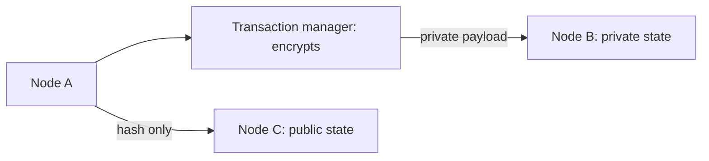

**In simple words:** Quorum is a private version of Ethereum for businesses, first built by J.P. Morgan. <Cite id="class-bt-m6" loc="slide 29" />

**Definition:** Quorum is an enterprise blockchain platform developed initially by J.P. Morgan. It is based on Ethereum and designed for businesses that need privacy, permissioned access and secure transactions. <Cite id="class-bt-m6" loc="slide 29" /> <Cite id="corda-ripple-quorum-quorum-github" />

**Features:** permissioned network, private transactions, smart contracts, high performance, Ethereum compatibility, consensus suited to permissioned networks (Raft, IBFT/QBFT). <Cite id="class-bt-m6" loc="slide 30" /> <Cite id="corda-ripple-quorum-quorum-ibft" />

**Working:**

1. A permissioned network is created and authorized members (banks, companies) join.
2. A member starts a transaction or smart contract.
3. A private transaction's details go only to the chosen participants.
4. The network validates it with its consensus mechanism and records it. <Cite id="class-bt-m6" loc="slide 31" />

**Applications:** banking, supply chain, finance settlements, healthcare data sharing, business agreements. **Advantages:** privacy, restricted access, smart contracts, Ethereum compatibility. <Cite id="class-bt-m6" loc="slide 32" /> <Cite id="class-bt-m6" loc="slide 33" />

**Conclusion:** Quorum keeps Ethereum's smart contracts and adds privacy and permissions. <Cite id="corda-ripple-quorum-gfg-quorum" />
