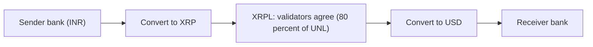

**In simple words:** Ripple is the company; the XRP Ledger (XRPL) is the open blockchain it uses; XRP is the token on that ledger. Together they move money across borders in seconds. <Cite id="class-bt-m4" loc="slide 73" />

**What is Ripple?** A financial technology company and payment ecosystem that makes solutions for fast cross-border payments. It is closely associated with the XRP Ledger and XRP, but Ripple itself is not the XRP Ledger. <Cite id="class-bt-m4" loc="slide 73" /> <Cite id="web-bt-2-wiki-ripple" />

**What is the XRP Ledger (XRPL)?** A decentralized blockchain whose native digital asset is XRP. XRP can pay across currencies or act as a bridge currency. <Cite id="class-bt-m4" loc="slide 73" /> <Cite id="class-bt-m4" loc="slide 74" /> <Cite id="corda-ripple-quorum-xrpl-whatis" />

**How it works:**

1. **Consensus, no mining.** Validators compare proposed transactions with the latest ledger and a majority must accept them. <Cite id="class-bt-m4" loc="slide 80" />
2. **Trusted list (UNL).** Each validator trusts a Unique Node List and a transaction set is accepted when about 80 percent of the list agrees. <Cite id="corda-ripple-quorum-xrpl-consensus" /> <Cite id="corda-ripple-quorum-xrpl-unl" />
3. **Speed.** Settlement in about 3 to 5 seconds with tiny fees.
4. **Bridge currency.** INR becomes XRP and then USD at once, so no pre-funding is needed. <Cite id="corda-ripple-quorum-ripple-odl" />

**Major uses of the XRP Ledger (as in class):** <Cite id="class-bt-m4" loc="slide 82" />

1. **Cross-border payments** with XRP as a bridge currency, without pre-funding or intermediaries.
2. **Remittances** to family and friends abroad.
3. **E-commerce** payments for online merchants.
4. **Smart contracts and decentralized applications**, such as escrow services and digital wallets. <Cite id="class-bt-m4" loc="slide 83" />
5. **Liquidity management** by financial institutions.

**Extend in the exam (add these to reach 10 marks):**

- **How to use.** Buy XRP on an exchange, keep it in a wallet, then send it with the receiver's address. <Cite id="class-bt-m4" loc="slide 79" />
- **Features.** Fast, low cost, high throughput, secure, open source. <Cite id="class-bt-m4" loc="slide 75" /> <Cite id="class-bt-m4" loc="slide 76" />
- **Payment paths.** XRPL finds a path through issuers and order books, even across currencies. <Cite id="corda-ripple-quorum-xrpl-paths" />
- **Limits.** Centralization concerns, regulatory uncertainty, competition. <Cite id="class-bt-m4" loc="slide 84" />

| Point | Bitcoin | XRP Ledger |
|---|---|---|
| Aim | Digital cash | Cross-border payments |
| Consensus | Proof of Work | Validator voting |
| Confirmation | About 10 minutes | 3 to 5 seconds |

<Cite id="corda-ripple-quorum-wiki-xrpl" />

**Conclusion:** Ripple is the company, XRPL the ledger and XRP the asset; together they make cross-border payment fast and cheap. <Cite id="corda-ripple-quorum-gfg-ripple" />
