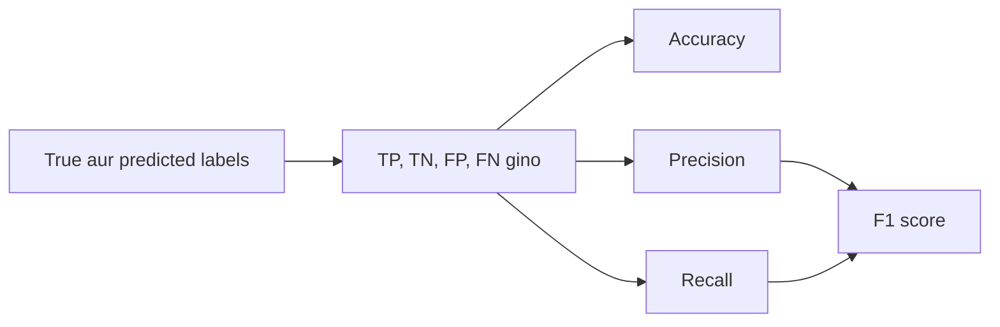
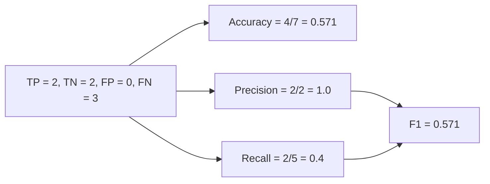

**Ek line mein:** pehle true aur predicted labels se <mark>TP, TN, FP, FN</mark> gino, phir <mark>Accuracy $= \dfrac{TP + TN}{TP + TN + FP + FN}$</mark> aur <mark>F1 $= \dfrac{2 \times \text{Precision} \times \text{Recall}}{\text{Precision} + \text{Recall}}$</mark>. <Cite id="class-dl-m2" loc="p. 15" /> <Cite id="class-dl-m2" loc="p. 16" />

<Box kind="key">

**Ye points likho (method):**

- <mark>Har (true, predicted) pair compare karo aur TP, TN, FP, FN gino.</mark> Class 1 positive class hai.
- <mark>Accuracy = sahi predictions ka hissa = $(TP + TN)/\text{total}$.</mark>
- <mark>Precision $= TP/(TP + FP)$ (positive bolne par kitni baar sahi). Recall $= TP/(TP + FN)$ (kitne real positives mile).</mark>
- <mark>F1, precision aur recall ka harmonic average hai</mark>; 0 sabse kharab aur 1 sabse achha.
- Quick check: $F1 = \dfrac{2TP}{2TP + FP + FN}$.
- **Numbers ka interpretation** hamesha ek-do sentence mein likho.

</Box>

## Core answer (5 marks): method

<Box kind="definition">

**Accuracy** is the fraction of predictions that are correct. **Precision** is the fraction of predicted positives that are really positive. **Recall** is the fraction of real positives that the model finds. **F1 score** combines precision and recall into one number. <Cite id="class-dl-m2" loc="p. 15" /> <Cite id="class-dl-m2" loc="p. 16" />

</Box>

**Steps:**

1. Har pair (true, predicted) compare karo aur TP, TN, FP ya FN likho.
2. Gino aur check karo ki total ke barabar hain.
3. Accuracy $= (TP + TN)/\text{total}$.
4. Precision $= TP/(TP + FP)$, recall $= TP/(TP + FN)$.
5. $F1 = 2PR/(P + R)$ aur interpret karo.

| | Predicted 1 | Predicted 0 |
|---|---|---|
| **Actually 1** | TP (sahi, mila) | FN (positive chhoot gaya) |
| **Actually 0** | FP (false alarm) | TN (sahi, reject) |

**Conclusion:** accuracy saare sahi answers ginti hai; F1 batata hai ki model positive class dhoondhne mein kitna achha hai. <Cite id="web-dl-1-google-prf" /> <Cite id="web-dl-1-wiki-fscore" />

## Extended answer (10 marks): solve kiya hua question

Class notes accuracy, precision, recall aur F1 deti hain; question bank data deta hai lekin worked solution nahi. Upar ki standard definitions use hui hain. <Cite id="class-dl-qb1" loc="p. 1" />

<Sum>

<Given>

Y_True = 1 0 0 1 1 1 1 aur Y_Pred = 0 0 0 1 1 0 0. Class 1 positive class hai.

</Given>

<Find>

accuracy aur F1 score, interpretation ke saath.

</Find>

<Steps>

1. **Har pair (true, predicted) compare karo:** (1,0) FN, (0,0) TN, (0,0) TN, (1,1) TP, (1,1) TP, (1,0) FN, (1,0) FN.
2. **Gino:** TP = 2, TN = 2, FP = 0, FN = 3 (total 7).
3. **Accuracy** $= (2 + 2)/7 = 4/7 = 0.571$.
4. **Precision** $= 2/(2 + 0) = 1.0$. **Recall** $= 2/(2 + 3) = 0.4$.
5. **F1** $= 2 \times 1.0 \times 0.4/(1.0 + 0.4) = 0.8/1.4 = 0.571$.

</Steps>

<Answer>

Accuracy $= 4/7 \approx 57.1\%$ aur F1 $= 4/7 \approx 0.571$.

</Answer>

<Box kind="verify">

Counts add up: $2 + 2 + 0 + 3 = 7$. F1 ko $2TP/(2TP + FP + FN) = 4/(4 + 0 + 3) = 4/7$ bhi likh sakte hain. Wahi result.

</Box>

</Sum>

**Interpretation:** precision 1.0 hai, yani model jab bhi "positive" bolta hai sahi hota hai (koi false positive nahi). Recall sirf 0.4 hai, yani 5 real positives mein se sirf 2 mile aur 3 chhoot gaye. Accuracy 57% aur F1 0.57 yahi dikhate hain: model cautious hai aur bahut positives miss karta hai.

**Effectiveness:** sirf moderately effective. Positive predict karne par bharosemand hai, lekin positives detect karne mein kamzor, isliye jahan positive miss karna costly ho wahan use se pehle improvement chahiye (zyada training ya better class balance). <Cite id="class-dl-m2" loc="p. 16" />

### Sirf accuracy kyun nahi

100 mein se 95 samples negative hon aur model hamesha "negative" bole, to accuracy 95% hai lekin ek bhi positive nahi mila; recall aur F1 0 hain. Isliye classes unequal hon to F1 prefer hota hai. <Cite id="web-dl-1-google-prf" />

## Har question mein kaise fit karein

- **"Numerical 1: Calculate the Accuracy and F1-Score for the following classification results. Interpret the calculated values and comment on the effectiveness of the classification model."** (10 marks) <PYQ id="assignment-1/q2d" />: method likho (core answer), phir diye gaye table ka solved Sum, confusion counts, interpretation aur effectiveness comment. Doosre data ke liye sirf counts badalte hain.

## Exam tips

- **Hamesha draw karo** 2 by 2 confusion table counts bharke.
- F1 se pehle precision aur recall ke formulas likho; F1 unse bana hai.
- **Interpretation** kabhi mat chhodo; question maangta hai aur marks usi ke hain.

Exam mein English mein likho.
