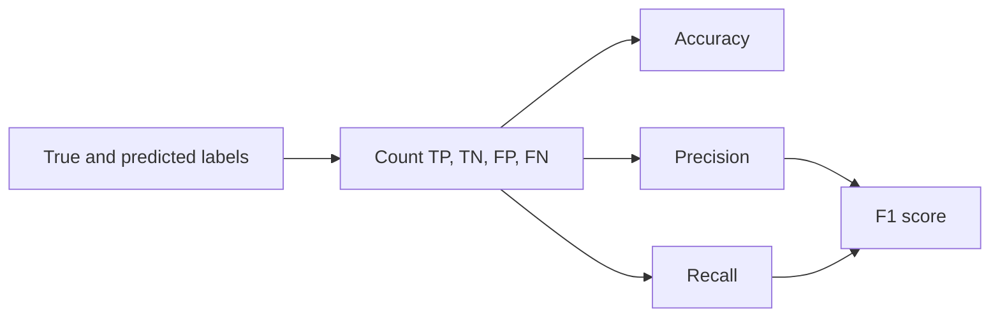
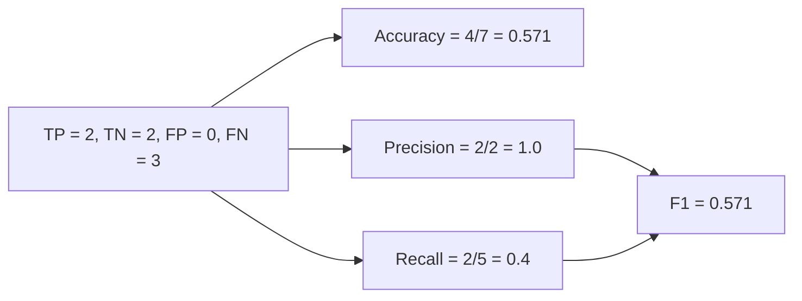

**In one line:** first count <mark>TP, TN, FP, FN</mark> from the true and predicted labels, then <mark>Accuracy $= \dfrac{TP + TN}{TP + TN + FP + FN}$</mark> and <mark>F1 $= \dfrac{2 \times \text{Precision} \times \text{Recall}}{\text{Precision} + \text{Recall}}$</mark>. <Cite id="class-dl-m2" loc="p. 15" /> <Cite id="class-dl-m2" loc="p. 16" />

<Box kind="key">

**Key points to write (the method):**

- <mark>Compare every (true, predicted) pair and count TP, TN, FP, FN.</mark> Class 1 is the positive class.
- <mark>Accuracy = share of correct predictions = $(TP + TN)/\text{total}$.</mark>
- <mark>Precision $= TP/(TP + FP)$ (when it says positive, how often is it right). Recall $= TP/(TP + FN)$ (how many real positives it finds).</mark>
- <mark>F1 is the harmonic average of precision and recall</mark>; 0 is worst and 1 is best.
- Quick check: $F1 = \dfrac{2TP}{2TP + FP + FN}$.
- **Always interpret** the numbers in one or two sentences.

</Box>

## Core answer (5 marks): the method

<Box kind="definition">

**Accuracy** is the fraction of predictions that are correct. **Precision** is the fraction of predicted positives that are really positive. **Recall** is the fraction of real positives that the model finds. **F1 score** combines precision and recall into one number. <Cite id="class-dl-m2" loc="p. 15" /> <Cite id="class-dl-m2" loc="p. 16" />

</Box>

**Steps:**

1. Compare each pair (true, predicted) and label it TP, TN, FP or FN.
2. Count them and check that they add up to the total.
3. Accuracy $= (TP + TN)/\text{total}$.
4. Precision $= TP/(TP + FP)$, recall $= TP/(TP + FN)$.
5. $F1 = 2PR/(P + R)$ and interpret.

| | Predicted 1 | Predicted 0 |
|---|---|---|
| **Actually 1** | TP (correct, found) | FN (missed positive) |
| **Actually 0** | FP (false alarm) | TN (correct, rejected) |

**Conclusion:** accuracy counts all correct answers; F1 tells whether the model is good at finding the positive class. <Cite id="web-dl-1-google-prf" /> <Cite id="web-dl-1-wiki-fscore" />

## Extended answer (10 marks): the solved question

The class notes give accuracy, precision, recall and F1; the question bank gives the data but no worked solution. The standard definitions above are used. <Cite id="class-dl-qb1" loc="p. 1" />

<Sum>

<Given>

Y_True = 1 0 0 1 1 1 1 and Y_Pred = 0 0 0 1 1 0 0. Class 1 is the positive class.

</Given>

<Find>

accuracy and F1 score, with an interpretation.

</Find>

<Steps>

1. **Compare each pair (true, predicted):** (1,0) FN, (0,0) TN, (0,0) TN, (1,1) TP, (1,1) TP, (1,0) FN, (1,0) FN.
2. **Count:** TP = 2, TN = 2, FP = 0, FN = 3 (total 7).
3. **Accuracy** $= (2 + 2)/7 = 4/7 = 0.571$.
4. **Precision** $= 2/(2 + 0) = 1.0$. **Recall** $= 2/(2 + 3) = 0.4$.
5. **F1** $= 2 \times 1.0 \times 0.4/(1.0 + 0.4) = 0.8/1.4 = 0.571$.

</Steps>

<Answer>

Accuracy $= 4/7 \approx 57.1\%$ and F1 $= 4/7 \approx 0.571$.

</Answer>

<Box kind="verify">

The counts add up: $2 + 2 + 0 + 3 = 7$. F1 also equals $2TP/(2TP + FP + FN) = 4/(4 + 0 + 3) = 4/7$. Same result.

</Box>

</Sum>

**Interpretation:** precision is 1.0, so every time the model says "positive" it is right (no false positives). Recall is only 0.4, so it finds just 2 of the 5 real positives and misses 3. Accuracy of 57% and F1 of 0.57 show the same: the model is cautious and misses many positives.

**Effectiveness:** only moderately effective. It is trustworthy when it predicts positive, but weak at detecting positives, so it needs improvement (more training or better class balance) before use where missing a positive is costly. <Cite id="class-dl-m2" loc="p. 16" />

### Why not accuracy alone

If 95 of 100 samples are negative, a model that always says "negative" has 95% accuracy but finds no positive at all; its recall and F1 are 0. So F1 is preferred when classes are unequal. <Cite id="web-dl-1-google-prf" />

## Fit it to each question

- **"Numerical 1: Calculate the Accuracy and F1-Score for the following classification results. Interpret the calculated values and comment on the effectiveness of the classification model."** (10 marks) <PYQ id="assignment-1/q2d" />: write the method (core answer), then the solved Sum for the given table, the confusion counts, the interpretation and the effectiveness comment. For other data, only the counts change.

## Exam tips

- **Always draw** the 2 by 2 confusion table with the counts filled in.
- Write the formulas of precision and recall before F1; F1 is built from them.
- Never skip the **interpretation**; the question asks for it and it carries marks.
