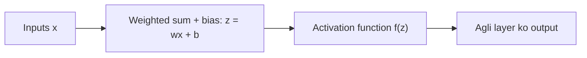
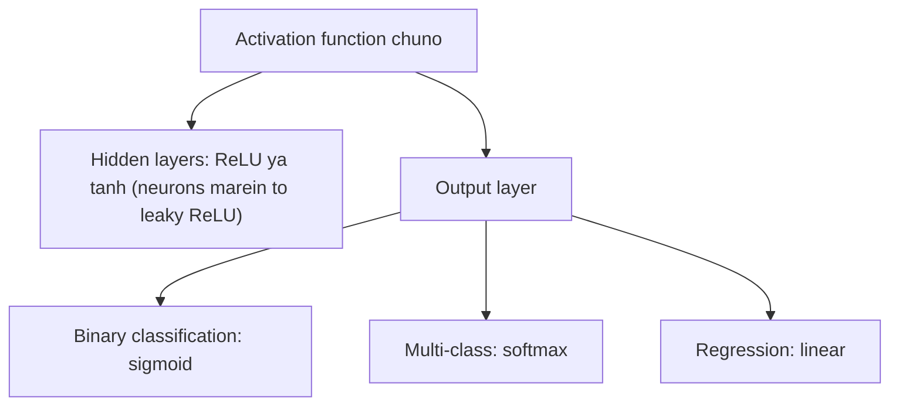

**Ek line mein:** <mark>activation function decide karta hai ki neuron activate ho ya nahi aur kitni strength se; ye network ko non-linear banata hai taaki wo complex patterns seekh sake</mark>. <Cite id="class-dl-chp2" loc="slide 9" /> <Cite id="class-dl-m2" loc="p. 13" />

<Box kind="key">

**Har activation function question mein ye points likho:**

- <mark>Ye $z = wx + b$ ko lekar ek naya value banata hai jo agli layer ko jaata hai.</mark>
- <mark>Activation function ke bina poora network sirf ek linear model hai.</mark> Ye **non-linearity** add karta hai.
- Significance: non-linearity, neuron output control, backpropagation mein madad, output range set karna.
- <mark>Sigmoid (0 se 1): output layer, binary classification. Tanh (−1 se 1): hidden layers, zero-centered. ReLU: $\max(0, x)$, hidden layers mein sabse zyada. Leaky ReLU: dying ReLU fix. Softmax: multi-class output.</mark>
- Problems: **vanishing gradient** (sigmoid, tanh) aur **dying ReLU**.
- Choice: hidden layers mein ReLU ya tanh; output layer mein task ke hisaab se sigmoid, softmax ya linear.

</Box>

## Core answer (5 marks, yahan ke har question ke liye)

<Box kind="definition">

An **activation function** is a mathematical function used in a neural network to decide whether a neuron should be activated (pass information) or not. It takes the output of a neuron ($z = wx + b$) and converts it into a new value that goes to the next layer. <Cite id="class-dl-chp2" loc="slide 9" /> <Cite id="class-dl-m2" loc="p. 3" />

</Box>

**Importance (significance):** <Cite id="class-dl-m2" loc="p. 13" />

1. **Non-linearity:** iske bina neuron sirf $y = z$ deta hai, to poora network linear model ban jaata hai aur sirf linear relationships seekhta hai.
2. **Output control:** ye neuron ka firing aur output ki strength decide karta hai.
3. **Learning mein madad:** backpropagation mein gradients isse guzarte hain; ReLU pe vanishing gradient ka asar kam hota hai. <Cite id="class-dl-chp2" loc="slide 25" />
4. **Output range set karta hai** task ke hisaab se: do classes ke liye sigmoid, kai ke liye softmax, numbers ke liye linear. <Cite id="class-dl-chp2" loc="slide 53" />

| Layer | Usual choice |
|---|---|
| Hidden | ReLU (neurons mar jaayen to Leaky ReLU), tanh |
| Output, binary | Sigmoid |
| Output, many classes | Softmax |
| Output, regression | Linear |

**Conclusion:** activation functions network ko non-linear patterns seekhne ki power dete hain. <Cite id="web-dl-1-wiki-actfn" />

## Extended answer (10 marks): ye add karo

### 1. Activation functions ke types

| Function | Equation | Range | Use aur problem |
|---|---|---|---|
| Binary step | 1 if $z \ge 0$, else 0 | $\{0, 1\}$ | Sabse purana; single-layer nets; differentiable nahi |
| Sigmoid | $\dfrac{1}{1 + e^{-z}}$ | (0, 1) | Binary classification ka output; vanishing gradient |
| Tanh | $\dfrac{e^z - e^{-z}}{e^z + e^{-z}}$ | (−1, 1) | Hidden layers; zero-centered |
| ReLU | $\max(0, z)$ | [0, ∞) | Hidden layers mein sabse zyada; dying ReLU |
| Leaky ReLU | $z$ if $z > 0$, else $0.01z$ | (−∞, ∞) | Dying ReLU fix karta hai |
| Softmax | $\dfrac{e^{z_i}}{\sum_j e^{z_j}}$ | (0, 1), sum 1 | Multi-class classification ka output |
| Linear | $f(z) = z$ | (−∞, ∞) | Regression ka output |

<Cite id="class-dl-chp2" loc="slides 11 to 17" /> <Cite id="class-dl-m2" loc="p. 13" />

### 2. Chaar main functions detail mein

- **Sigmoid:** S-shape, probability deta hai, $\sigma(0) = 0.5$. Bahut bade ya bahut chhote input pe curve flat hoti hai, isliye gradient lagbhag zero (**vanishing gradient**). <Cite id="class-dl-chp2" loc="slide 11" />
- **Tanh:** −1 se +1 tak S-shape, point (0, 0) se guzarta hai; zero-centered, isliye hidden layers mein aksar sigmoid se better. <Cite id="class-dl-chp2" loc="slide 13" />
- **ReLU:** negative inputs 0 ho jaate hain aur positive inputs jaise ke taise (8, 3, 0, −2, −7 se 8, 3, 0, 0, 0). Simple aur fast, lekin jo neuron hamesha negative input paata hai wo 0 pe atak jaata hai aur seekhna band kar deta hai (**dying ReLU**). <Cite id="class-dl-chp2" loc="slide 15" />
- **Leaky ReLU:** chhota negative value ($0.01z$) guzarne deta hai, isliye neuron kabhi marta nahi. <Cite id="class-dl-chp2" loc="slide 17" />

### 3. Softmax ek chhote example ke saath

Scores $z = (2, 1, 0)$ se $e^z = 7.389, 2.718, 1$; inka sum $11.107$ hai, to probabilities $0.665, 0.245, 0.090$ aate hain, jinka sum 1 hai. Sabse bade score ko sabse badi probability milti hai. <Cite id="class-dl-chp2" loc="slide 19" />

### 4. Kaise choose karein

## Har question mein kaise fit karein

- **"What is an activation function? Describe any four activation functions."** (10 marks) <PYQ id="2023-12/q2b" />: definition aur neuron diagram, phir section 2 se **sigmoid, tanh, ReLU aur leaky ReLU** equation, range, use aur problem ke saath, aur types table.
- **"What is the significance of Activation Functions in Neural Networks, explain different types Activation functions used in NN."** (10 marks) <PYQ id="2024-05/q6a" /> <PYQ id="2024-12/q6a" /> <PYQ id="2025-05/q6a" />: significance ke chaar points, poori types table, "where used" diagram aur vanishing gradient aur dying ReLU problems.
- **"Describe the importance of activation functions in deep learning models."** (5 marks) <PYQ id="2026-05/q1d" />: sirf **core answer** likho: definition, importance ke chaar points, picture aur layer table.

## Exam tips

- **Hamesha draw karo** $f(z)$ wala neuron diagram aur functions ka plot ya table ranges ke saath.
- **Har function ki range** likho; ye sabse aasani se chhootne wale marks hain.
- Har function ki problem likho: sigmoid aur tanh ka vanishing gradient, ReLU ka dying ReLU, aur fix, Leaky ReLU.

Exam mein English mein likho.
