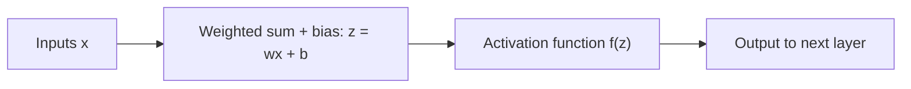
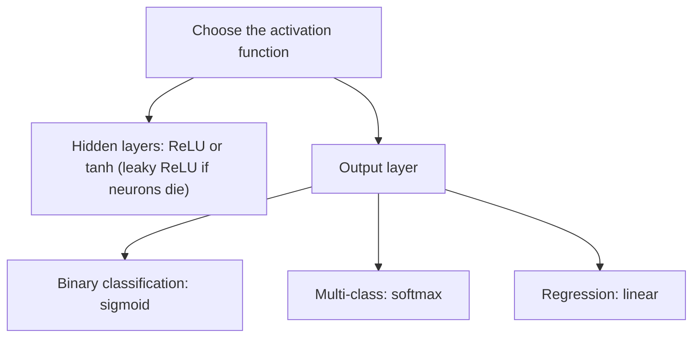

**In one line:** <mark>an activation function decides whether a neuron should be activated and how strongly; it makes the network non-linear so it can learn complex patterns</mark>. <Cite id="class-dl-chp2" loc="slide 9" /> <Cite id="class-dl-m2" loc="p. 13" />

<Box kind="key">

**Key points to write (any activation function question):**

- <mark>It takes $z = wx + b$ and converts it into a new value that goes to the next layer.</mark>
- <mark>Without an activation function the whole network is only a linear model.</mark> It adds **non-linearity**.
- Significance: non-linearity, controls the neuron output, helps backpropagation, sets the output range.
- <mark>Sigmoid (0 to 1): output layer, binary classification. Tanh (−1 to 1): hidden layers, zero-centered. ReLU: $\max(0, x)$, the most used in hidden layers. Leaky ReLU: fixes dying ReLU. Softmax: multi-class output.</mark>
- Problems: **vanishing gradient** (sigmoid, tanh) and **dying ReLU**.
- Choice: hidden layers ReLU or tanh; output layer sigmoid, softmax or linear by the task.

</Box>

## Core answer (5 marks, fits every question here)

<Box kind="definition">

An **activation function** is a mathematical function used in a neural network to decide whether a neuron should be activated (pass information) or not. It takes the output of a neuron ($z = wx + b$) and converts it into a new value that goes to the next layer. <Cite id="class-dl-chp2" loc="slide 9" /> <Cite id="class-dl-m2" loc="p. 3" />

</Box>

**Importance (significance):** <Cite id="class-dl-m2" loc="p. 13" />

1. **Non-linearity:** without it the neuron gives only $y = z$, so the whole network is a linear model and learns only linear relationships.
2. **Controls the output:** it decides the firing of a neuron and the strength of its output.
3. **Helps learning:** gradients flow through it in backpropagation; ReLU is less affected by the vanishing gradient. <Cite id="class-dl-chp2" loc="slide 25" />
4. **Sets the output range** for the task: sigmoid for two classes, softmax for many, linear for numbers. <Cite id="class-dl-chp2" loc="slide 53" />

| Layer | Usual choice |
|---|---|
| Hidden | ReLU (Leaky ReLU if neurons die), tanh |
| Output, binary | Sigmoid |
| Output, many classes | Softmax |
| Output, regression | Linear |

**Conclusion:** activation functions give the network its power to learn non-linear patterns. <Cite id="web-dl-1-wiki-actfn" />

## Extended answer (10 marks): add these

### 1. Types of activation functions

| Function | Equation | Range | Use and problem |
|---|---|---|---|
| Binary step | 1 if $z \ge 0$, else 0 | $\{0, 1\}$ | Oldest; single-layer nets; not differentiable |
| Sigmoid | $\dfrac{1}{1 + e^{-z}}$ | (0, 1) | Output of binary classification; vanishing gradient |
| Tanh | $\dfrac{e^z - e^{-z}}{e^z + e^{-z}}$ | (−1, 1) | Hidden layers; zero-centered |
| ReLU | $\max(0, z)$ | [0, ∞) | Most used in hidden layers; dying ReLU |
| Leaky ReLU | $z$ if $z > 0$, else $0.01z$ | (−∞, ∞) | Fixes dying ReLU |
| Softmax | $\dfrac{e^{z_i}}{\sum_j e^{z_j}}$ | (0, 1), sum 1 | Output of multi-class classification |
| Linear | $f(z) = z$ | (−∞, ∞) | Output of regression |

<Cite id="class-dl-chp2" loc="slides 11 to 17" /> <Cite id="class-dl-m2" loc="p. 13" />

### 2. The four main functions in detail

- **Sigmoid:** S-shaped, gives a probability, $\sigma(0) = 0.5$. For very large or very small inputs the curve is flat, so the gradient is almost zero (**vanishing gradient**). <Cite id="class-dl-chp2" loc="slide 11" />
- **Tanh:** S-shaped from −1 to +1 through the point (0, 0); zero-centered, so it is usually better than sigmoid in hidden layers. <Cite id="class-dl-chp2" loc="slide 13" />
- **ReLU:** negative inputs become 0 and positive inputs pass unchanged (8, 3, 0, −2, −7 become 8, 3, 0, 0, 0). It is simple and fast, but a neuron that always gets negative input stays at 0 and stops learning (**dying ReLU**). <Cite id="class-dl-chp2" loc="slide 15" />
- **Leaky ReLU:** lets a small negative value pass ($0.01z$), so the neuron never dies. <Cite id="class-dl-chp2" loc="slide 17" />

### 3. Softmax with a small example

Scores $z = (2, 1, 0)$ give $e^z = 7.389, 2.718, 1$; their sum is $11.107$, so the probabilities are $0.665, 0.245, 0.090$, which add up to 1. The biggest score gets the biggest probability. <Cite id="class-dl-chp2" loc="slide 19" />

### 4. How to choose

## Fit it to each question

- **"What is an activation function? Describe any four activation functions."** (10 marks) <PYQ id="2023-12/q2b" />: the definition and the neuron diagram, then **sigmoid, tanh, ReLU and leaky ReLU** from section 2 with equation, range, use and problem, and the types table.
- **"What is the significance of Activation Functions in Neural Networks, explain different types Activation functions used in NN."** (10 marks) <PYQ id="2024-05/q6a" /> <PYQ id="2024-12/q6a" /> <PYQ id="2025-05/q6a" />: the four significance points, the full types table, the "where used" diagram and the vanishing gradient and dying ReLU problems.
- **"Describe the importance of activation functions in deep learning models."** (5 marks) <PYQ id="2026-05/q1d" />: write only the **core answer**: definition, four points of importance, the picture and the layer table.

## Exam tips

- **Always draw** the neuron diagram with $f(z)$ and a plot or table of the functions with their ranges.
- Write the **range** of every function; it is the easiest mark to lose.
- Name the problem of each function: sigmoid and tanh vanishing gradient, ReLU dying ReLU, and the fix, Leaky ReLU.
