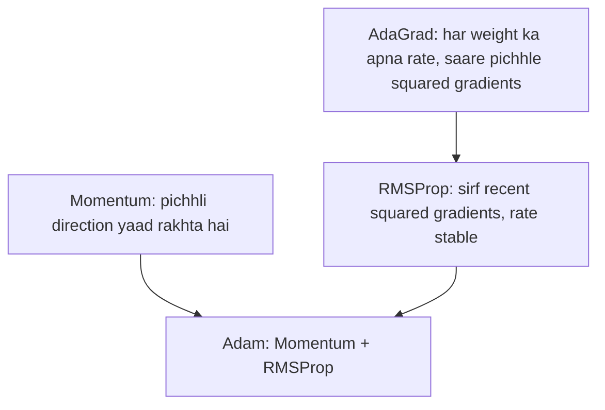
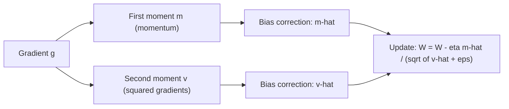

**Ek line mein:** AdaGrad, RMSProp aur Adam <mark>adaptive optimizers hain jo har weight ko uska apna learning rate dete hain</mark>; har ek pichhle ki ek kamzori fix karta hai, aur <mark>Adam = Momentum + RMSProp</mark>. <Cite id="class-dl-chp2" loc="slide 80" />

<Box kind="key">

**Har adaptive optimizer question mein ye points likho:**

- <mark>AdaGrad: har weight ko apna learning rate; jo weights zyada update hote hain unka rate chhota, jo kam update hote hain unka bada.</mark> Kamzori: ye saare pichhle squared gradients jodta hai, isliye rate girte girte zero ke paas pahunch jaata hai.
- <mark>RMSProp: sirf recent gradients use karta hai (squared gradients ka moving average)</mark>, isliye rate stable rehta hai. Kamzori: momentum nahi.
- <mark>Adam, Momentum (first moment) aur RMSProp (second moment) ko bias correction ke saath combine karta hai.</mark>
- Defaults: RMSProp $\beta = 0.9$; Adam $\beta_1 = 0.9$, $\beta_2 = 0.999$.
- Ideas ka order: **GD, phir Momentum, phir AdaGrad, phir RMSProp, phir Adam.**
- Adam sabse zyada use hone wala optimizer hai (fast, stable, usual default).

</Box>

## Core answer (5 marks, yahan ke har question ke liye)

<Box kind="definition">

**Adaptive optimizers** change the learning rate of every weight separately, using the history of its gradients, instead of one fixed learning rate for all weights. <Cite id="class-dl-chp2" loc="slide 80" />

</Box>

**Kyun chahiye:** plain gradient descent mein saare weights ke liye ek fixed $\eta$ hota hai, isliye kuch weights bahut tez aur kuch bahut dheere chalte hain. <Cite id="class-dl-chp2" loc="slide 80" />

| | AdaGrad | RMSProp | Adam |
|---|---|---|---|
| Gradient history | Saare pichhle squared gradients | Sirf recent squared gradients | Dono moments, bias corrected |
| Learning rate | Girta rehta hai | Stable rehta hai | Adaptive + momentum |
| Best for | Sparse data | Deep learning, RNNs | Zyadatar deep learning (default) |

<Cite id="class-dl-chp2" loc="slides 80 to 88" />

**Conclusion:** Adam = Momentum + RMSProp; ye fast, stable aur sabse zyada use hone wala optimizer hai. <Cite id="class-dl-m2" loc="p. 65" /> <Cite id="web-dl-1-paper-adam" />

## Extended answer (10 marks): ye add karo

### 1. AdaGrad (Adaptive Gradient)

Har weight ko apna rate: jo weights aksar update hote hain unko chhota rate aur jo kam update hote hain unko bada rate. $G_t = G_{t-1} + g_t^2$ aur $W_{new} = W_{old} - \dfrac{\eta}{\sqrt{G_t} + \epsilon} g_t$, jahan $g_t$ gradient hai aur $\epsilon$ ek bahut chhota number jo zero se divide hone se bachata hai. **Kamzori:** $G_t$ sirf badhta hai, isliye learning rate girta rehta hai aur lagbhag zero ho sakta hai. <Cite id="class-dl-chp2" loc="slides 80 to 82" /> <Cite id="web-dl-1-paper-adagrad" />

### 2. RMSProp (Root Mean Square Propagation)

Ye AdaGrad ko moving average se fix karta hai: $S_t = \beta S_{t-1} + (1 - \beta) g_t^2$ aur $W_{new} = W_{old} - \dfrac{\eta}{\sqrt{S_t} + \epsilon} g_t$ ($\beta$ aam taur par 0.9). Purane gradients dheere dheere bhoole jaate hain, isliye learning rate healthy rehta hai. **Kamzori:** momentum nahi. <Cite id="class-dl-chp2" loc="slides 83 to 85" /> <Cite id="web-dl-1-d2l-rmsprop" />

### 3. Adam (Adaptive Moment Estimation)

Adam do averages rakhta hai: first moment $m_t$ (momentum) aur second moment $v_t$ (RMSProp), phir unke start-up bias ko correct karta hai. <Cite id="class-dl-chp2" loc="slides 86 to 88" />

- $m_t = \beta_1 m_{t-1} + (1 - \beta_1) g_t$ aur $v_t = \beta_2 v_{t-1} + (1 - \beta_2) g_t^2$
- $\hat m_t = \dfrac{m_t}{1 - \beta_1^t}$ aur $\hat v_t = \dfrac{v_t}{1 - \beta_2^t}$
- $W_{new} = W_{old} - \eta\, \dfrac{\hat m_t}{\sqrt{\hat v_t} + \epsilon}$, $\beta_1 = 0.9$, $\beta_2 = 0.999$.

### 4. Chhota numeric check (made up, arithmetic dikhane ke liye)

<Sum>

<Given>

$\eta = 0.1$, step 1 pe gradient $g = 2$ aur step 2 pe phir $g = 2$; $\epsilon$ ignore karo. Adam ke liye step 1 pe ek gradient $g = 0.5$, $\beta_1 = 0.9$, $\beta_2 = 0.999$.

</Given>

<Find>

AdaGrad ka step 1 aur step 2 ka step size, aur Adam ka pehla step.

</Find>

<Steps>

1. **AdaGrad, step 1:** $G_1 = 4$, step $= 0.1 \times 2 / \sqrt{4} = 0.1$.
2. **AdaGrad, step 2:** $G_2 = 8$, step $= 0.1 \times 2 / \sqrt{8} = 0.0707$. Gradient same hai phir bhi step chhota ho gaya.
3. **Adam:** $m_1 = 0.1 \times 0.5 = 0.05$, $v_1 = 0.001 \times 0.25 = 0.00025$.
4. **Bias correction:** $\hat m_1 = 0.05 / 0.1 = 0.5$, $\hat v_1 = 0.00025 / 0.001 = 0.25$.
5. **Step:** $0.1 \times 0.5 / \sqrt{0.25} = 0.1$.

</Steps>

<Answer>

AdaGrad steps: 0.1 phir 0.0707 (ghat raha hai). Adam ka pehla step 0.1 hai, $\eta$ ke barabar.

</Answer>

</Sum>

## Har question mein kaise fit karein

- **"Illustrate the working of AdaGrad, RMSProp, and Adam optimization algorithms with suitable diagrams."** (10 marks) <PYQ id="assignment-1/q2c" />: adaptive rates kyun chahiye ye ek line mein, phir section 1, 2 aur 3 har ek ke formula aur kamzori ke saath, **relationship diagram** aur **comparison table**, aur Adam flow picture.

## Exam tips

- **Hamesha draw karo** "AdaGrad, RMSProp, Momentum, Adam" relationship diagram aur comparison table; question diagrams maangta hai.
- Har method ki **kamzori** likho: AdaGrad ka rate mar jaata hai, RMSProp mein momentum nahi.
- Adam ka poora formula bias correction ke saath likho; examiner $\hat m_t$ aur $\hat v_t$ dhoondhta hai.

Exam mein English mein likho.
