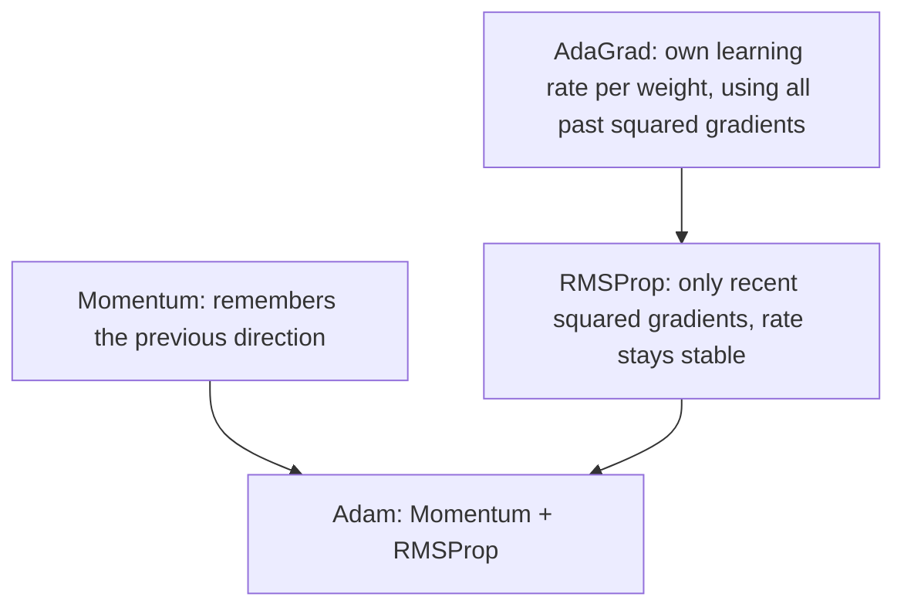
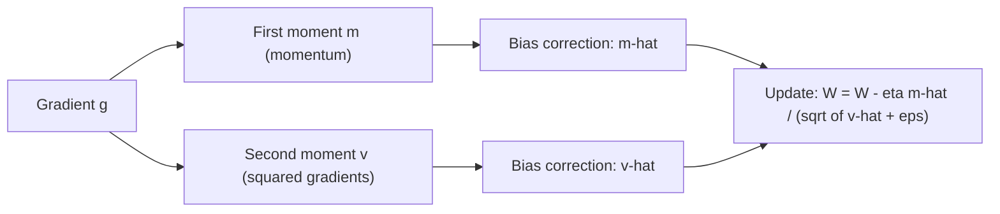

**In one line:** AdaGrad, RMSProp and Adam are <mark>adaptive optimizers that give each weight its own learning rate</mark>; each fixes a weakness of the one before, and <mark>Adam = Momentum + RMSProp</mark>. <Cite id="class-dl-chp2" loc="slide 80" />

<Box kind="key">

**Key points to write (any adaptive optimizer question):**

- <mark>AdaGrad: each weight gets its own learning rate; frequently updated weights get a smaller rate, rarely updated weights a larger rate.</mark> Weakness: it adds all past squared gradients, so the rate keeps shrinking toward zero.
- <mark>RMSProp: uses only recent gradients (a moving average of squared gradients)</mark>, so the rate stays stable. Weakness: no momentum.
- <mark>Adam combines Momentum (first moment) and RMSProp (second moment) with bias correction.</mark>
- Defaults: RMSProp $\beta = 0.9$; Adam $\beta_1 = 0.9$, $\beta_2 = 0.999$.
- Order of ideas: **GD, then Momentum, then AdaGrad, then RMSProp, then Adam.**
- Adam is the most widely used optimizer (fast, stable, the usual default).

</Box>

## Core answer (5 marks, fits every question here)

<Box kind="definition">

**Adaptive optimizers** change the learning rate of every weight separately, using the history of its gradients, instead of one fixed learning rate for all weights. <Cite id="class-dl-chp2" loc="slide 80" />

</Box>

**Why needed:** with plain gradient descent one fixed $\eta$ is used for all weights, so some weights move too fast and others too slowly. <Cite id="class-dl-chp2" loc="slide 80" />

| | AdaGrad | RMSProp | Adam |
|---|---|---|---|
| Gradient history | All past squared gradients | Recent squared gradients only | Both moments, bias corrected |
| Learning rate | Keeps decreasing | Stays stable | Adaptive + momentum |
| Best for | Sparse data | Deep learning, RNNs | Most deep learning (default) |

<Cite id="class-dl-chp2" loc="slides 80 to 88" />

**Conclusion:** Adam = Momentum + RMSProp; it is fast, stable and the most widely used optimizer. <Cite id="class-dl-m2" loc="p. 65" /> <Cite id="web-dl-1-paper-adam" />

## Extended answer (10 marks): add these

### 1. AdaGrad (Adaptive Gradient)

Every weight gets its own rate: weights updated often get a smaller rate and weights updated rarely get a larger one. $G_t = G_{t-1} + g_t^2$ and $W_{new} = W_{old} - \dfrac{\eta}{\sqrt{G_t} + \epsilon} g_t$, where $g_t$ is the gradient and $\epsilon$ a tiny number that avoids division by zero. **Weakness:** $G_t$ only grows, so the learning rate keeps decreasing and may become almost zero. <Cite id="class-dl-chp2" loc="slides 80 to 82" /> <Cite id="web-dl-1-paper-adagrad" />

### 2. RMSProp (Root Mean Square Propagation)

It fixes AdaGrad by a moving average: $S_t = \beta S_{t-1} + (1 - \beta) g_t^2$ and $W_{new} = W_{old} - \dfrac{\eta}{\sqrt{S_t} + \epsilon} g_t$ ($\beta$ usually 0.9). Old gradients fade away, so the learning rate stays healthy. **Weakness:** no momentum. <Cite id="class-dl-chp2" loc="slides 83 to 85" /> <Cite id="web-dl-1-d2l-rmsprop" />

### 3. Adam (Adaptive Moment Estimation)

Adam keeps two averages: the first moment $m_t$ (momentum) and the second moment $v_t$ (RMSProp), then corrects their start-up bias. <Cite id="class-dl-chp2" loc="slides 86 to 88" />

- $m_t = \beta_1 m_{t-1} + (1 - \beta_1) g_t$ and $v_t = \beta_2 v_{t-1} + (1 - \beta_2) g_t^2$
- $\hat m_t = \dfrac{m_t}{1 - \beta_1^t}$ and $\hat v_t = \dfrac{v_t}{1 - \beta_2^t}$
- $W_{new} = W_{old} - \eta\, \dfrac{\hat m_t}{\sqrt{\hat v_t} + \epsilon}$, with $\beta_1 = 0.9$, $\beta_2 = 0.999$.

### 4. Tiny numeric check (made up, to show the arithmetic)

<Sum>

<Given>

$\eta = 0.1$, gradient $g = 2$ at step 1 and again $g = 2$ at step 2; ignore $\epsilon$. For Adam use one gradient $g = 0.5$ at step 1 with $\beta_1 = 0.9$, $\beta_2 = 0.999$.

</Given>

<Find>

the AdaGrad step size at step 1 and step 2, and Adam's first step.

</Find>

<Steps>

1. **AdaGrad, step 1:** $G_1 = 4$, step $= 0.1 \times 2 / \sqrt{4} = 0.1$.
2. **AdaGrad, step 2:** $G_2 = 8$, step $= 0.1 \times 2 / \sqrt{8} = 0.0707$. The step shrinks even though the gradient is the same.
3. **Adam:** $m_1 = 0.1 \times 0.5 = 0.05$, $v_1 = 0.001 \times 0.25 = 0.00025$.
4. **Bias correction:** $\hat m_1 = 0.05 / 0.1 = 0.5$, $\hat v_1 = 0.00025 / 0.001 = 0.25$.
5. **Step:** $0.1 \times 0.5 / \sqrt{0.25} = 0.1$.

</Steps>

<Answer>

AdaGrad steps: 0.1 then 0.0707 (shrinking). Adam's first step is 0.1, equal to $\eta$.

</Answer>

</Sum>

## Fit it to each question

- **"Illustrate the working of AdaGrad, RMSProp, and Adam optimization algorithms with suitable diagrams."** (10 marks) <PYQ id="assignment-1/q2c" />: one line on why adaptive rates are needed, then sections 1, 2 and 3 with formula and weakness of each, the **relationship diagram** and the **comparison table**, and the Adam flow picture.

## Exam tips

- **Always draw** the "AdaGrad, RMSProp, Momentum, Adam" relationship diagram and the comparison table; the question asks for diagrams.
- Write the **weakness** of each method: AdaGrad's rate dies, RMSProp has no momentum.
- Write the full Adam formula with the bias correction; examiners look for $\hat m_t$ and $\hat v_t$.
