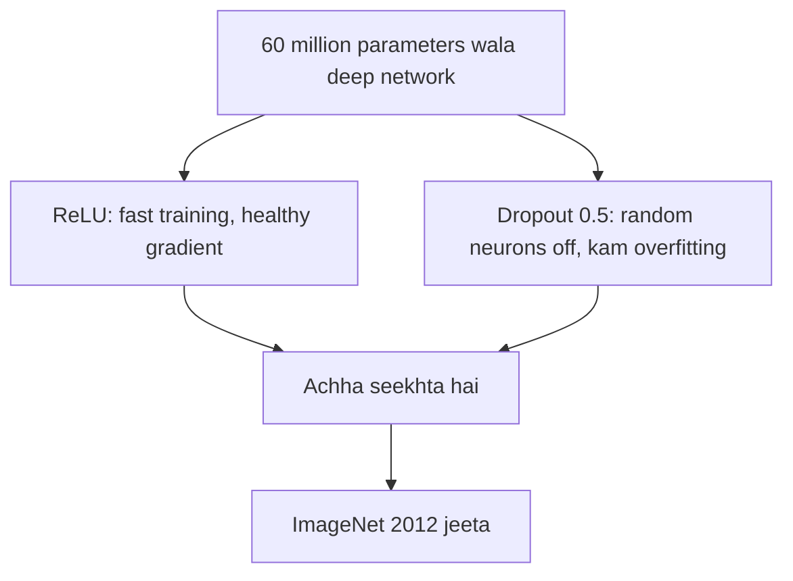

**Ek line mein:** <mark>AlexNet ek deep CNN hai jisne ImageNet 2012 jeeta</mark>; ismein <mark>5 convolution aur 3 fully connected layers</mark> hain aur isne <mark>ReLU, dropout, data augmentation aur GPUs</mark> use kiye. <Cite id="class-dl-chp4" loc="slide 46" />

<Box kind="key">

**AlexNet ke har question mein ye points likho:**

- <mark>Krizhevsky, Sutskever aur Hinton ne banaya; ImageNet 2012 winner</mark>.
- <mark>Input 227×227×3; 8 learnable layers: 5 convolution + 3 fully connected</mark>, softmax ke saath 1000 classes.
- <mark>ReLU tanh ki jagah: training lagbhag 6 guna fast</mark> aur vanishing gradient kam.
- <mark>Fully connected layers mein dropout (0.5) overfitting kam karta hai</mark> (lagbhag 60 million parameters).
- Aur bhi: **overlapping max pooling**, **data augmentation**, **GPU training**.
- <mark>Filters ki sankhya badhti hai (96, 256, 384, 384, 256), filter size ghatta hai (11, 5, 3, 3, 3)</mark>.

</Box>

## Core answer (5 marks, yahan ke har question ke liye)

```mermaid
%% caption: AlexNet: paanch convolution layers (pooling 1, 2 aur 5 ke baad) aur teen fully connected layers.
flowchart LR
  A["Input 227×227×3"] --> B["Conv1 96 filters 11×11, s4 → 55×55×96"]
  B --> C["Pool → 27×27×96"]
  C --> D["Conv2 256, 5×5 → 27×27×256"]
  D --> E["Pool → 13×13×256"]
  E --> F["Conv3, Conv4 384, Conv5 256 → 13×13×256"]
  F --> G["Pool → 6×6×256"]
  G --> H["FC6 4096, FC7 4096 (dropout 0.5)"]
  H --> I["FC8 1000 + softmax"]
```

<Box kind="definition">

**AlexNet** is a deep CNN architecture that became a landmark in 2012 by achieving outstanding ImageNet image-classification performance and popularizing deep learning for computer vision. It was developed by Krizhevsky, Sutskever and Hinton. <Cite id="class-dl-chp4" loc="slide 46" />

</Box>

**Architecture points mein:** <Cite id="class-dl-m4" loc="p. 57" /> <Cite id="class-dl-m4" loc="p. 58" />

- **8 learnable layers:** 5 convolutional aur 3 fully connected. Output layer (softmax) ko chhodkar har layer ke baad ReLU.
- Output size $= \lfloor (N + 2P - F)/S \rfloor + 1$, jaise $(227 - 11)/4 + 1 = 55$.
- Pooling size kam karti hai, depth nahi. Lagbhag **62 million parameters**, zyadatar fully connected layers mein.

**Conclusion:** deep CNN + ReLU + dropout + GPUs se state-of-the-art image classification mili. <Cite id="class-dl-chp4" loc="slide 46" />

## Extended answer (10 marks): ye add karo

### 1. Layer by layer

| Layer | Operation | Output |
|---|---|---|
| Input | RGB image | 227×227×3 |
| Conv1 | 96 filters 11×11, stride 4, ReLU | 55×55×96 |
| Pool1 | Max pool | 27×27×96 |
| Conv2 | 256 filters 5×5, ReLU | 27×27×256 |
| Pool2 | Max pool | 13×13×256 |
| Conv3, Conv4, Conv5 | 384, 384, 256 filters 3×3, ReLU | 13×13×256 |
| Pool3 | Max pool | 6×6×256 (flatten 9216) |
| FC6, FC7 | Fully connected 4096, ReLU, dropout | 4096 |
| FC8 | Fully connected + softmax | 1000 |

<Cite id="class-dl-chp4" loc="slide 48" /> <Cite id="web-dl-2-d2l-alexnet" /> Depth ke saath filters badhte hain aur unka size ghatta hai, isliye deeper layers complex features seekhti hain.

### 2. ReLU ka significance

- ReLU $\max(0, x)$ hai: simple, fast aur gradient mein sasta. AlexNet ne tanh ki jagah isse use kiya aur training lagbhag **6 guna fast** hui. <Cite id="class-dl-m4" loc="p. 55" /> <Cite id="web-dl-2-alexnet-paper" />
- Sigmoid ya tanh se ye vanishing gradient se kam affect hota hai, isliye aath layers mein gradients healthy rehte hain. <Cite id="class-dl-chp2" loc="slide 65" />

### 3. Dropout ka significance

- Lagbhag 60 million parameters training images ko aasani se memorize kar sakte hain (overfitting).
- Dropout training mein fully connected layers ke **neurons ko randomly off** kar deta hai (probability 0.5). Neurons ek-dusre pe depend nahi kar sakte, isliye general features seekhte hain. Test time pe saare neurons use hote hain. <Cite id="class-dl-chp2" loc="slide 108" /> <Cite id="web-dl-2-dropout-paper" />
- Isi maksad se data augmentation bhi use hua.

### 4. Merits aur demerits

| Merits | Demerits |
|---|---|
| Deep CNN features khud seekhta hai | Lagbhag 62 million parameters, heavy |
| ReLU, dropout, GPU se practical | Shuruaati layers mein dormant neurons |
| ImageNet 2012 jeeta | Pehli layer ke bade filter se aliasing |

<Cite id="class-dl-m4" loc="p. 85" />

## Har question mein kaise fit karein

- **"Explain and analyze the architectural of AlexNet Convolution Neural Network."** (10 marks) <PYQ id="2024-12/q2b" />: core answer diagram ke saath, layer table (section 1), key features aur merits-demerits (section 4).
- **"Explain the architecture of AlexNet with a diagram. Explain the significance of ReLU activation and Dropout regularization in AlexNet."** (10 marks) <PYQ id="2026-05/q5a" />: core answer diagram ke saath, phir section 2 aur 3 poore.

## Exam tips

- **Draw karo:** har layer ke baad sizes ke saath strip (227 → 55 → 27 → 13 → 6) aur FC4096, FC4096, 1000 mark karo.
- **Keywords:** ReLU, dropout 0.5, overlapping max pooling, data augmentation, GPU, 5 conv + 3 FC.
- Common galti: dropout test time pe use hota hai likhna; tab saare neurons use hote hain.

Exam mein English mein likho.
