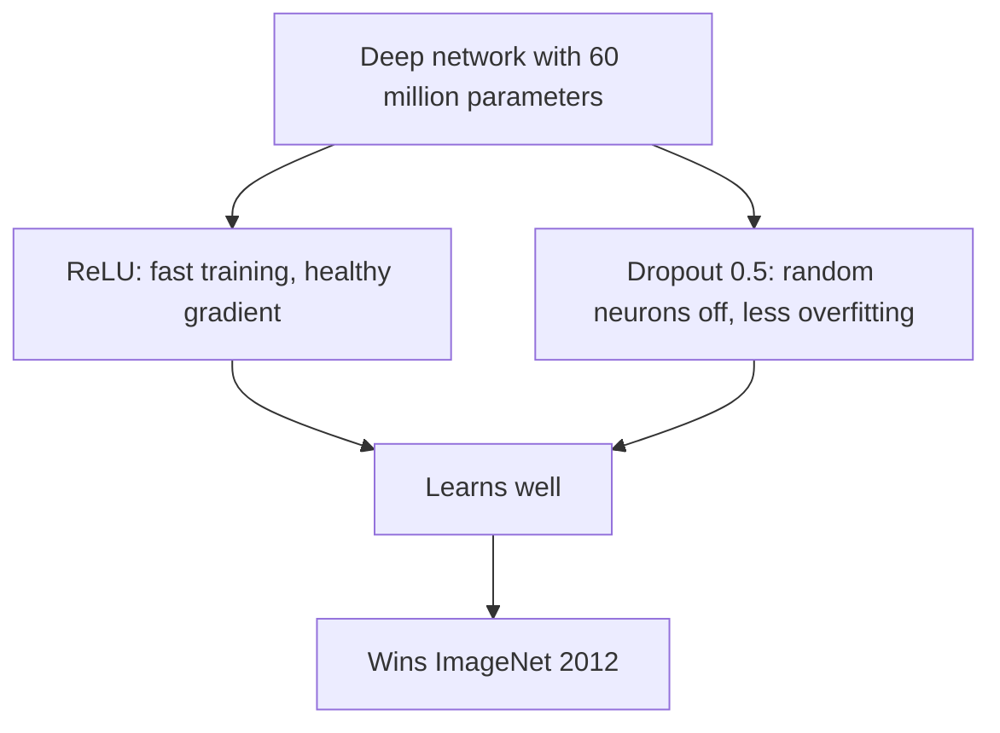

**In one line:** <mark>AlexNet is a deep CNN that won ImageNet 2012</mark>; it has <mark>5 convolution and 3 fully connected layers</mark> and used <mark>ReLU, dropout, data augmentation and GPUs</mark>. <Cite id="class-dl-chp4" loc="slide 46" />

<Box kind="key">

**Key points to write (AlexNet):**

- <mark>Developed by Krizhevsky, Sutskever and Hinton; winner of ImageNet 2012</mark>.
- <mark>Input 227×227×3; 8 learnable layers: 5 convolution + 3 fully connected</mark>, 1000 classes with softmax.
- <mark>ReLU instead of tanh: training about 6 times faster</mark> and less vanishing gradient.
- <mark>Dropout (0.5) in the fully connected layers reduces overfitting</mark> of about 60 million parameters.
- Also: **overlapping max pooling**, **data augmentation**, **GPU training**.
- <mark>Number of filters grows (96, 256, 384, 384, 256), filter size falls (11, 5, 3, 3, 3)</mark>.

</Box>

## Core answer (5 marks, fits every question here)

```mermaid
%% caption: AlexNet: five convolution layers (max pooling after 1, 2 and 5) and three fully connected layers.
flowchart LR
  A["Input 227×227×3"] --> B["Conv1 96 filters 11×11, s4 → 55×55×96"]
  B --> C["Pool → 27×27×96"]
  C --> D["Conv2 256, 5×5 → 27×27×256"]
  D --> E["Pool → 13×13×256"]
  E --> F["Conv3, Conv4 384, Conv5 256 → 13×13×256"]
  F --> G["Pool → 6×6×256"]
  G --> H["FC6 4096, FC7 4096 (dropout 0.5)"]
  H --> I["FC8 1000 + softmax"]
```

<Box kind="definition">

**AlexNet** is a deep CNN architecture that became a landmark in 2012 by achieving outstanding ImageNet image-classification performance and popularizing deep learning for computer vision. It was developed by Krizhevsky, Sutskever and Hinton. <Cite id="class-dl-chp4" loc="slide 46" />

</Box>

**Architecture in points:** <Cite id="class-dl-m4" loc="p. 57" /> <Cite id="class-dl-m4" loc="p. 58" />

- **8 learnable layers:** 5 convolutional and 3 fully connected. ReLU follows every layer except the output (softmax).
- Output size $= \lfloor (N + 2P - F)/S \rfloor + 1$, for example $(227 - 11)/4 + 1 = 55$.
- Pooling reduces size, never depth. About **62 million parameters**, most in the fully connected layers.

**Conclusion:** deep CNN + ReLU + dropout + GPUs gave state-of-the-art image classification. <Cite id="class-dl-chp4" loc="slide 46" />

## Extended answer (10 marks): add these

### 1. Layer by layer

| Layer | Operation | Output |
|---|---|---|
| Input | RGB image | 227×227×3 |
| Conv1 | 96 filters 11×11, stride 4, ReLU | 55×55×96 |
| Pool1 | Max pool | 27×27×96 |
| Conv2 | 256 filters 5×5, ReLU | 27×27×256 |
| Pool2 | Max pool | 13×13×256 |
| Conv3, Conv4, Conv5 | 384, 384, 256 filters 3×3, ReLU | 13×13×256 |
| Pool3 | Max pool | 6×6×256 (flatten 9216) |
| FC6, FC7 | Fully connected 4096, ReLU, dropout | 4096 |
| FC8 | Fully connected + softmax | 1000 |

<Cite id="class-dl-chp4" loc="slide 48" /> <Cite id="web-dl-2-d2l-alexnet" /> Filters increase and their size decreases with depth, so deeper layers learn more complex features.

### 2. Significance of ReLU

- ReLU is $\max(0, x)$: simple, fast and cheap in the gradient. AlexNet used it instead of tanh and trained about **six times faster**. <Cite id="class-dl-m4" loc="p. 55" /> <Cite id="web-dl-2-alexnet-paper" />
- It is less affected by the vanishing gradient problem than sigmoid or tanh, so gradients stay healthy through eight layers. <Cite id="class-dl-chp2" loc="slide 65" />

### 3. Significance of dropout

- About 60 million parameters can easily memorize the training images (overfitting).
- Dropout **randomly switches off neurons** (probability 0.5) in the fully connected layers during training. Neurons cannot depend on each other, so they learn general features. At test time all neurons are used. <Cite id="class-dl-chp2" loc="slide 108" /> <Cite id="web-dl-2-dropout-paper" />
- Data augmentation was also used for the same purpose.

### 4. Merits and demerits

| Merits | Demerits |
|---|---|
| Deep CNN learns features automatically | About 62 million parameters, heavy |
| ReLU, dropout, GPU make it practical | Dormant neurons in the first layers |
| Won ImageNet 2012 | Aliasing from the large first-layer filter |

<Cite id="class-dl-m4" loc="p. 85" />

## Fit it to each question

- **"Explain and analyze the architectural of AlexNet Convolution Neural Network."** (10 marks) <PYQ id="2024-12/q2b" />: core answer with the diagram, layer table (section 1), key features and merits and demerits (section 4).
- **"Explain the architecture of AlexNet with a diagram. Explain the significance of ReLU activation and Dropout regularization in AlexNet."** (10 marks) <PYQ id="2026-05/q5a" />: core answer with the diagram, then sections 2 and 3 in full.

## Exam tips

- **Draw** the strip with the sizes after each layer (227 → 55 → 27 → 13 → 6) and mark FC4096, FC4096, 1000.
- **Keywords:** ReLU, dropout 0.5, overlapping max pooling, data augmentation, GPU, 5 conv + 3 FC.
- Common mistake: saying dropout is used at test time; all neurons are used then.
