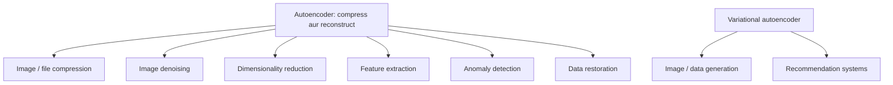
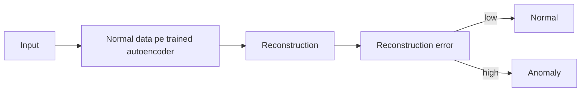

**Ek line mein:** autoencoder ek chhota code seekhta hai jo data ka important part rakhta hai, isliye <mark>wahi idea compression, denoising, dimensionality reduction, feature extraction aur anomaly detection mein use hota hai</mark>, aur VAE ismein <mark>naya data generate karna</mark> add karta hai. <Cite id="class-dl-chp3" loc="slide 34" />

<Box kind="key">

**Autoencoder applications ke har question mein ye points likho:**

- <mark>Autoencoder = unsupervised network jo input ko compress karke reconstruct karta hai</mark>; beech ka chhota code **latent space** hai.
- Main uses: <mark>image compression, image denoising, dimensionality reduction, feature extraction, anomaly detection, data restoration, recommendation</mark>.
- <mark>Anomaly detection: normal data pe train karo, high reconstruction error matlab anomaly</mark>.
- <mark>VAE latent space mein distribution (μ aur σ²) seekhta hai</mark>, isliye training data jaisa **naya data generate** kar sakta hai.
- <mark>Latent space visualization: similar inputs paas-paas hote hain</mark>; ye dikhata hai autoencoder ne kya seekha.
- VAE ka <mark>continuous, smooth latent space</mark> hota hai, isliye examples ke beech sample kar sakte hain.

</Box>

## Core answer (5 marks, yahan ke har question ke liye)

<Box kind="definition">

An **autoencoder** is an unsupervised neural network that learns to compress the input into a smaller representation (encoding) and then reconstruct the original input from that compressed representation. <Cite id="class-dl-chp3" loc="slide 2" />

</Box>

**Applications kyun hain:** chhota code (latent space) sirf important features rakhta hai, isliye jahan data chhota karna, saaf karna ya unusual dhoondhna ho wahan kaam aata hai. <Cite id="class-dl-chp3" loc="slide 34" />

**Autoencoder ke applications:** <Cite id="class-dl-chp3" loc="slides 34 and 35" />

1. **Compression:** encoder chhota code banata hai, decoder image wapas banata hai.
2. **Denoising:** noisy photo clean photo ban jaati hai.
3. **Dimensionality reduction:** 1000 features se 100 important features.
4. **Feature extraction:** encoder edges ya face shapes seekhta hai dusre model ke liye.
5. **Anomaly detection:** high reconstruction error matlab defect ya fraud.
6. **Data restoration:** damaged ya missing data wapas banana.

**VAE ke applications:** <mark>training data jaisa naya data generate karta hai</mark> (new images, synthetic data, molecules), aur recommendation bhi. <Cite id="class-dl-chp3" loc="slide 27" />

**Conclusion:** autoencoders compress, clean aur detect karte hain; VAE generation add karta hai.

## Extended answer (10 marks): ye add karo

### 1. Applications detail mein

| Application | Autoencoder kaise karta hai | Example |
|---|---|---|
| Compression | Code input se chhota hota hai | Badi image chhote code ke roop mein |
| Denoising | Noisy input, clean target se train | Noise ya watermark hatana |
| Dimensionality reduction | Bottleneck hi reduced data hai | 1000 se 100 features |
| Feature extraction | Encoder ka output feature vector hai | Classifier ke liye features |
| Anomaly detection | Normal data achha rebuild hota hai, abnormal nahi | Fraud, machine defects |
| Restoration | Missing hissa bhar deta hai | Damaged image, black-and-white se colour |
| Recommendation | User ki preferences seekhta hai | Dusri movie suggest karna |

<Cite id="class-dl-chp3" loc="slide 34" /> <Cite id="class-dl-m3" loc="pp. 25-27" /> Standard textbook mein bhi dimensionality reduction aur information retrieval classic uses bataye gaye hain. <Cite id="web-dl-2-goodfellow-ae" />

### 2. Variational autoencoder (VAE) aur uske applications

Normal autoencoder har input ke liye ek **fixed point** rakhta hai. VAE ek **distribution** (mean μ aur variance σ²) rakhta hai, ek point z sample karta hai aur decode karta hai. Isliye wo training data jaisa naya data bana sakta hai. <Cite id="class-dl-chp3" loc="slide 27" /> <Cite id="web-dl-2-vae-paper" />

| | Autoencoder | VAE |
|---|---|---|
| Latent code | Fixed point | Distribution (μ, σ²) |
| Best for | Compression, denoising, anomaly detection, features | Naya data generate karna |

VAE uses: image generation, synthetic data, reconstruction, anomaly detection, drug ya molecule generation, compression aur recommendation. <Cite id="class-dl-chp3" loc="slide 34" />

### 3. Latent space visualization ka role

Bahut saare inputs ke latent codes plot karo: <Cite id="class-dl-chp3" loc="slide 28" />

- **Similar inputs paas-paas** hote hain (red apples ek group mein, green apples dusre mein), matlab features meaningful hain.
- Har latent value ka matlab ho sakta hai (smile, skin tone, glasses). <Cite id="class-dl-m3" loc="p. 30" />
- VAE ka space **continuous aur smooth** hota hai: paas ke points similar outputs dete hain, isliye groups ke beech sample karke naya data bana sakte hain. <Cite id="class-dl-m3" loc="pp. 31-33" />

Wikipedia aur textbook mein bhi yahi uses hain. <Cite id="web-dl-2-wiki-autoencoder" />

## Har question mein kaise fit karein

- **"Explain briefly the various applications of Autoencoders and Variational Autoencoders."** (10 marks) <PYQ id="assignment-1/q3a" />: core answer, phir table (section 1) aur VAE part (section 2); end mein AE vs VAE table.
- **"Analyze the role of latent space visualization in understanding feature representations learned by an autoencoder."** (10 marks) <PYQ id="assignment-1/q3b" />: autoencoder pe ek line, phir section 3 poora: latent space mein kya hota hai, similar inputs saath, values ka matlab, VAE mein smoothness, aur aim (kya seekha check karna).

## Exam tips

- **Draw karo:** application tree aur encoder, code, decoder ki picture.
- **Keywords:** reconstruction error, latent space, bottleneck, distribution (μ, σ²), generate new data.
- Image-to-image translation GAN ka application hai; autoencoder ki list mein mat likho.

Exam mein English mein likho.
