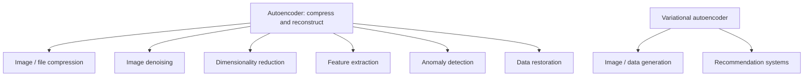
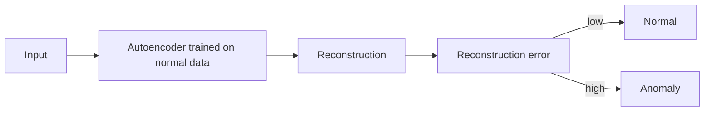

**In one line:** an autoencoder learns a short code that keeps the important part of the data, so <mark>the same idea is used for compression, denoising, dimensionality reduction, feature extraction and anomaly detection</mark>, and the VAE adds <mark>generation of new data</mark>. <Cite id="class-dl-chp3" loc="slide 34" />

<Box kind="key">

**Key points to write (any autoencoder application question):**

- <mark>Autoencoder = unsupervised network that compresses the input and reconstructs it</mark>; the small middle code is the **latent space**.
- Main uses: <mark>image compression, image denoising, dimensionality reduction, feature extraction, anomaly detection, data restoration, recommendation</mark>.
- <mark>Anomaly detection: train on normal data, a high reconstruction error means an anomaly</mark>.
- <mark>VAE learns a distribution (μ and σ²) in the latent space</mark>, so it can **generate new data** similar to the training data.
- <mark>Latent space visualization: similar inputs lie close together</mark>; it shows what the autoencoder has learned.
- A VAE gives a <mark>continuous, smooth latent space</mark>, so we can sample between examples.

</Box>

## Core answer (5 marks, fits every question here)

<Box kind="definition">

An **autoencoder** is an unsupervised neural network that learns to compress the input into a smaller representation (encoding) and then reconstruct the original input from that compressed representation. <Cite id="class-dl-chp3" loc="slide 2" />

</Box>

**Why applications exist:** the small code (latent space) keeps only the important features, so it is useful wherever we want to shrink data, clean data or find the unusual. <Cite id="class-dl-chp3" loc="slide 34" />

**Applications of autoencoders:** <Cite id="class-dl-chp3" loc="slides 34 and 35" />

1. **Compression:** the encoder makes a small code, the decoder rebuilds the image.
2. **Denoising:** a noisy photo becomes a clean photo.
3. **Dimensionality reduction:** 1000 features become 100 important ones.
4. **Feature extraction:** the encoder learns edges or face shapes for another model.
5. **Anomaly detection:** high reconstruction error means a defect or fraud.
6. **Data restoration:** rebuild damaged or missing data.

**Applications of VAE:** <mark>generates new data similar to the training data</mark> (new images, synthetic data, molecules), and also recommendation. <Cite id="class-dl-chp3" loc="slide 27" />

**Conclusion:** autoencoders compress, clean and detect; the VAE adds generation.

## Extended answer (10 marks): add these

### 1. Applications in detail

| Application | How the autoencoder does it | Example |
|---|---|---|
| Compression | Code is smaller than the input | Large image sent as a small code |
| Denoising | Trained with noisy input, clean target | Remove noise or a watermark |
| Dimensionality reduction | The bottleneck is the reduced data | 1000 to 100 features |
| Feature extraction | Encoder output is the feature vector | Features for a classifier |
| Anomaly detection | Normal data rebuilds well, abnormal data does not | Fraud, machine defects |
| Restoration | Fills in the missing part | Damaged image, black-and-white to colour |
| Recommendation | Learns the user's preferences | Suggest another movie |

<Cite id="class-dl-chp3" loc="slide 34" /> <Cite id="class-dl-m3" loc="pp. 25-27" /> Dimensionality reduction and information retrieval are also named as classic uses in the standard textbook. <Cite id="web-dl-2-goodfellow-ae" />

### 2. Variational autoencoder (VAE) and its applications

A normal autoencoder stores a **fixed point** for each input. A VAE stores a **distribution** (mean μ and variance σ²), samples a point z and decodes it. So it can create new data that looks like the training data. <Cite id="class-dl-chp3" loc="slide 27" /> <Cite id="web-dl-2-vae-paper" />

| | Autoencoder | VAE |
|---|---|---|
| Latent code | Fixed point | Distribution (μ, σ²) |
| Best for | Compression, denoising, anomaly detection, features | Generating new data |

VAE uses: image generation, synthetic data, reconstruction, anomaly detection, drug or molecule generation, compression and recommendation. <Cite id="class-dl-chp3" loc="slide 34" />

### 3. Role of latent space visualization

Plot the latent codes of many inputs: <Cite id="class-dl-chp3" loc="slide 28" />

- **Similar inputs lie near each other** (red apples in one group, green apples in another), so the features are meaningful.
- Each latent value can have a meaning (smile, skin tone, glasses). <Cite id="class-dl-m3" loc="p. 30" />
- A VAE gives a **continuous, smooth** space: close points decode to similar outputs, so we can sample between groups to generate new data. <Cite id="class-dl-m3" loc="pp. 31-33" />

Wikipedia and the textbook describe the same uses. <Cite id="web-dl-2-wiki-autoencoder" />

## Fit it to each question

- **"Explain briefly the various applications of Autoencoders and Variational Autoencoders."** (10 marks) <PYQ id="assignment-1/q3a" />: core answer, then the table (section 1) and the VAE part (section 2); end with the AE versus VAE table.
- **"Analyze the role of latent space visualization in understanding feature representations learned by an autoencoder."** (10 marks) <PYQ id="assignment-1/q3b" />: one line on the autoencoder, then section 3 in full: what the latent space holds, similar inputs together, meaning of values, smoothness in a VAE, and the aim (check what was learned).

## Exam tips

- **Draw** the application tree and the encoder, code, decoder picture.
- **Keywords:** reconstruction error, latent space, bottleneck, distribution (μ, σ²), generate new data.
- Image-to-image translation is a GAN application; do not list it for autoencoders.
