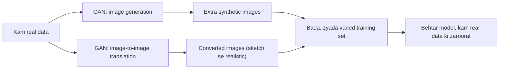
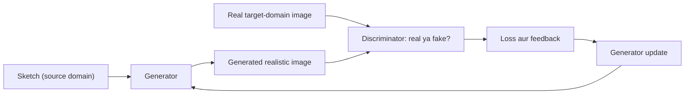

**Ek line mein:** trained GAN ka generator <mark>naye, realistic samples bana sakta hai</mark> (image generation, augmentation ke liye synthetic data) aur <mark>image ko ek domain se doosre domain mein convert kar sakta hai</mark> (image-to-image translation, jaise sketch se realistic image), isliye model ko kam real data chahiye. <Cite id="class-dl-chp6" loc="slide 16" />

<Box kind="key">

**GAN applications ke har question mein ye points likho:**

- <mark>Image generation: generator random noise se naye faces, objects, animals, scenery banata hai</mark>.
- <mark>Synthetic data: kuch real images pe GAN train karo, phir bahut saari aur generate karke training set badhao</mark>.
- <mark>Model performance badhta hai aur badi real data pe dependency kam hoti hai</mark>.
- <mark>Image-to-image translation: source domain (sketch) se target domain (realistic image) ka mapping seekhna</mark>; day se night, summer se winter.
- <mark>Discriminator check karta hai ki generated image real target-domain image jaisi lagti hai ya nahi</mark>.
- <mark>Synthetic images use karne se pehle quality check karo</mark>; GAN training unstable ho sakti hai (mode collapse).

</Box>

## Core answer (5 marks, yahan ke har question ke liye)

<Box kind="definition">

**GAN applications** use the trained generator of a GAN: for **data generation** it creates new samples similar to the real data, and for **image-to-image translation** it converts an image from a source domain into a target domain. <Cite id="class-dl-chp6" loc="slides 16 and 19" />

</Box>

**1. Data generation (synthetic data).** Real data aksar kam ya jama karna mushkil hota hai. Real images pe GAN train karo, phir generator ko random noise ke saath use karke bahut saari nayi images banao. Real plus synthetic images ek bada aur zyada diverse training dataset dete hain. <Cite id="class-dl-chp6" loc="slide 22" />

**2. Image-to-image translation.** GAN source domain (sketch) se target domain (realistic image) ka mapping seekhta hai. Generator sketch ko convert karta hai; discriminator check karta hai ki result real lagta hai ya nahi; loss feedback deta hai jab tak output real na lage. <Cite id="class-dl-chp6" loc="slide 19" />

**Conclusion:** data generation zyada samples add karta hai aur image-to-image translation aasani se milne wali images ko zaroori type mein badalta hai, isliye model kam real data se train hota hai.

## Extended answer (10 marks): ye add karo

### 1. Extra training data banana: steps

500 real images ka example: <Cite id="class-dl-chp6" loc="slide 22" />

1. **Limited real data:** sirf 500 real images.
2. **GAN train karo** unpe; result trained generator hai.
3. Random noise se naye samples **generate** karo.
4. **Discriminator check karta hai** ki wo real data jaise hain ya nahi; loss aur update kai baar repeat.
5. Synthetic images ko real ke saath **add** karo: bada training dataset.

**Important:** synthetic images ki quality check karo, kyunki kuch unnatural lagti hain ya artifacts hote hain; aim useful aur diverse samples hain, sirf zyada data nahi. Use cases: image classification, chhote datasets ka augmentation, behtar generalization. Medical imaging mein synthetic images research aur augmentation ke liye hain, diagnosis ke liye nahi. <Cite id="class-dl-chp6" loc="slide 25" />

### 2. Image-to-image translation: steps

1. Generator ko **sketch** (source domain) do.
2. Wo **realistic-looking image** (target domain) banata hai.
3. Discriminator ko real target image aur generated image milti hain: "kya ye target domain ki real image jaisi lagti hai?"
4. **Loss aur feedback:** unrealistic image se loss badhta hai; realistic image se loss kam.
5. Generator update hoke phir try karta hai; **repeat** jab tak discriminator farq na bata paye. <Cite id="class-dl-chp6" loc="slide 19" />

Research mein popular version pix2pix hai, jo aisa conditional GAN paired examples pe train karta hai (jaise edges se photos, labels se street scenes). <Cite id="web-dl-2-pix2pix-paper" />

### 3. Related applications

| Application | Kya karta hai |
|---|---|
| Super-resolution | Low-resolution image se high-resolution image |
| Image restoration | Noise hatana, damaged images theek karna, missing parts bharna |
| Video generation, art | Video aur creative content banana ya badalna |

<Cite id="class-dl-chp6" loc="slide 16" />

### 4. Limits

Class nahi kehti ki GANs training ko khud fast banate hain; fayda **zyada aur behtar data** ka hai. GAN training unstable ho sakti hai (mode collapse), aur wahi technology deepfakes bhi banati hai. <Cite id="class-dl-chp6" loc="slide 13" /> <Cite id="class-dl-chp6" loc="slide 14" /> <Cite id="web-dl-2-gan-paper" />

## Har question mein kaise fit karein

- **"Analyze the applications of GANs in image generation and image-to-image translation for improving training efficiency."** (10 marks) <PYQ id="2026-05/q6b" />: core answer flow diagram ke saath, phir section 1 aur 2 short mein, aur section 4 (training efficiency matlab kam real data, behtar data; training khud fast nahi).
- **"Suggest how GANs can be used to generate additional training data for a machine-learning model."** (10 marks) <PYQ id="assignment-2/q6b" />: 500-image steps (section 1), flow diagram, quality-check warning aur use cases.
- **"Demonstrate how GANs can be applied for image-to-image translation."** (10 marks) <PYQ id="assignment-2/q6c" />: sketch-to-realistic steps aur diagram (section 2), dono pictures, aur day to night doosre example ki tarah.

## Exam tips

- **Draw karo:** sketch, generator, generated image, real image, discriminator loop; data generation ke liye "500 real + synthetic = bada dataset".
- **Keywords:** source domain, target domain, adversarial training, synthetic data, data augmentation, quality check.
- Common galti: ye likhna ki discriminator images banata hai; images generator banata hai.

Exam mein English mein likho.
