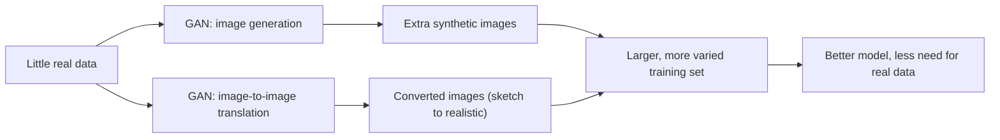
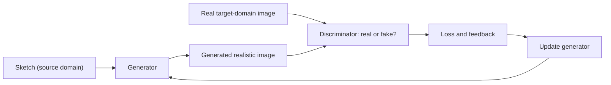

**In one line:** a trained GAN generator can <mark>create new, realistic samples</mark> (image generation, synthetic data for augmentation) and can <mark>convert an image from one domain to another</mark> (image-to-image translation, for example a sketch to a realistic image), so a model needs less real data. <Cite id="class-dl-chp6" loc="slide 16" />

<Box kind="key">

**Key points to write (GAN applications):**

- <mark>Image generation: the generator makes new faces, objects, animals, scenery from random noise</mark>.
- <mark>Synthetic data: train the GAN on a few real images, then generate many more to enlarge the training set</mark>.
- <mark>It improves model performance and reduces the dependency on large amounts of real data</mark>.
- <mark>Image-to-image translation: learn a mapping from a source domain (sketch) to a target domain (realistic image)</mark>; day to night, summer to winter.
- <mark>The discriminator checks whether the generated image looks like a real target-domain image</mark>.
- <mark>Check the quality of synthetic images before use</mark>; GAN training can be unstable (mode collapse).

</Box>

## Core answer (5 marks, fits every question here)

<Box kind="definition">

**GAN applications** use the trained generator of a GAN: for **data generation** it creates new samples similar to the real data, and for **image-to-image translation** it converts an image from a source domain into a target domain. <Cite id="class-dl-chp6" loc="slides 16 and 19" />

</Box>

**1. Data generation (synthetic data).** Real data is often limited or hard to collect. Train the GAN on the real images, then use the generator with random noise to make many new ones. Real plus synthetic images give a larger and more diverse training dataset. <Cite id="class-dl-chp6" loc="slide 22" />

**2. Image-to-image translation.** The GAN learns the mapping from a source domain (sketch) to a target domain (realistic image). The generator converts the sketch; the discriminator checks whether the result looks real; the loss gives feedback until the output looks real. <Cite id="class-dl-chp6" loc="slide 19" />

**Conclusion:** data generation adds more samples and image-to-image translation converts easy-to-get images into the needed kind, so the model trains with less real data.

## Extended answer (10 marks): add these

### 1. Generating additional training data: steps

Example with 500 real images: <Cite id="class-dl-chp6" loc="slide 22" />

1. **Limited real data:** only 500 real images.
2. **Train the GAN** on them; the result is a trained generator.
3. **Generate** new samples from random noise.
4. **Discriminator checks** whether they resemble the real data; the loss and update repeat many times.
5. **Add** the synthetic images to the real ones: a larger training dataset.

**Important:** quality-check synthetic images, because some look unnatural or contain artifacts; the aim is useful and diverse samples, not just more data. Use cases: image classification, augmentation of small datasets, better generalization. In medical imaging synthetic images are for research and augmentation, not diagnosis. <Cite id="class-dl-chp6" loc="slide 25" />

### 2. Image-to-image translation: steps

1. Give the generator a **sketch** (source domain).
2. It produces a **realistic-looking image** (target domain).
3. The discriminator receives the real target image and the generated image: "does this look like a real image of the target domain?"
4. **Loss and feedback:** an unrealistic image increases the loss; a realistic one gives low loss.
5. The generator updates and tries again; **repeat** until the discriminator can no longer tell the difference. <Cite id="class-dl-chp6" loc="slide 19" />

The widely used research version, pix2pix, trains such a conditional GAN on paired examples (for example edges to photos, labels to street scenes). <Cite id="web-dl-2-pix2pix-paper" />

### 3. Related applications

| Application | What it does |
|---|---|
| Super-resolution | Low-resolution image to high-resolution image |
| Image restoration | Remove noise, fix damaged images, fill missing parts |
| Video generation, art | Create or manipulate video and creative content |

<Cite id="class-dl-chp6" loc="slide 16" />

### 4. Limits

The class does not say GANs make the training itself faster; the benefit is **more and better data**. GAN training can be unstable with mode collapse, and the same technology allows deepfakes. <Cite id="class-dl-chp6" loc="slide 13" /> <Cite id="class-dl-chp6" loc="slide 14" /> <Cite id="web-dl-2-gan-paper" />

## Fit it to each question

- **"Analyze the applications of GANs in image generation and image-to-image translation for improving training efficiency."** (10 marks) <PYQ id="2026-05/q6b" />: core answer with the flow diagram, then sections 1 and 2 briefly, and section 4 (training efficiency means less real data, better data; not faster training).
- **"Suggest how GANs can be used to generate additional training data for a machine-learning model."** (10 marks) <PYQ id="assignment-2/q6b" />: the 500-image steps (section 1), the flow diagram, the quality-check warning and the use cases.
- **"Demonstrate how GANs can be applied for image-to-image translation."** (10 marks) <PYQ id="assignment-2/q6c" />: the sketch-to-realistic steps and diagram (section 2), the two pictures, and day to night as another example.

## Exam tips

- **Draw** the sketch, generator, generated image, real image, discriminator loop; for data generation draw "500 real + synthetic = larger dataset".
- **Keywords:** source domain, target domain, adversarial training, synthetic data, data augmentation, quality check.
- Common mistake: claiming the discriminator creates the images; the generator does.
