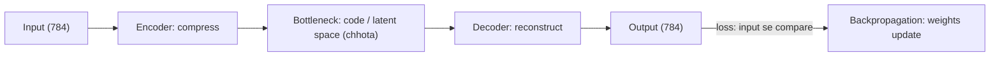

**Ek line mein:** autoencoder ke <mark>teen main parts hote hain: encoder, bottleneck (code) aur decoder</mark>; undercomplete autoencoder wo hai jiska <mark>bottleneck input se kam neurons ka hota hai</mark>, isliye wo sirf important features rakhta hai. <Cite id="class-dl-chp3" loc="slide 13" />

<Box kind="key">

**Components, architecture, undercomplete ke har question mein ye points likho:**

- <mark>Autoencoder = unsupervised network jo input ko compress karke reconstruct karta hai; goal Input ≈ Output</mark>.
- **Encoder** compress karta hai (784 → 128 → 64 → 16), **bottleneck** (code / latent space) sabse important information rakhta hai, **decoder** rebuild karta hai (16 → 64 → 128 → 784).
- Training: <mark>output ko input se compare karo, loss (MSE) nikalo, backpropagate karo, weights update karo</mark>.
- <mark>Undercomplete: hidden layer (code) mein input se kam neurons</mark>, isliye network ko compress karna padta hai.
- Bottleneck chhota hai, isliye <mark>wo input ko seedha copy nahi kar sakta</mark>; meaningful features seekhta hai.
- Risk: **bahut chhota** bottleneck important information kho deta hai.

</Box>

## Core answer (5 marks, yahan ke har question ke liye)

<Box kind="definition">

An **autoencoder** is an unsupervised neural network that learns to compress the input into a smaller representation (encoding) and then reconstruct the original input from that compressed representation. Goal: Input ≈ Output. <Cite id="class-dl-chp3" loc="slide 2" />

An **undercomplete autoencoder** is an autoencoder in which the hidden layer (bottleneck / code) has fewer neurons than the input layer. <Cite id="class-dl-chp3" loc="slide 13" />

</Box>

**Main components:** <Cite id="class-dl-chp3" loc="slides 2 and 3" />

1. **Input:** raw data (image, audio, text), jaise 28 × 28 = 784 pixels.
2. **Encoder:** high-dimensional input ko chhote representation mein badalta hai aur important features nikalta hai.
3. **Bottleneck (latent space / code):** sabse chhota layer; sirf sabse important information rakhta hai.
4. **Decoder:** code se original input wapas banata hai.
5. **Output:** reconstructed data, input ke jitna paas ho sake.

**Undercomplete:** code size < input size, jaise 784 → 64 → 784. Chhota bottleneck network ko compress karne aur sirf important features rakhne pe majboor karta hai. <Cite id="class-dl-chp3" loc="slide 13" />

**Conclusion:** bottleneck network ko input ke sirf important features rakhne pe majboor karta hai.

## Extended answer (10 marks): ye add karo

### 1. Autoencoder ki training

1. Input encoder ko do, code lo, decode karo. <Cite id="class-dl-chp3" loc="slide 3" />
2. Output ko input se compare karke **loss** nikalo: MSE $= \dfrac{1}{n}\sum (x_i - \hat x_i)^2$ (ya L1 $= \dfrac{1}{n}\sum |x_i - \hat x_i|$).
3. Backpropagation weights update karta hai. Reconstruction error minimum hone tak repeat.

Labels nahi chahiye, kyunki input hi apna target hai.

### 2. Undercomplete autoencoder detail mein

**Working:** (1) input encoder mein jaata hai, (2) encoder compress karta hai, (3) bottleneck important features store karta hai, (4) decoder reconstruct karta hai, (5) loss calculate hota hai, (6) backpropagation se weights update. <Cite id="class-dl-chp3" loc="slide 13" />

Textbook kehta hai ki isme koi explicit regularization term nahi hota; sirf chhota hidden layer memorize hone se rokta hai. <Cite id="class-dl-m3" loc="p. 15" /> Linear decoder aur MSE ke saath ye PCA wala hi subspace seekhta hai. <Cite id="web-dl-2-goodfellow-ae" />

### 3. Undercomplete vs overcomplete

| Feature | Undercomplete | Overcomplete |
|---|---|---|
| Hidden layer | Input se kam neurons | Input se zyada neurons |
| Copy ka risk | Kam (bottleneck rokta hai) | Zyada, regularization chahiye (sparse, denoising) |
| Use | Compression, features, dimensionality reduction | Sparse aur denoising versions |

<Cite id="class-dl-chp3" loc="slides 15 and 16" />

### 4. Advantages aur disadvantages

| Advantages | Disadvantages |
|---|---|
| Bina labels ke seekhta hai | Output hamesha input jaisa nahi hota |
| Data compress karta hai, redundancy hatata hai | Kuch information kho sakti hai |
| Useful features seekhta hai, simple copying se bachta hai | Bottleneck size sahi chunna padta hai |

<Cite id="class-dl-chp3" loc="slides 3 and 14" /> Wikipedia mein bhi yahi overview hai. <Cite id="web-dl-2-wiki-autoencoder" />

## Har question mein kaise fit karein

- **"Explain main components of an Autoencoder and it's architecture."** (10 marks) <PYQ id="2024-05/q3b" />: core answer (components aur diagram), phir training (section 1) aur advantages-disadvantages (section 4). Undercomplete ka ek line mention.
- **"What are Undercomplete Autoencoders?"** (5 marks) <PYQ id="2024-05/q1d" />: definition box, "code size < input size", 784 → 64 → 784 picture, kaise kaam karta hai (6 steps) aur ek advantage, ek disadvantage.

## Exam tips

- **Draw karo:** input, encoder, bottleneck, decoder, output, neuron counts ke saath.
- **Keywords:** bottleneck, latent space, reconstruction, fewer neurons than input, loss.
- Bottleneck ko "output" mat likho; output reconstruction hota hai.

Exam mein English mein likho.
