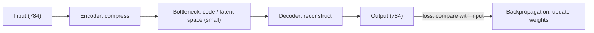

**In one line:** an autoencoder has <mark>three main parts: an encoder, a bottleneck (code) and a decoder</mark>; an undercomplete autoencoder is one whose <mark>bottleneck has fewer neurons than the input</mark>, so it must keep only the important features. <Cite id="class-dl-chp3" loc="slide 13" />

<Box kind="key">

**Key points to write (components, architecture, undercomplete):**

- <mark>Autoencoder = unsupervised network that compresses the input and reconstructs it; goal Input ≈ Output</mark>.
- **Encoder** compresses (784 → 128 → 64 → 16), **bottleneck** (code / latent space) stores the most important information, **decoder** rebuilds (16 → 64 → 128 → 784).
- Training: <mark>compare output with input, calculate the loss (MSE), backpropagate, update weights</mark>.
- <mark>Undercomplete: hidden layer (code) has fewer neurons than the input</mark>, so the network is forced to compress.
- Because the bottleneck is small, it <mark>cannot simply copy the input</mark>; it learns meaningful features.
- Risk: a **too-small** bottleneck loses important information.

</Box>

## Core answer (5 marks, fits every question here)

<Box kind="definition">

An **autoencoder** is an unsupervised neural network that learns to compress the input into a smaller representation (encoding) and then reconstruct the original input from that compressed representation. Goal: Input ≈ Output. <Cite id="class-dl-chp3" loc="slide 2" />

An **undercomplete autoencoder** is an autoencoder in which the hidden layer (bottleneck / code) has fewer neurons than the input layer. <Cite id="class-dl-chp3" loc="slide 13" />

</Box>

**Main components:** <Cite id="class-dl-chp3" loc="slides 2 and 3" />

1. **Input:** the raw data (image, audio, text), for example 28 × 28 = 784 pixels.
2. **Encoder:** converts the high-dimensional input to a smaller representation and extracts important features.
3. **Bottleneck (latent space / code):** the smallest layer; it keeps only the most important information.
4. **Decoder:** rebuilds the original input from the code.
5. **Output:** the reconstructed data, as close to the input as possible.

**Undercomplete:** code size < input size, for example 784 → 64 → 784. The small bottleneck forces the network to compress and keep only the important features. <Cite id="class-dl-chp3" loc="slide 13" />

**Conclusion:** the bottleneck forces the network to keep only the important features of the input.

## Extended answer (10 marks): add these

### 1. Training of an autoencoder

1. Give the input to the encoder, get the code, decode it. <Cite id="class-dl-chp3" loc="slide 3" />
2. Compare the output with the input and calculate the **loss**: MSE $= \dfrac{1}{n}\sum (x_i - \hat x_i)^2$ (or L1 $= \dfrac{1}{n}\sum |x_i - \hat x_i|$).
3. Backpropagation updates the weights. Repeat until the reconstruction error is minimum.

No labels are needed, because the input is its own target.

### 2. Undercomplete autoencoder in detail

**Working:** (1) input enters the encoder, (2) the encoder compresses, (3) the bottleneck stores important features, (4) the decoder reconstructs, (5) the loss is calculated, (6) the weights are updated by backpropagation. <Cite id="class-dl-chp3" loc="slide 13" />

The textbook says it has no explicit regularization term; only the small hidden layer stops it from memorizing. <Cite id="class-dl-m3" loc="p. 15" /> With a linear decoder and MSE it learns the same subspace as PCA. <Cite id="web-dl-2-goodfellow-ae" />

### 3. Undercomplete versus overcomplete

| Feature | Undercomplete | Overcomplete |
|---|---|---|
| Hidden layer | Fewer neurons than input | More neurons than input |
| Copy risk | Low (bottleneck blocks it) | High, needs regularization (sparse, denoising) |
| Use | Compression, features, dimensionality reduction | Sparse and denoising versions |

<Cite id="class-dl-chp3" loc="slides 15 and 16" />

### 4. Advantages and disadvantages

| Advantages | Disadvantages |
|---|---|
| Learns without labels | Output is not always identical to input |
| Compresses data, removes redundancy | Some information may be lost |
| Learns useful features, avoids simple copying | Bottleneck size must be chosen properly |

<Cite id="class-dl-chp3" loc="slides 3 and 14" /> Wikipedia gives the same overview. <Cite id="web-dl-2-wiki-autoencoder" />

## Fit it to each question

- **"Explain main components of an Autoencoder and it's architecture."** (10 marks) <PYQ id="2024-05/q3b" />: core answer (components and diagram), then training (section 1) and advantages and disadvantages (section 4). Mention undercomplete in one line.
- **"What are Undercomplete Autoencoders?"** (5 marks) <PYQ id="2024-05/q1d" />: definition box, "code size < input size", the 784 → 64 → 784 picture, how it works (6 steps) and one advantage, one disadvantage.

## Exam tips

- **Draw** input, encoder, bottleneck, decoder, output with neuron counts.
- **Keywords:** bottleneck, latent space, reconstruction, fewer neurons than input, loss.
- Do not say the bottleneck is "the output"; the output is the reconstruction.
