**Ek line mein:** <mark>CNN ek deep learning model hai jo convolutional filters se images ke spatial features khud seekhta hai</mark>; convolution aur pooling layers features dhoondhte hain, aur flatten, fully connected aur softmax layers class decide karte hain. <Cite id="class-dl-chp4" loc="slide 5" />

<Box kind="key">

**CNN architecture ya workflow ke har question mein ye points likho:**

- <mark>CNN = convolution + pooling (feature extractor), phir flatten + fully connected + softmax (classifier)</mark>.
- <mark>Local connectivity, weight sharing aur pooling</mark> se fully connected network se bahut kam parameters lagte hain.
- **Convolution** filters image pe slide karke feature maps dete hain; **ReLU** negatives ko 0 kar deta hai.
- <mark>Pooling height aur width kam karta hai, depth nahi</mark>.
- **Early layers** edges seekhti hain, deeper layers shapes aur object parts.
- Output size: <mark>$\lfloor (N - F + 2P)/S \rfloor + 1$</mark>; layer ke parameters: <mark>$(F \times F \times D + 1) \times K$</mark>.

</Box>

## Core answer (5 marks, yahan ke har question ke liye)

```mermaid
%% caption: Class ka basic CNN, har step ke baad data shape ke saath. Left part features nikalta hai; right part classify karta hai.
flowchart LR
  A["Input 32×32×3"] --> B["Conv + ReLU: 28×28×32"]
  B --> C["Max pool: 14×14×32"]
  C --> D["Conv + ReLU: 10×10×64"]
  D --> E["Max pool: 5×5×64"]
  E --> F["Flatten: 1600"]
  F --> G["Fully connected: 128"]
  G --> H["Softmax: Dog 0.80"]
```

<Box kind="definition">

A **CNN** is a type of deep neural network specially designed to work with images and other grid-like data. It automatically learns spatial features from images using convolutional filters. <Cite id="class-dl-chp4" loc="slide 5" />

</Box>

**Kyun chahiye:** fully connected network mein bahut parameters hote hain (28 × 28 image aur 100 neurons ke liye 78,400 weights) aur pixels ki position kho jaati hai. CNN local connectivity, weight sharing aur pooling use karta hai. <Cite id="class-dl-chp4" loc="slide 5" />

**Layers, step by step:** <Cite id="class-dl-chp4" loc="slide 28" />

1. **Input:** image numbers ki tarah (RGB = 3 channels).
2. **Convolution + ReLU:** filters image pe slide karte hain, multiply aur add, har filter ka ek feature map.
3. **Pooling:** sabse strong values rakhta hai, isliye map chhota hota hai.
4. **Repeat** convolution aur pooling: edges, phir shapes, phir object parts.
5. **Flatten:** 3D maps se 1D vector.
6. **Fully connected layer + softmax:** class probabilities; sabse high prediction hai.

**Conclusion:** convolution aur pooling features dhoondhte hain, fully connected layers softmax ke saath class decide karti hain.

## Extended answer (10 marks): ye add karo

### 1. Har layer kya karti hai

| Layer | Kaam | Size change |
|---|---|---|
| Convolution | Shared filters se features detect | Height-width kam; depth = filters ki sankhya |
| ReLU | Negative values hatata hai (non-linearity) | Koi nahi |
| Pooling | Strongest values rakhta hai | Height-width kam; depth same |
| Flatten | 3D se 1D vector | 5×5×64 → 1600 |
| Fully connected | Features combine | 128 ka vector |
| Softmax | Probabilities jinka sum 1 | Har class ke liye ek value |

<Cite id="class-dl-chp4" loc="slide 28" /> Textbook mein bhi yahi teen ideas hain: sparse connections, parameter sharing aur pooling. <Cite id="web-dl-2-goodfellow-cnn" />

### 2. Training aur use

Filter weights haath se set nahi hote. Prediction, loss aur backpropagation unhe update karte hain. <Cite id="class-dl-chp4" loc="slide 8" /> Uses: image classification, face recognition, object detection, medical images. <Cite id="class-dl-chp4" loc="slide 67" /> Padding border pixels add karta hai; stride filter ki jump hai. <Cite id="web-dl-2-d2l-padding-strides" /> <Cite id="web-dl-2-cs231n-cnn" />

### 3. Layer ke parameters (agar question mein numbers ho)

<Sum>

<Given>

input 32×32×3, das 5×5 filters, stride 1, padding 2.

</Given>

<Find>

parameters ki sankhya aur output size.

</Find>

<Steps>

1. **Har filter 5×5×3 hai,** kyunki filter ki depth input depth ke barabar hoti hai.
2. **Ek filter ke weights:** $5 \times 5 \times 3 = 75$; 1 bias add karo: $76$.
3. **Das filters:** $76 \times 10 = 760$.
4. **Output size:** $(32 - 5 + 2 \cdot 2)/1 + 1 = 32$, depth 10, yani 32×32×10.

</Steps>

<Answer>

760 parameters; output 32×32×10.

</Answer>

<Box kind="verify">

$(5 \cdot 5 \cdot 3 + 1) \times 10 = 760$. 5×5 filter ke saath padding 2 se 32×32 bana rehta hai. Stride aur padding parameter count nahi badalte.

</Box>

</Sum>

## Har question mein kaise fit karein

- **"Explain CNN architecture in detail. ... input volume of 32*32*3 ... ten 5*5 filters with stride 1 and pad 2; calculate the number of parameters"** (10 marks) <PYQ id="2023-12/q3a" />: core answer diagram ke saath, layer table (section 1), phir section 3 ka sum (answer 760).
- **"Explain the architecture of CNN with the help of a diagram."** (10 marks) <PYQ id="2024-05/q2b" />: core answer, dono picture halves, layer table.
- **"Explain basic working of CNN."** (5 marks) <PYQ id="2025-05/q1e" />: sirf core answer, flow diagram ke saath.
- **"Explain the complete workflow of a Convolutional Neural Network with a neat diagram and suitable example."** (10 marks) <PYQ id="2026-05/q4a" />: core answer 32×32×3 dog example aur shapes ke saath, phir training (section 2).
- **"What are the various steps involved in image classification / object detection using CNN?"** (10 marks) <PYQ id="assignment-2/q4b" />: numbered steps 1 se 6 image classification ke roop mein, plus training; object detection ke liye likho ki feature steps same hain par network ye bhi batata hai ki object kahan hai.

## Exam tips

- **Draw karo:** har layer ke baad sizes ke saath flow; examiner convolution, pooling, flatten, fully connected, softmax order mein dhoondhta hai.
- **Keywords:** feature map, filter, weight sharing, local connectivity, flatten, softmax.
- Common galti: parameter count mein **+1 bias** bhool jaana, ya pooling se depth kam hona likhna.

Exam mein English mein likho.
