**In one line:** <mark>a CNN is a deep learning model that automatically learns spatial features from images using convolutional filters</mark>; convolution and pooling layers find the features, and flatten, fully connected and softmax layers decide the class. <Cite id="class-dl-chp4" loc="slide 5" />

<Box kind="key">

**Key points to write (any CNN architecture or workflow question):**

- <mark>CNN = convolution + pooling (feature extractor), then flatten + fully connected + softmax (classifier)</mark>.
- <mark>Local connectivity, weight sharing and pooling</mark> give far fewer parameters than a fully connected network.
- **Convolution** filters slide over the image and give feature maps; **ReLU** turns negatives into 0.
- <mark>Pooling reduces height and width, not depth</mark>.
- **Early layers** learn edges, deeper layers learn shapes and object parts.
- Output size: <mark>$\lfloor (N - F + 2P)/S \rfloor + 1$</mark>; parameters of a layer: <mark>$(F \times F \times D + 1) \times K$</mark>.

</Box>

## Core answer (5 marks, fits every question here)

```mermaid
%% caption: The basic CNN of the class with the data shape after each step. The left part extracts features; the right part classifies.
flowchart LR
  A["Input 32×32×3"] --> B["Conv + ReLU: 28×28×32"]
  B --> C["Max pool: 14×14×32"]
  C --> D["Conv + ReLU: 10×10×64"]
  D --> E["Max pool: 5×5×64"]
  E --> F["Flatten: 1600"]
  F --> G["Fully connected: 128"]
  G --> H["Softmax: Dog 0.80"]
```

<Box kind="definition">

A **CNN** is a type of deep neural network specially designed to work with images and other grid-like data. It automatically learns spatial features from images using convolutional filters. <Cite id="class-dl-chp4" loc="slide 5" />

</Box>

**Why needed:** a fully connected network has too many parameters (a 28 × 28 image with 100 neurons needs 78,400 weights) and loses the position of pixels. A CNN uses local connectivity, weight sharing and pooling. <Cite id="class-dl-chp4" loc="slide 5" />

**Layers, step by step:** <Cite id="class-dl-chp4" loc="slide 28" />

1. **Input:** the image as numbers (RGB = 3 channels).
2. **Convolution + ReLU:** filters slide over the image, multiply and add, one feature map per filter.
3. **Pooling:** keeps the strongest values, so the map shrinks.
4. **Repeat** convolution and pooling: edges, then shapes, then object parts.
5. **Flatten:** 3D maps become a 1D vector.
6. **Fully connected layer + softmax:** class probabilities; the highest is the prediction.

**Conclusion:** convolution and pooling find the features, fully connected layers with softmax decide the class.

## Extended answer (10 marks): add these

### 1. What each layer does

| Layer | Job | Size change |
|---|---|---|
| Convolution | Detect features with shared filters | Height and width shrink; depth = number of filters |
| ReLU | Remove negative values (non-linearity) | None |
| Pooling | Keep the strongest values | Height and width shrink; depth same |
| Flatten | 3D to 1D vector | 5×5×64 → 1600 |
| Fully connected | Combine features | Vector of 128 |
| Softmax | Probabilities that add to 1 | One value per class |

<Cite id="class-dl-chp4" loc="slide 28" /> The textbook explains the same three ideas: sparse connections, parameter sharing and pooling. <Cite id="web-dl-2-goodfellow-cnn" />

### 2. Training and use

The filter weights are not set by hand. Prediction, loss and backpropagation update them. <Cite id="class-dl-chp4" loc="slide 8" /> Uses: image classification, face recognition, object detection, medical images. <Cite id="class-dl-chp4" loc="slide 67" /> Padding adds border pixels; stride is how far the filter jumps. <Cite id="web-dl-2-d2l-padding-strides" /> <Cite id="web-dl-2-cs231n-cnn" />

### 3. Parameters of a layer (if the question gives numbers)

<Sum>

<Given>

input 32×32×3, ten 5×5 filters, stride 1, padding 2.

</Given>

<Find>

the number of parameters and the output size.

</Find>

<Steps>

1. **Each filter is 5×5×3,** because its depth equals the input depth.
2. **Weights per filter:** $5 \times 5 \times 3 = 75$; add 1 bias: $76$.
3. **Ten filters:** $76 \times 10 = 760$.
4. **Output size:** $(32 - 5 + 2 \cdot 2)/1 + 1 = 32$, depth 10, so 32×32×10.

</Steps>

<Answer>

760 parameters; output 32×32×10.

</Answer>

<Box kind="verify">

$(5 \cdot 5 \cdot 3 + 1) \times 10 = 760$. Padding 2 with a 5×5 filter keeps 32×32. Stride and padding do not change the parameter count.

</Box>

</Sum>

## Fit it to each question

- **"Explain CNN architecture in detail. ... input volume of 32*32*3 ... ten 5*5 filters with stride 1 and pad 2; calculate the number of parameters"** (10 marks) <PYQ id="2023-12/q3a" />: core answer with diagram, layer table (section 1), then the sum in section 3 (answer 760).
- **"Explain the architecture of CNN with the help of a diagram."** (10 marks) <PYQ id="2024-05/q2b" />: core answer, both picture halves, layer table.
- **"Explain basic working of CNN."** (5 marks) <PYQ id="2025-05/q1e" />: core answer only, with the flow diagram.
- **"Explain the complete workflow of a Convolutional Neural Network with a neat diagram and suitable example."** (10 marks) <PYQ id="2026-05/q4a" />: core answer with the 32×32×3 dog example and the shapes, then training (section 2).
- **"What are the various steps involved in image classification / object detection using CNN?"** (10 marks) <PYQ id="assignment-2/q4b" />: the numbered steps 1 to 6 as image classification, plus training; for object detection say the feature steps are the same but the network also says where the object is.

## Exam tips

- **Draw** the flow with sizes after each layer; examiners look for convolution, pooling, flatten, fully connected, softmax in order.
- **Keywords:** feature map, filter, weight sharing, local connectivity, flatten, softmax.
- Common mistake: forgetting the **+1 bias** in the parameter count, or saying pooling reduces depth.
