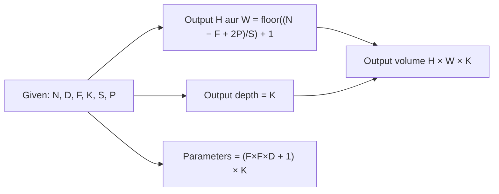

**Ek line mein:** output size <mark>$\lfloor (N - F + 2P)/S \rfloor + 1$</mark> hai aur depth <mark>$K$ (filters ki sankhya)</mark>, aur layer ke parameters <mark>$(F \times F \times D + 1) \times K$</mark> hote hain. <Cite id="class-dl-chp4" loc="slide 60" />

<Box kind="key">

**CNN numerical ke har question mein ye points likho:**

- <mark>Output height aur width $= \lfloor (N - F + 2P)/S \rfloor + 1$</mark>; <mark>output depth $= K$</mark>.
- <mark>Har filter ki depth uske input jitni hoti hai</mark>: filter $F \times F \times D$ ka hota hai.
- <mark>Parameters $= (F \times F \times D + 1) \times K$</mark>; $+1$ har filter ka bias hai.
- <mark>Stride aur padding output size badalte hain, parameters ki sankhya nahi</mark>.
- Image size parameter count mein nahi aata (weight sharing).
- Pipeline questions: convolution, phir ReLU (negative se 0), phir max pooling $(N - F)/S + 1$.

</Box>

## Core answer (5 marks, yahan ke har question ke liye)

<Box kind="definition">

The **trainable parameters** of a convolution layer are the weights of all its filters plus one bias per filter. Each filter covers the full depth of the input, so one filter has $F \times F \times D$ weights. <Cite id="class-dl-chp4" loc="slide 27" />

</Box>

**Symbols:** $N$ = input height ya width, $F$ = filter size, $P$ = padding, $S$ = stride, $D$ = input depth (channels), $K$ = filters ki sankhya.

**Method (3 steps):** <Cite id="class-dl-chp4" loc="slide 66" />

1. **Given values likho** ($N$, $D$, $F$, $K$, $S$, $P$).
2. **Output size:** height aur width ke liye $\lfloor (N - F + 2P)/S \rfloor + 1$; depth $= K$.
3. **Parameters:** $(F \times F \times D + 1) \times K$.

**Conclusion:** output shape $N$, $F$, $S$, $P$ se aati hai; parameter count sirf $F$, $D$, $K$ se. CS231n mein dono samjhaye gaye hain. <Cite id="web-dl-2-cs231n-cnn" />

## Extended answer (10 marks): ye add karo

### 1. Worked example: do convolution layers (Assignment 2, Q4d)

<Sum>

<Given>

input 100×100×3. Layer 1: 3×3 ke 8 filters, stride 1, padding 0. Layer 2: 3×3 ka 1 filter, stride 1, padding 0.

</Given>

<Find>

har layer ka output aur parameters (bias ke saath), aur total.

</Find>

<Steps>

1. **Layer 1 output:** $(100 - 3)/1 + 1 = 98$; depth = 8, yani **98×98×8**.
2. **Layer 1 parameters:** har filter 3×3×3 hai, isliye $(3 \cdot 3 \cdot 3 + 1) \times 8 = 28 \times 8 = 224$.
3. **Layer 2 output:** input ab 98×98×8 hai, isliye $(98 - 3)/1 + 1 = 96$; depth = 1, yani **96×96×1**.
4. **Layer 2 parameters:** filter 3×3×8 hona chahiye (naye input ki depth), isliye $(3 \cdot 3 \cdot 8 + 1) \times 1 = 73$.
5. **Total:** $224 + 73 = 297$.

</Steps>

<Answer>

98×98×8, 224 parameters; phir 96×96×1, 73 parameters; total 297.

</Answer>

<Box kind="verify">

Padding ke bina har 3×3 convolution height aur width se 2 kam karta hai ($100 \to 98 \to 96$). Layer 2 mein parameters kam hain kyunki sirf ek filter hai. Numbers class sheet se match karte hain. <Cite id="class-dl-chp4" loc="slide 54" />

</Box>

</Sum>

### 2. Is theme ke baaki numericals, wahi method

| Question | Output | Parameters |
|---|---|---|
| 64×64×32 input, 3×3 ke 64 filters, s1, p0 | $(64 - 3)/1 + 1 = 62$, yani 62×62×64 | $(3 \cdot 3 \cdot 32 + 1) \times 64 = 18{,}496$ (18,432 weights + 64 biases) |
| 224×224×3 input, 7×7 ke 5 filters, s1, p0 | $(224 - 7)/1 + 1 = 218$, yani 218×218×5 | $(7 \cdot 7 \cdot 3 + 1) \times 5 = 740$ |
| 6×6×1 input, ek 3×3 filter, s1, p0, ReLU, 2×2 max pool s2 | 4×4 map, pooling ke baad 2×2 | $(3 \cdot 3 \cdot 1 + 1) \times 1 = 10$ |

<Cite id="class-dl-chp4" loc="slide 60" /> <Cite id="class-dl-m4" loc="p. 30" />

**6×6 question alag kaise hai:** yahan numbers bhi calculate karne hote hain. Filter slide karo, 16 positions pe products ka sum lo to 4×4 map, phir ReLU, phir max pool. Rows (1, 0, −1) ke liye har value 3 rows ka (left pixel − right pixel) sum hai; result $\begin{bmatrix} 0 & 8 \\ 0 & 10 \end{bmatrix}$. <Cite id="class-dl-chp4" loc="slide 32" />

### 3. Interpretation ke liye likhne wali lines

- Padding na ho to height aur width kam hote hain, kyunki filter image ke andar fit hona chahiye.
- Output depth filters ki sankhya ke barabar hoti hai, kyunki har filter saare input channels se ek feature map banata hai.
- Parameters image size pe depend nahi karte (weight sharing); zyada filters ya deeper input se parameters badhte hain. <Cite id="web-dl-2-d2l-padding-strides" />

## Har question mein kaise fit karein

- **"Consider a CNN layer: 32 channels, 64×64, 64 filters 3×3, stride 1, no padding ... total number of parameters"** (10 marks) <PYQ id="2024-12/q4b" />: method, filter 3×3×32 = 288, 64 se multiply = 18,432 weights; 64 biases add karke 18,496; dono likho.
- **"A 100×100×3 RGB image ... first layer 8 filters ... second layer 1 filter ..."** (10 marks) <PYQ id="assignment-2/q4d" />: section 1 ka worked example line by line, phir interpretation.
- **"6×6×1 grayscale image, 3×3 filter, ReLU, 2×2 max pooling"** (10 marks) <PYQ id="assignment-2/q4e" />: (a) 4×4×1, (b) 4×4 map, (c) ReLU, (d) pooled 2×2, (e) 10 parameters, (f) filter vertical edges detect karta hai.
- **"A 224×224×3 RGB image ... 5 filters of 7×7 ..."** (10 marks) <PYQ id="assignment-2/q4f" />: 218×218×5 aur 740 parameters; input, 5 filters, output ka diagram sizes ke saath.

## Exam tips

- **Draw karo:** input, filters, output ka flow, har stage pe size ke saath.
- **Formula pehle likho,** phir substitute karo; method pe marks milte hain.
- Common galtiyan: dusri layer ke filter ki depth 3 lena (wo pichhle output ki depth jitni honi chahiye), bias bhoolna, ya image size ko parameter count mein daalna.

Exam mein English mein likho.
