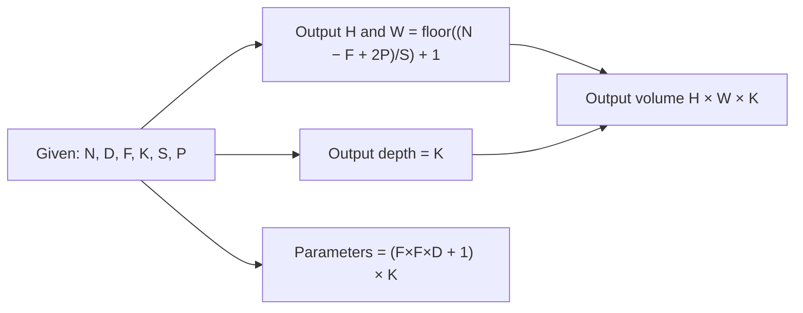

**In one line:** output size is <mark>$\lfloor (N - F + 2P)/S \rfloor + 1$</mark> with depth <mark>$K$ (the number of filters)</mark>, and the parameters of a layer are <mark>$(F \times F \times D + 1) \times K$</mark>. <Cite id="class-dl-chp4" loc="slide 60" />

<Box kind="key">

**Key points to write (any CNN numerical):**

- <mark>Output height and width $= \lfloor (N - F + 2P)/S \rfloor + 1$</mark>; <mark>output depth $= K$</mark>.
- <mark>Each filter has the depth of its input</mark>: a filter is $F \times F \times D$.
- <mark>Parameters $= (F \times F \times D + 1) \times K$</mark>; the $+1$ is the bias of each filter.
- <mark>Stride and padding change the output size, not the number of parameters</mark>.
- Image size does not appear in the parameter count (weight sharing).
- Pipeline questions: convolution, then ReLU (negative becomes 0), then max pooling $(N - F)/S + 1$.

</Box>

## Core answer (5 marks, fits every question here)

<Box kind="definition">

The **trainable parameters** of a convolution layer are the weights of all its filters plus one bias per filter. Each filter covers the full depth of the input, so one filter has $F \times F \times D$ weights. <Cite id="class-dl-chp4" loc="slide 27" />

</Box>

**Symbols:** $N$ = input height or width, $F$ = filter size, $P$ = padding, $S$ = stride, $D$ = input depth (channels), $K$ = number of filters.

**Method (3 steps):** <Cite id="class-dl-chp4" loc="slide 66" />

1. **Write the given values** ($N$, $D$, $F$, $K$, $S$, $P$).
2. **Output size:** $\lfloor (N - F + 2P)/S \rfloor + 1$ for height and width; depth $= K$.
3. **Parameters:** $(F \times F \times D + 1) \times K$.

**Conclusion:** the output shape comes from $N$, $F$, $S$, $P$; the parameter count comes from $F$, $D$, $K$ only. Both are explained in CS231n. <Cite id="web-dl-2-cs231n-cnn" />

## Extended answer (10 marks): add these

### 1. Worked example: two convolution layers (Assignment 2, Q4d)

<Sum>

<Given>

input 100×100×3. Layer 1: 8 filters of 3×3, stride 1, padding 0. Layer 2: 1 filter of 3×3, stride 1, padding 0.

</Given>

<Find>

output and parameters (with bias) of each layer, and the total.

</Find>

<Steps>

1. **Layer 1 output:** $(100 - 3)/1 + 1 = 98$; depth = 8, so **98×98×8**.
2. **Layer 1 parameters:** each filter is 3×3×3, so $(3 \cdot 3 \cdot 3 + 1) \times 8 = 28 \times 8 = 224$.
3. **Layer 2 output:** input is now 98×98×8, so $(98 - 3)/1 + 1 = 96$; depth = 1, so **96×96×1**.
4. **Layer 2 parameters:** the filter must be 3×3×8 (depth of the new input), so $(3 \cdot 3 \cdot 8 + 1) \times 1 = 73$.
5. **Total:** $224 + 73 = 297$.

</Steps>

<Answer>

98×98×8 with 224 parameters, then 96×96×1 with 73 parameters; total 297.

</Answer>

<Box kind="verify">

Each 3×3 convolution without padding removes 2 from height and width ($100 \to 98 \to 96$). Layer 2 has few parameters because it has only one filter. The numbers match the class sheet. <Cite id="class-dl-chp4" loc="slide 54" />

</Box>

</Sum>

### 2. The other numericals of this theme, solved by the same method

| Question | Output | Parameters |
|---|---|---|
| 64×64×32 input, 64 filters 3×3, s1, p0 | $(64 - 3)/1 + 1 = 62$, so 62×62×64 | $(3 \cdot 3 \cdot 32 + 1) \times 64 = 18{,}496$ (18,432 weights + 64 biases) |
| 224×224×3 input, 5 filters 7×7, s1, p0 | $(224 - 7)/1 + 1 = 218$, so 218×218×5 | $(7 \cdot 7 \cdot 3 + 1) \times 5 = 740$ |
| 6×6×1 input, one 3×3 filter, s1, p0, ReLU, 2×2 max pool s2 | 4×4 map, then 2×2 after pooling | $(3 \cdot 3 \cdot 1 + 1) \times 1 = 10$ |

<Cite id="class-dl-chp4" loc="slide 60" /> <Cite id="class-dl-m4" loc="p. 30" />

**How the 6×6 question differs:** you also compute the numbers. Slide the filter, take the sum of products at each of the 16 positions to get the 4×4 map, apply ReLU, then max pool. For rows (1, 0, −1) each value is the sum over 3 rows of (left pixel − right pixel); the result is $\begin{bmatrix} 0 & 8 \\ 0 & 10 \end{bmatrix}$. <Cite id="class-dl-chp4" loc="slide 32" />

### 3. Interpretation lines to write (for "interpret the result")

- Height and width shrink without padding, because the filter must fit inside the image.
- Output depth equals the number of filters, since each filter gives one feature map from all input channels.
- Parameters do not depend on image size (weight sharing); more filters or deeper input means more parameters. <Cite id="web-dl-2-d2l-padding-strides" />

## Fit it to each question

- **"Consider a CNN layer: 32 channels, 64×64, 64 filters 3×3, stride 1, no padding ... total number of parameters"** (10 marks) <PYQ id="2024-12/q4b" />: method, filter is 3×3×32 = 288, times 64 = 18,432 weights; add 64 biases for 18,496; state both.
- **"A 100×100×3 RGB image ... first layer 8 filters ... second layer 1 filter ..."** (10 marks) <PYQ id="assignment-2/q4d" />: the worked example in section 1 line by line, then the interpretation.
- **"6×6×1 grayscale image, 3×3 filter, ReLU, 2×2 max pooling"** (10 marks) <PYQ id="assignment-2/q4e" />: answer (a) 4×4×1, (b) the 4×4 map, (c) ReLU, (d) pooled 2×2, (e) 10 parameters, (f) the filter detects vertical edges.
- **"A 224×224×3 RGB image ... 5 filters of 7×7 ..."** (10 marks) <PYQ id="assignment-2/q4f" />: 218×218×5 and 740 parameters; draw input, 5 filters, output with the sizes.

## Exam tips

- **Draw** the flow input, filters, output with the size at each stage.
- **Always write the formula first,** then substitute; marks are given for the method.
- Common mistakes: using depth 3 for the second layer's filter (it must match the previous output depth), forgetting the bias, or putting image size into the parameter count.
