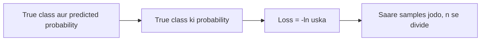

**Ek line mein:** har sample ke liye <mark>true class ko model ne jo probability di wo lo, loss $= -\ln$ uska</mark>, phir average lo: <mark>$\text{BCE} = -\dfrac{1}{n}\sum \big[y\ln\hat y + (1 - y)\ln(1 - \hat y)\big]$</mark>. <Cite id="class-dl-chp2" loc="slide 40" />

<Box kind="key">

**Ye points likho (method):**

- <mark>$y = 1$ ho to loss $-\ln \hat y$; $y = 0$ ho to loss $-\ln(1 - \hat y)$</mark>, jahan $\hat y$ class 1 ki predicted probability hai.
- <mark>Sahi class ko high probability to chhota loss; low probability to bada loss.</mark>
- Saare samples ke losses jodo aur **$n$ se divide** karo.
- <mark>Cross entropy confident galat prediction ko bahut zyada punish karta hai.</mark>
- Achha model: average loss 0 ke paas.
- Question kuch na bole to natural log use karo.

</Box>

## Core answer (5 marks): method

<Box kind="definition">

**Binary cross entropy** measures how far the predicted probability is from the true class (0 or 1). It is the usual loss for classification with a sigmoid output. <Cite id="class-dl-chp2" loc="slide 40" /> <Cite id="class-dl-m2" loc="p. 14" />

</Box>

**Steps:**

1. Har sample ke liye **true class ko di gayi probability** nikalo: $y = 1$ ho to $\hat y$, $y = 0$ ho to $1 - \hat y$.
2. Sample ka loss $= -\ln(\text{wo probability})$.
3. Saare samples ke losses jodo.
4. Samples ki ginti $n$ se divide karo.
5. Interpret karo: 0 ke paas achha, bada kharab.

| True class ko di gayi probability | Loss $-\ln p$ |
|---|---|
| 0.9 | 0.105 (chhota) |
| 0.5 | 0.693 |
| 0.1 | 2.303 (bada) |

**Conclusion:** model sahi aur pakka ho to cross entropy chhota hai, galat aur pakka ho to bahut bada. <Cite id="web-dl-1-wiki-xent" />

## Extended answer (10 marks): solve kiya hua question

Data assignment question bank se hai. <Cite id="class-dl-qb1" loc="p. 1" />

<Sum>

<Given>

Y_True = 1, 1, 0, 0 aur predicted probability (class 1 ki) = 0.8, 0.1, 0.1, 0.7.

</Given>

<Find>

cross-entropy loss aur uska interpretation.

</Find>

<Steps>

1. **Sample 1** ($y = 1$, $\hat y = 0.8$): $-\ln(0.8) = 0.2231$.
2. **Sample 2** ($y = 1$, $\hat y = 0.1$): $-\ln(0.1) = 2.3026$.
3. **Sample 3** ($y = 0$, $\hat y = 0.1$): $-\ln(1 - 0.1) = -\ln(0.9) = 0.1054$.
4. **Sample 4** ($y = 0$, $\hat y = 0.7$): $-\ln(1 - 0.7) = -\ln(0.3) = 1.2040$.
5. **Jodo:** $0.2231 + 2.3026 + 0.1054 + 1.2040 = 3.8351$.
6. **$n = 4$ pe average:** $3.8351/4 = 0.9588$.

</Steps>

<Answer>

Cross-entropy loss $\approx 0.959$.

</Answer>

<Box kind="verify">

Har loss se wapas jao: $e^{-0.2231} = 0.800$, $e^{-2.3026} = 0.100$, $e^{-0.1054} = 0.900$, $e^{-1.2040} = 0.300$. Ye har row mein true class ko di gayi probability se match karte hain.

</Box>

</Sum>

| Sample | True | Class 1 ki probability | True class ko di probability | Loss |
|---|---|---|---|---|
| 1 | 1 | 0.8 | 0.8 | 0.223 |
| 2 | 1 | 0.1 | 0.1 | 2.303 |
| 3 | 0 | 0.1 | 0.9 | 0.105 |
| 4 | 0 | 0.7 | 0.3 | 1.204 |

**Interpretation:** sample 1 aur 3 achhe predict hue (chhote loss). Sample 2 galat aur confident hai (true 1 ke liye 0.1), isliye uska loss 2.303 bahut bada hai; sample 4 bhi galat hai (true 0 ke liye 0.7). In do samples ne average ko 0.959 kar diya. Achhe model ka average loss 0 ke paas hota hai, isliye performance sirf moderate se poor hai: chaar mein se do predictions galat hain, aur confident galtiyan heavy punish hoti hain. <Cite id="class-dl-chp2" loc="slide 39" />

**Log base 2 use ho to** numbers ko $\ln 2 = 0.693$ se divide karo, lagbhag 1.383 aata hai; achhe aur kharab samples ka ranking nahi badalta.

## Har question mein kaise fit karein

- **"Numerical 2: Measure the Cross-Entropy Loss for the following data. Show the necessary calculations and interpret the obtained loss value by commenting on the model's prediction performance."** (10 marks) <PYQ id="assignment-1/q2e" />: formula aur method likho, phir per-sample table ke saath solved Sum aur average 0.959, phir interpretation: kaunse samples kharab hain aur loss kyun high hai.

## Exam tips

- **Hamesha table dikhao** jisme har sample ki ek row aur uska loss ho; har mark dikhta hai.
- $y = 0$ ke liye $-\ln(1 - \hat y)$ use karo; "1 minus" bhoolna common galti hai.
- End mein **interpretation** ki ek sentence likho (moderate ya poor, aur kyun).

Exam mein English mein likho.
