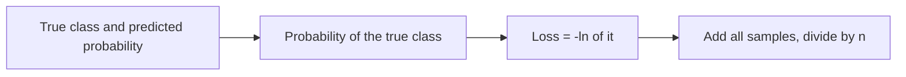

**In one line:** for each sample take <mark>the probability the model gave to the true class, loss $= -\ln$ of it</mark>, then average: <mark>$\text{BCE} = -\dfrac{1}{n}\sum \big[y\ln\hat y + (1 - y)\ln(1 - \hat y)\big]$</mark>. <Cite id="class-dl-chp2" loc="slide 40" />

<Box kind="key">

**Key points to write (the method):**

- <mark>If $y = 1$ the loss is $-\ln \hat y$; if $y = 0$ the loss is $-\ln(1 - \hat y)$</mark>, where $\hat y$ is the predicted probability of class 1.
- <mark>A high probability for the right class gives a small loss; a low one gives a large loss.</mark>
- Sum the losses of all samples and **divide by $n$**.
- <mark>Cross entropy punishes a confident wrong prediction very heavily.</mark>
- Good model: average loss close to 0.
- Use the natural log unless the question says otherwise.

</Box>

## Core answer (5 marks): the method

<Box kind="definition">

**Binary cross entropy** measures how far the predicted probability is from the true class (0 or 1). It is the usual loss for classification with a sigmoid output. <Cite id="class-dl-chp2" loc="slide 40" /> <Cite id="class-dl-m2" loc="p. 14" />

</Box>

**Steps:**

1. For every sample find the **probability given to the true class**: $\hat y$ if $y = 1$, and $1 - \hat y$ if $y = 0$.
2. Loss of the sample $= -\ln(\text{that probability})$.
3. Add the losses of all samples.
4. Divide by the number of samples $n$.
5. Interpret: near 0 is good, large is bad.

| Probability given to the true class | Loss $-\ln p$ |
|---|---|
| 0.9 | 0.105 (small) |
| 0.5 | 0.693 |
| 0.1 | 2.303 (large) |

**Conclusion:** cross entropy is small when the model is right and sure, and very large when it is wrong and sure. <Cite id="web-dl-1-wiki-xent" />

## Extended answer (10 marks): the solved question

The data is from the assignment question bank. <Cite id="class-dl-qb1" loc="p. 1" />

<Sum>

<Given>

Y_True = 1, 1, 0, 0 and predicted probability (of class 1) = 0.8, 0.1, 0.1, 0.7.

</Given>

<Find>

the cross-entropy loss and its interpretation.

</Find>

<Steps>

1. **Sample 1** ($y = 1$, $\hat y = 0.8$): $-\ln(0.8) = 0.2231$.
2. **Sample 2** ($y = 1$, $\hat y = 0.1$): $-\ln(0.1) = 2.3026$.
3. **Sample 3** ($y = 0$, $\hat y = 0.1$): $-\ln(1 - 0.1) = -\ln(0.9) = 0.1054$.
4. **Sample 4** ($y = 0$, $\hat y = 0.7$): $-\ln(1 - 0.7) = -\ln(0.3) = 1.2040$.
5. **Add:** $0.2231 + 2.3026 + 0.1054 + 1.2040 = 3.8351$.
6. **Average over $n = 4$:** $3.8351/4 = 0.9588$.

</Steps>

<Answer>

Cross-entropy loss $\approx 0.959$.

</Answer>

<Box kind="verify">

Go back from each loss: $e^{-0.2231} = 0.800$, $e^{-2.3026} = 0.100$, $e^{-0.1054} = 0.900$, $e^{-1.2040} = 0.300$. These match the probability given to the true class in every row.

</Box>

</Sum>

| Sample | True | Probability of class 1 | Probability given to the true class | Loss |
|---|---|---|---|---|
| 1 | 1 | 0.8 | 0.8 | 0.223 |
| 2 | 1 | 0.1 | 0.1 | 2.303 |
| 3 | 0 | 0.1 | 0.9 | 0.105 |
| 4 | 0 | 0.7 | 0.3 | 1.204 |

**Interpretation:** samples 1 and 3 are predicted well (small losses). Sample 2 is wrong and confident (0.1 for a true 1), so its loss 2.303 is very large; sample 4 is also wrong (0.7 for a true 0). These two samples raise the average to 0.959. A good model has an average loss close to 0, so the performance is only moderate to poor: two of four predictions are wrong, and confident mistakes are punished heavily. <Cite id="class-dl-chp2" loc="slide 39" />

**If log base 2 is used** the numbers are divided by $\ln 2 = 0.693$, giving about 1.383; the ranking of good and bad samples does not change.

## Fit it to each question

- **"Numerical 2: Measure the Cross-Entropy Loss for the following data. Show the necessary calculations and interpret the obtained loss value by commenting on the model's prediction performance."** (10 marks) <PYQ id="assignment-1/q2e" />: write the formula and method, then the solved Sum with the per-sample table and the average 0.959, then the interpretation: which samples are bad and why the loss is high.

## Exam tips

- **Always show** a table with one row per sample and its loss; it makes every mark visible.
- For $y = 0$ use $-\ln(1 - \hat y)$; forgetting the "1 minus" is the common mistake.
- End with a sentence on the **interpretation** (moderate or poor, and why).
