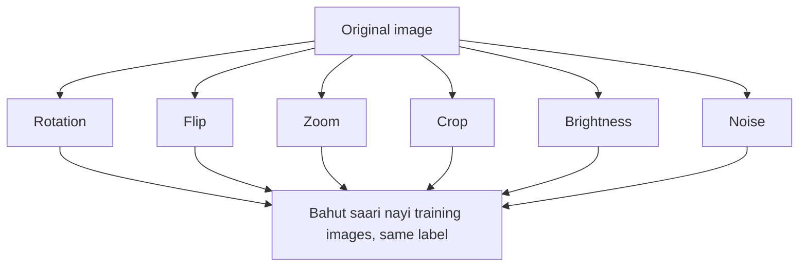

**Ek line mein:** <mark>data augmentation maujooda data ko modify karke naye training samples banata hai</mark>; naye samples wahi object (wahi label) dikhate hain lekin model ko alag dikhte hain. <Cite id="class-dl-chp2" loc="slide 115" />

<Box kind="key">

**Ye points likho:**

- <mark>Data augmentation naya data collect kiye bina training dataset ki diversity badhata hai.</mark>
- Kyun: chhote dataset mein model object ki jagah **background, lighting aur camera angle** ratta maarta hai (overfitting); naya data mehnga ya impossible (medical images).
- <mark>Image ke chhe types: rotation, flipping, zooming, cropping, brightness adjustment, noise addition.</mark>
- **Label nahi badalta:** flip kiya hua apple bhi Apple hai.
- **Text** (synonym replacement, back translation) aur **audio** (time stretching, pitch shifting, noise) ke liye bhi.
- Advantages: zyada data, kam overfitting, robust model. Disadvantages: lambi training, bahut zyada augmentation nuksaan kar sakta hai.

</Box>

## Core answer (5 marks, yahan ke har question ke liye)

<Box kind="definition">

**Data augmentation** creates new training samples by modifying the existing data. The modified images still represent the same object but look different to the model. It increases the diversity of the training dataset. <Cite id="class-dl-chp2" loc="slide 115" />

</Box>

**Kyun chahiye:** deep learning ko bahut data chahiye. Chhote dataset mein model object ki jagah background, lighting aur camera angle ratta maarta hai, yahi overfitting hai. Naya data collect karna time-consuming, mehnga aur kabhi kabhi impossible hai. <Cite id="class-dl-chp2" loc="slide 115" />

| Type | Kya badalta hai | Model ko kisme madad |
|---|---|---|
| Rotation | Ek angle se ghumaya (jaise 20°) | Alag orientations |
| Flipping | Horizontal ya vertical mirror | Mirrored objects |
| Zooming | Zoom in ya out | Alag distances |
| Cropping | Image ka ek hissa hata diya | Aadhe dikhte objects |
| Brightness | Zyada ya kam bright | Alag lighting |
| Noise | Chhota random noise add | Noisy inputs |

<Cite id="class-dl-chp2" loc="slide 116" />

**Conclusion:** data augmentation model ko sikhata hai ki ek hi object alag dikh sakta hai, isliye wo naye conditions mein bhi pehchanta hai. <Cite id="web-dl-1-wiki-aug" />

## Extended answer (10 marks): ye add karo

### 1. Textbook ke aur image types

Colour changes, cutout ya random erasing, **mixup** (do images aur unke labels combine), aur affine ya perspective transformations. <Cite id="class-dl-m2" loc="p. 89" />

### 2. Doosre data types

- **Text:** synonym replacement, back translation, random insertion, deletion ya swap, BERT se contextual augmentation.
- **Audio:** time stretching, pitch shifting, noise add karna, time mein shift, speed badalna.
- Health care data mein dhyaan rakho: change se sample ka matlab nahi badalna chahiye. <Cite id="class-dl-m2" loc="pp. 90-92" />

### 3. Aise changes chuno jo label na badlein

Change tabhi valid hai jab label sahi rahe. Apple ki photo flip karna theek hai; digit 2 ko mirror karna ya 6 ko ulta karna theek nahi, kyunki wo wahi class nahi dikhata. <Cite id="web-dl-1-gb-reg" loc="§7.4" />

### 4. Chhota count example

<Sum>

<Given>

1000 training images aur har image ke 6 augmentations (rotation, flip, zoom, crop, brightness, noise).

</Given>

<Find>

augmentation ke baad training set ka size.

</Find>

<Steps>

1. Nayi images $= 1000 \times 6 = 6000$.
2. Originals ke saath: $1000 + 6000 = 7000$.

</Steps>

<Answer>

7000 training images, 1000 collected images se.

</Answer>

</Sum>

Practice mein changes aksar har epoch mein randomly on the fly lagaye jaate hain, isliye stored dataset bada nahi hota.

### 5. Advantages aur disadvantages

| Advantages | Disadvantages |
|---|---|
| Collect kiye bina zyada data | Training time zyada |
| Kam overfitting, better generalization | Bahut zyada augmentation accuracy kam kar sakta hai |
| Zyada robust model | Kuch changes har dataset ke liye suit nahi karte |

<Cite id="class-dl-chp2" loc="slide 116" />

## Har question mein kaise fit karein

- **"Describe the concept of data augmentation and illustrate its different types with suitable examples."** (10 marks) <PYQ id="assignment-1/q2b" />: **core answer** (definition, why, examples ke saath chhe types aur flow picture), phir section 2 aur 5 (text aur audio, advantages aur disadvantages). Time ho to section 1 aur 3 add karo.

## Exam tips

- **Hamesha draw karo** ek original image aur chhe arrows, aur har type ka ek example do.
- "**Label does not change**" likho; ye key idea hai.
- Likho ki augmentation sirf **training set** pe lagta hai, test set pe kabhi nahi.

Exam mein English mein likho.
