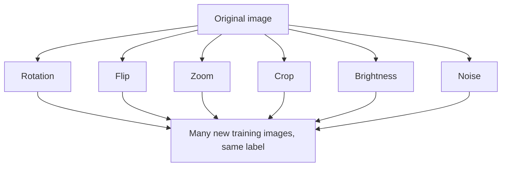

**In one line:** <mark>data augmentation creates new training samples by modifying the existing data</mark>; the new samples still show the same object (same label) but look different to the model. <Cite id="class-dl-chp2" loc="slide 115" />

<Box kind="key">

**Key points to write:**

- <mark>Data augmentation increases the diversity of the training dataset without collecting new data.</mark>
- Why: a small dataset makes the model memorize the **background, lighting and camera angle** (overfitting); new data is costly or impossible (medical images).
- <mark>Six image types: rotation, flipping, zooming, cropping, brightness adjustment, noise addition.</mark>
- The **label does not change**: a flipped apple is still an Apple.
- Also for **text** (synonym replacement, back translation) and **audio** (time stretching, pitch shifting, adding noise).
- Advantages: more data, less overfitting, robust model. Disadvantages: longer training, too much augmentation can hurt.

</Box>

## Core answer (5 marks, fits every question here)

<Box kind="definition">

**Data augmentation** creates new training samples by modifying the existing data. The modified images still represent the same object but look different to the model. It increases the diversity of the training dataset. <Cite id="class-dl-chp2" loc="slide 115" />

</Box>

**Why needed:** deep learning needs a lot of data. A small dataset makes the model memorize the background, lighting and camera angle instead of the object, which is overfitting. Collecting new data is time-consuming, expensive and sometimes impossible. <Cite id="class-dl-chp2" loc="slide 115" />

| Type | What changes | Helps the model with |
|---|---|---|
| Rotation | Turned by an angle (for example 20°) | Different orientations |
| Flipping | Mirrored horizontally or vertically | Mirrored objects |
| Zooming | Zoomed in or out | Different distances |
| Cropping | Part of the image removed | Partly visible objects |
| Brightness | Brighter or darker | Different lighting |
| Noise | Small random noise added | Noisy inputs |

<Cite id="class-dl-chp2" loc="slide 116" />

**Conclusion:** data augmentation teaches the model that the same object can look different, so it recognizes it in new conditions. <Cite id="web-dl-1-wiki-aug" />

## Extended answer (10 marks): add these

### 1. More image types from the textbook

Colour changes, cutout or random erasing, **mixup** (combine two images and their labels) and affine or perspective transformations. <Cite id="class-dl-m2" loc="p. 89" />

### 2. Other data types

- **Text:** synonym replacement, back translation, random insertion, deletion or swap, contextual augmentation with BERT.
- **Audio:** time stretching, pitch shifting, adding noise, shifting in time, changing speed.
- Be careful with health care data: a change must not alter the meaning of the sample. <Cite id="class-dl-m2" loc="pp. 90-92" />

### 3. Choose changes that keep the label

A change is valid only if the label stays true. Flipping a photo of an apple is fine; mirroring the digit 2 or turning a 6 upside down is not, because it no longer shows the same class. <Cite id="web-dl-1-gb-reg" loc="§7.4" />

### 4. Small count example

<Sum>

<Given>

1000 training images and 6 augmentations per image (rotation, flip, zoom, crop, brightness, noise).

</Given>

<Find>

the size of the training set after augmentation.

</Find>

<Steps>

1. New images $= 1000 \times 6 = 6000$.
2. Together with the originals: $1000 + 6000 = 7000$.

</Steps>

<Answer>

7000 training images, from 1000 collected ones.

</Answer>

</Sum>

In practice the changes are usually applied randomly on the fly in every epoch, so the stored dataset does not grow.

### 5. Advantages and disadvantages

| Advantages | Disadvantages |
|---|---|
| More data without collecting it | Longer training time |
| Less overfitting, better generalization | Too much augmentation may reduce accuracy |
| More robust model | Some changes do not suit every dataset |

<Cite id="class-dl-chp2" loc="slide 116" />

## Fit it to each question

- **"Describe the concept of data augmentation and illustrate its different types with suitable examples."** (10 marks) <PYQ id="assignment-1/q2b" />: the **core answer** (definition, why, the six types with examples and the flow picture), then sections 2 and 5 (text and audio, advantages and disadvantages). Add sections 1 and 3 if time allows.

## Exam tips

- **Always draw** one original image with the six arrows and give one example for each type.
- Write "**label does not change**"; it is the key idea.
- Mention that augmentation is applied to the **training set only**, never to the test set.
