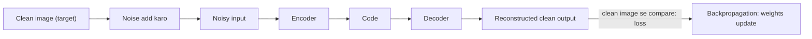
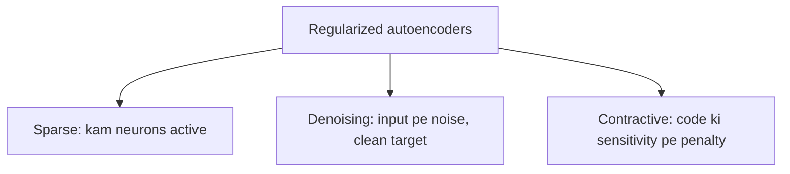

**Ek line mein:** <mark>Denoising Autoencoder (DAE) ek autoencoder hai jo noisy input leta hai lekin original clean input ko reconstruct karna seekhta hai</mark>: Noisy Input → Autoencoder → Clean Output. <Cite id="class-dl-chp3" loc="slide 23" />

<Box kind="key">

**Ye points likho:**

- <mark>Main idea: Noisy Input → Autoencoder → Clean Output.</mark>
- <mark>Input (noisy) ≠ Target (clean)</mark>: loss (MSE ya MAE) **clean** input ke against nikalta hai.
- Kyun: real-world data noisy ya corrupted hota hai, aur normal autoencoder noise samet input copy karna seekh sakta hai.
- Wo input seedha copy nahi kar sakta, isliye use **important underlying features** seekhne padte hain; isse overfitting bhi kam hoti hai.
- Noise types: **Gaussian, salt-and-pepper, masking, speckle.**
- Applications: image denoising, restoration, medical images, speech denoising, watermark hatana.

</Box>

## Core answer (5 marks, yahan ke har question ke liye)

<Box kind="definition">

A **Denoising Autoencoder (DAE)** is an autoencoder that receives a noisy input but is trained to reconstruct the original clean input. Main idea: Noisy Input → Autoencoder → Clean Output. <Cite id="class-dl-chp3" loc="slide 23" />

</Box>

**Kyun chahiye:** real-world data noisy ya corrupted hota hai. Normal autoencoder jo bhi diya jaye wo copy karna seekh sakta hai, noise samet. <Cite id="class-dl-chp3" loc="slide 23" />

**Training:** clean image mein noise add karo, encoder ko do, decoder reconstruct kare, **clean target** se compare karo (MSE ya MAE), phir backpropagate karke weights update karo. <Cite id="class-dl-chp3" loc="slide 24" />

**Key point:** Input (noisy) ≠ Target (clean). Model input copy nahi kar sakta, isliye use important underlying features seekhne padte hain, jisse overfitting bhi kam hoti hai. Textbook kehti hai ki autoencoder ko dikhne wala input "raw input nahi balki stochastically corrupted version" hota hai. <Cite id="class-dl-m3" loc="p. 26" />

**Conclusion:** DAE = noise hatao aur clean data reconstruct karo. <Cite id="web-dl-1-paper-dae" />

## Extended answer (10 marks): ye add karo

### 1. Noise ke types

| Noise | Kya karta hai |
|---|---|
| Gaussian | Har pixel mein chhote random values add karta hai |
| Salt-and-pepper | Kuch pixels ko pure white ya pure black kar deta hai |
| Masking | Input ke ek random hisse ko 0 kar deta hai |
| Speckle | Pixels ko random values se multiply karta hai (grainy look) |

<Cite id="class-dl-chp3" loc="slide 24" />

### 2. Normal autoencoder vs denoising autoencoder

| | Normal autoencoder | Denoising autoencoder |
|---|---|---|
| Input | Clean | Corrupted (noisy) |
| Target | Input khud | Clean original |
| Risk | Noise samet input copy karta hai | Copy nahi kar sakta, features seekhne padte hain |
| Result | Reconstruction | Reconstruction + noise removal |

<Cite id="class-dl-chp3" loc="slides 23 and 24" />

### 3. Training pair ka chhota example (made up)

<Sum>

<Given>

clean pixel row $x = (0.2, 0.8, 0.5, 0.9)$; masking noise 2nd aur 4th values ko 0 kar deta hai.

</Given>

<Find>

noisy input, target aur squared error agar network $(0.2, 0.7, 0.5, 0.8)$ output de.

</Find>

<Steps>

1. **Noisy input:** $\tilde x = (0.2, 0, 0.5, 0)$.
2. **Target:** clean $x = (0.2, 0.8, 0.5, 0.9)$, $\tilde x$ nahi.
3. **Clean target ke against errors:** $(0, 0.1, 0, 0.1)$.
4. **MSE:** $(0 + 0.01 + 0 + 0.01) / 4 = 0.005$.

</Steps>

<Answer>

Input $(0.2, 0, 0.5, 0)$, target $(0.2, 0.8, 0.5, 0.9)$, MSE $= 0.005$.

</Answer>

</Sum>

Network ko bache hue pixels se missing pixels guess karne padte hain, isliye wo seekhta hai ki input ke hisse ek doosre se kaise jude hain. <Cite id="web-dl-1-gb-ae" loc="§14.2.2" />

### 4. Applications, advantages, limits

- **Applications:** image denoising, image restoration, medical image processing, speech denoising, watermark hatana.
- **Advantages:** noise hatata hai, robust features seekhta hai, overfitting kam karta hai.
- **Limits:** suitable kind aur amount ka noise chahiye; bahut zyada noise real details bhi hata sakta hai.

## Har question mein kaise fit karein

- **"Explain denoising auto encoder model."** (5 marks) <PYQ id="2023-12/q1d" />: **core answer** likho: definition, kyun chahiye, training diagram, training steps, key point aur applications.
- **"What are Denoising Autoencoders?"** (5 marks) <PYQ id="2024-12/q1d" />: wahi **core answer**; definition line, "Input (noisy) ≠ Target (clean)" aur diagram pe zor do. Extra marks ke liye noise-types table add karo.

## Exam tips

- **Hamesha draw karo** chain: clean image, noise add, encoder, code, decoder, output, aur dikhao ki loss kahan nikalta hai (**clean** image ke against).
- Teen keywords likho: **noisy input, clean target, robust features.**
- Ye mat likho ki loss noisy input ke against hai; sabse common galti yahi hai.

Exam mein English mein likho.
