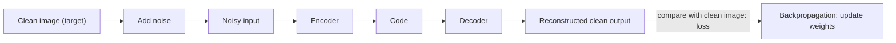
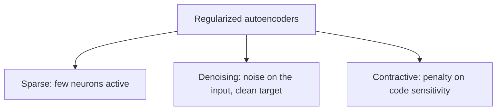

**In one line:** <mark>a Denoising Autoencoder (DAE) is an autoencoder that receives a noisy input but is trained to reconstruct the original clean input</mark>: Noisy Input → Autoencoder → Clean Output. <Cite id="class-dl-chp3" loc="slide 23" />

<Box kind="key">

**Key points to write:**

- <mark>Main idea: Noisy Input → Autoencoder → Clean Output.</mark>
- <mark>Input (noisy) ≠ Target (clean)</mark>: the loss (MSE or MAE) is calculated against the **clean** input.
- Why: real-world data is noisy or corrupted, and a normal autoencoder may learn to copy the input including the noise.
- Because it cannot just copy the input, it must learn the **important underlying features**; this also reduces overfitting.
- Noise types: **Gaussian, salt-and-pepper, masking, speckle.**
- Applications: image denoising, restoration, medical images, speech denoising, removing watermarks.

</Box>

## Core answer (5 marks, fits every question here)

<Box kind="definition">

A **Denoising Autoencoder (DAE)** is an autoencoder that receives a noisy input but is trained to reconstruct the original clean input. Main idea: Noisy Input → Autoencoder → Clean Output. <Cite id="class-dl-chp3" loc="slide 23" />

</Box>

**Why it is needed:** real-world data is noisy or corrupted. A normal autoencoder may learn to copy whatever it is given, including the noise. <Cite id="class-dl-chp3" loc="slide 23" />

**Training:** add noise to a clean image, feed it to the encoder, let the decoder reconstruct, compare with the **clean target** (MSE or MAE), then backpropagate and update the weights. <Cite id="class-dl-chp3" loc="slide 24" />

**Key point:** Input (noisy) ≠ Target (clean). Because the model cannot just copy the input, it must learn the important underlying features, which also reduces overfitting. The textbook says the input seen by the autoencoder "is not the raw input but a stochastically corrupted version". <Cite id="class-dl-m3" loc="p. 26" />

**Conclusion:** DAE = denoise and reconstruct clean data. <Cite id="web-dl-1-paper-dae" />

## Extended answer (10 marks): add these

### 1. Types of noise

| Noise | What it does |
|---|---|
| Gaussian | Adds small random values to every pixel |
| Salt-and-pepper | Sets some pixels to pure white or pure black |
| Masking | Sets a random part of the input to 0 |
| Speckle | Multiplies pixels by random values (grainy look) |

<Cite id="class-dl-chp3" loc="slide 24" />

### 2. Normal autoencoder vs denoising autoencoder

| | Normal autoencoder | Denoising autoencoder |
|---|---|---|
| Input | Clean | Corrupted (noisy) |
| Target | The input itself | The clean original |
| Risk | Copies the input, noise included | Cannot copy, must learn features |
| Result | Reconstruction | Reconstruction + noise removal |

<Cite id="class-dl-chp3" loc="slides 23 and 24" />

### 3. Small example of the training pair (made up)

<Sum>

<Given>

a clean pixel row $x = (0.2, 0.8, 0.5, 0.9)$; masking noise sets the 2nd and 4th values to 0.

</Given>

<Find>

the noisy input, the target and the squared error if the network outputs $(0.2, 0.7, 0.5, 0.8)$.

</Find>

<Steps>

1. **Noisy input:** $\tilde x = (0.2, 0, 0.5, 0)$.
2. **Target:** the clean $x = (0.2, 0.8, 0.5, 0.9)$, not $\tilde x$.
3. **Errors against the clean target:** $(0, 0.1, 0, 0.1)$.
4. **MSE:** $(0 + 0.01 + 0 + 0.01) / 4 = 0.005$.

</Steps>

<Answer>

Input $(0.2, 0, 0.5, 0)$, target $(0.2, 0.8, 0.5, 0.9)$, MSE $= 0.005$.

</Answer>

</Sum>

The network has to guess the missing pixels from the remaining ones, so it learns how the parts of an input relate to each other. <Cite id="web-dl-1-gb-ae" loc="§14.2.2" />

### 4. Applications, advantages, limits

- **Applications:** image denoising, image restoration, medical image processing, speech denoising, removing watermarks.
- **Advantages:** removes noise, learns robust features, reduces overfitting.
- **Limits:** needs a suitable kind and amount of noise; too much noise may remove real details.

## Fit it to each question

- **"Explain denoising auto encoder model."** (5 marks) <PYQ id="2023-12/q1d" />: write the **core answer**: definition, why needed, the training diagram, the training steps, the key point and the applications.
- **"What are Denoising Autoencoders?"** (5 marks) <PYQ id="2024-12/q1d" />: same **core answer**; stress the definition line, "Input (noisy) ≠ Target (clean)" and the diagram. Add the noise-types table for extra marks.

## Exam tips

- **Always draw** the chain: clean image, add noise, encoder, code, decoder, output, and mark where the loss is calculated (against the **clean** image).
- Write the three keywords: **noisy input, clean target, robust features.**
- Do not say the loss is against the noisy input; that is the most common mistake.
