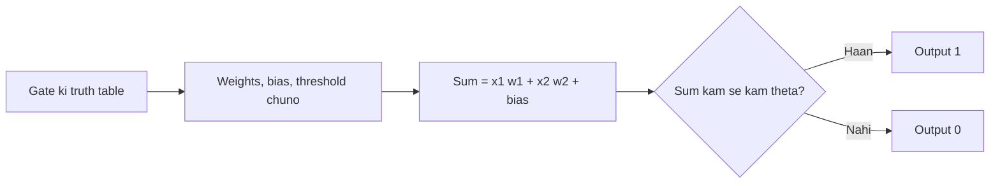
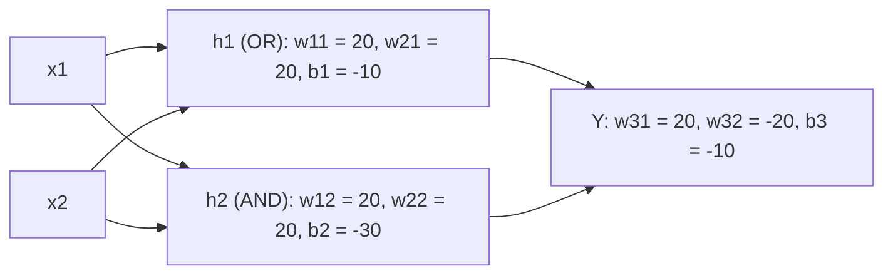

**Ek line mein:** perceptron <mark>Sum $= x_1w_1 + x_2w_2 + \text{Bias}$ nikalta hai aur Sum $\ge \theta$ ho to output 1, warna 0</mark> deta hai; AND ke liye ye kaafi hai, lekin <mark>XOR linearly separable nahi hai, isliye use hidden layer (MLP) chahiye</mark>. <Cite id="class-dl-chp1" loc="slide 18" /> <Cite id="class-dl-chp1" loc="slide 23" />

<Box kind="key">

**Har gate question mein ye points likho:**

- <mark>Perceptron: sabse simple neural network, binary classification ke liye.</mark>
- <mark>AND gate: output 1 sirf tab jab saare inputs 1 hon.</mark> Design: $w_1 = w_2 = 1$, bias $= 0$, threshold $\theta = 2$.
- Rule: <mark>Sum $\ge \theta$ to 1, warna 0</mark>. Hamesha Sum column ke saath **truth table** dikhao.
- <mark>XOR linearly separable nahi hai</mark>: koi ek seedhi line (0,1) aur (1,0) ko (0,0) aur (1,1) se alag nahi kar sakti.
- <mark>XOR ko 2-2-1 MLP solve karta hai</mark>: hidden neuron 1 = OR, hidden neuron 2 = AND, output = "OR but not AND".
- Hidden layer **non-linear decision boundary** deti hai.

</Box>

## Core answer (5 marks, yahan ke har question ke liye)

<Box kind="definition">

A **perceptron** is the simplest neural network, used for binary classification. It multiplies each input with a weight, adds a bias and compares the sum with a threshold. <Cite id="class-dl-chp1" loc="slide 13" />

</Box>

**Perceptron se gate design karne ka method:** <Cite id="class-dl-chp1" loc="slide 18" />

1. Gate ki **truth table** likho.
2. Weights $w_1, w_2$, bias aur threshold $\theta$ chuno.
3. Har row ke liye Sum $= x_1w_1 + x_2w_2 + \text{Bias}$ nikalo.
4. Sum $\ge \theta$ ho to output 1, warna 0.
5. Check karo ki saari rows truth table se match karti hain.

**AND gate design:** $w_1 = w_2 = 1$, bias $= 0$, $\theta = 2$. <Cite id="class-dl-chp1" loc="slide 18" />

| $x_1$ | $x_2$ | Sum $= x_1 \cdot 1 + x_2 \cdot 1$ | Output |
|---|---|---|---|
| 0 | 0 | 0 | 0 (0 < 2) |
| 0 | 1 | 1 | 0 (1 < 2) |
| 1 | 0 | 1 | 0 (1 < 2) |
| 1 | 1 | 2 | 1 (2 ≥ 2) |

**Conclusion:** output sirf tab 1 hai jab dono inputs 1 hain, isliye AND gate ek perceptron se design ho gaya. <Cite id="web-dl-1-wiki-perceptron" />

## Extended answer (10 marks): ye add karo

### 1. Ek perceptron XOR kyun nahi kar sakta

XOR tab 1 deta hai jab exactly ek input 1 ho. Points (0,1) aur (1,0) class 1 hain; (0,0) aur (1,1) class 0. Seedhi line kaise bhi kheencho, ek point galat classify hota hai, isliye XOR **linearly separable nahi hai**. <Cite id="class-dl-m1" loc="p. 6" />

### 2. XOR network ka design (2-2-1 MLP)

Do inputs lo, do neurons ki hidden layer add karo, hidden neurons ko output neuron $Y$ se jodo aur sigmoid (ya step) activation use karo. <Cite id="class-dl-chp1" loc="slide 24" />

<Sum>

<Given>

sigmoid neurons ka 2-2-1 network: $w_{11} = w_{21} = 20$, $b_1 = -10$; $w_{12} = w_{22} = 20$, $b_2 = -30$; $w_{31} = 20$, $w_{32} = -20$, $b_3 = -10$.

</Given>

<Find>

har input pair ke liye output $Y$.

</Find>

<Steps>

1. **Hidden neuron 1:** $z_1 = 20x_1 + 20x_2 - 10$ yani (0,0), (0,1), (1,0), (1,1) ke liye $-10, 10, 10, 30$, to $h_1 \approx 0, 1, 1, 1$ (OR).
2. **Hidden neuron 2:** $z_2 = 20x_1 + 20x_2 - 30$ yani $-30, -10, -10, 10$, to $h_2 \approx 0, 0, 0, 1$ (AND).
3. **Output neuron:** $z_3 = 20h_1 - 20h_2 - 10$ yani $-10, 10, 10, -10$.
4. **Sigmoid:** $\sigma(-10) \approx 0.00005 \approx 0$ aur $\sigma(10) \approx 0.99995 \approx 1$.

</Steps>

<Answer>

$Y = 0, 1, 1, 0$: XOR truth table.

</Answer>

<Box kind="verify">

(1,1) check: $h_1 = h_2 = 1$, to $z_3 = 20 - 20 - 10 = -10$ aur $Y \approx 0$, sahi. (0,1) check: $h_1 = 1$, $h_2 = 0$, to $z_3 = 10$ aur $Y \approx 1$, sahi.

</Box>

</Sum>

| $x_1$ | $x_2$ | $h_1$ (OR) | $h_2$ (AND) | $Y$ |
|---|---|---|---|---|
| 0 | 0 | 0 | 0 | 0 |
| 0 | 1 | 1 | 0 | 1 |
| 1 | 0 | 1 | 0 | 1 |
| 1 | 1 | 1 | 1 | 0 |

### 3. Perceptron vs MLP

| | Single perceptron | MLP (2-2-1) |
|---|---|---|
| Hidden layer | Nahi | Ek ya zyada |
| Decision boundary | Ek seedhi line | Non-linear |
| Gates solve | AND, OR | AND, OR aur XOR |

<Cite id="class-dl-chp1" loc="slide 16" /> <Cite id="web-dl-1-d2l-mlp" />

## Har question mein kaise fit karein

- **"Design AND gate using Perceptron."** (5 marks) <PYQ id="2023-12/q1a" />: **core answer** likho: truth table, weights 1 aur 1, threshold 2, Sum table aur diagram.
- **"Design and solve a Multi-Layer Perceptron (MLP) for the XOR gate using a suitable example."** (10 marks) <PYQ id="assignment-1/q1c" />: section 1 aur 2 poore: XOR table, ek perceptron kyun fail, 2-2-1 design, worked Sum aur final table. Core answer ke method ki ek line add karo.

## Exam tips

- **Hamesha draw karo** truth table aur network, arrows pe weights likho.
- Table se pehle **rule** likho (Sum $\ge \theta$ to 1); method ke marks wahin se milte hain.
- XOR mein "OR and not AND" likho aur har row dikhao; sirf final weights mat likho.

Exam mein English mein likho.
