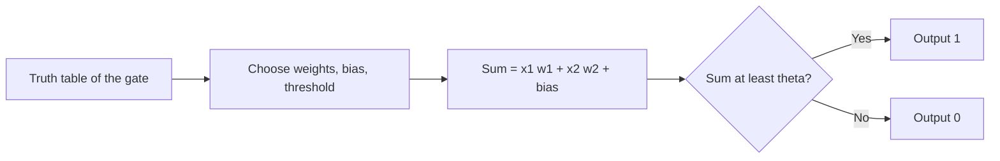
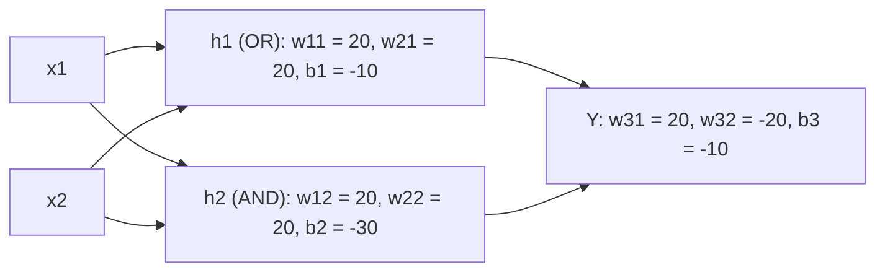

**In one line:** a perceptron computes <mark>Sum $= x_1w_1 + x_2w_2 + \text{Bias}$ and gives output 1 if Sum $\ge \theta$, else 0</mark>; this is enough for AND, but <mark>XOR is not linearly separable, so it needs a hidden layer (an MLP)</mark>. <Cite id="class-dl-chp1" loc="slide 18" /> <Cite id="class-dl-chp1" loc="slide 23" />

<Box kind="key">

**Key points to write (any gate question):**

- <mark>Perceptron: the simplest neural network, used for binary classification.</mark>
- <mark>AND gate: output 1 only when all inputs are 1.</mark> Design: $w_1 = w_2 = 1$, bias $= 0$, threshold $\theta = 2$.
- Rule: <mark>Sum $\ge \theta$ gives 1, otherwise 0</mark>. Always show the **truth table** with the Sum column.
- <mark>XOR is not linearly separable</mark>: no single straight line separates (0,1) and (1,0) from (0,0) and (1,1).
- <mark>XOR is solved by a 2-2-1 MLP</mark>: hidden neuron 1 = OR, hidden neuron 2 = AND, output = "OR but not AND".
- Hidden layer gives a **non-linear decision boundary**.

</Box>

## Core answer (5 marks, fits every question here)

<Box kind="definition">

A **perceptron** is the simplest neural network, used for binary classification. It multiplies each input with a weight, adds a bias and compares the sum with a threshold. <Cite id="class-dl-chp1" loc="slide 13" />

</Box>

**Method to design a gate with a perceptron:** <Cite id="class-dl-chp1" loc="slide 18" />

1. Write the **truth table** of the gate.
2. Choose weights $w_1, w_2$, bias and threshold $\theta$.
3. Find Sum $= x_1w_1 + x_2w_2 + \text{Bias}$ for every row.
4. If Sum $\ge \theta$ the output is 1, else 0.
5. Check that all rows match the truth table.

**AND gate design:** $w_1 = w_2 = 1$, bias $= 0$, $\theta = 2$. <Cite id="class-dl-chp1" loc="slide 18" />

| $x_1$ | $x_2$ | Sum $= x_1 \cdot 1 + x_2 \cdot 1$ | Output |
|---|---|---|---|
| 0 | 0 | 0 | 0 (0 < 2) |
| 0 | 1 | 1 | 0 (1 < 2) |
| 1 | 0 | 1 | 0 (1 < 2) |
| 1 | 1 | 2 | 1 (2 ≥ 2) |

**Conclusion:** the output is 1 only when both inputs are 1, so the AND gate is designed with one perceptron. <Cite id="web-dl-1-wiki-perceptron" />

## Extended answer (10 marks): add these

### 1. Why one perceptron cannot do XOR

XOR gives 1 when exactly one input is 1. The points (0,1) and (1,0) are class 1; (0,0) and (1,1) are class 0. However a straight line is drawn, one point is misclassified, so XOR is **not linearly separable**. <Cite id="class-dl-m1" loc="p. 6" />

### 2. Design of the XOR network (2-2-1 MLP)

Take two inputs, add a hidden layer of two neurons, connect the hidden neurons to the output neuron $Y$ and use a sigmoid (or step) activation. <Cite id="class-dl-chp1" loc="slide 24" />

<Sum>

<Given>

a 2-2-1 network with sigmoid neurons: $w_{11} = w_{21} = 20$, $b_1 = -10$; $w_{12} = w_{22} = 20$, $b_2 = -30$; $w_{31} = 20$, $w_{32} = -20$, $b_3 = -10$.

</Given>

<Find>

the output $Y$ for each input pair.

</Find>

<Steps>

1. **Hidden neuron 1:** $z_1 = 20x_1 + 20x_2 - 10$ is $-10, 10, 10, 30$ for (0,0), (0,1), (1,0), (1,1), so $h_1 \approx 0, 1, 1, 1$ (OR).
2. **Hidden neuron 2:** $z_2 = 20x_1 + 20x_2 - 30$ is $-30, -10, -10, 10$, so $h_2 \approx 0, 0, 0, 1$ (AND).
3. **Output neuron:** $z_3 = 20h_1 - 20h_2 - 10$ is $-10, 10, 10, -10$.
4. **Sigmoid:** $\sigma(-10) \approx 0.00005 \approx 0$ and $\sigma(10) \approx 0.99995 \approx 1$.

</Steps>

<Answer>

$Y = 0, 1, 1, 0$: the XOR truth table.

</Answer>

<Box kind="verify">

Check (1,1): $h_1 = h_2 = 1$, so $z_3 = 20 - 20 - 10 = -10$ and $Y \approx 0$, correct. Check (0,1): $h_1 = 1$, $h_2 = 0$, so $z_3 = 10$ and $Y \approx 1$, correct.

</Box>

</Sum>

| $x_1$ | $x_2$ | $h_1$ (OR) | $h_2$ (AND) | $Y$ |
|---|---|---|---|---|
| 0 | 0 | 0 | 0 | 0 |
| 0 | 1 | 1 | 0 | 1 |
| 1 | 0 | 1 | 0 | 1 |
| 1 | 1 | 1 | 1 | 0 |

### 3. Perceptron vs MLP

| | Single perceptron | MLP (2-2-1) |
|---|---|---|
| Hidden layer | None | One or more |
| Decision boundary | One straight line | Non-linear |
| Gates solved | AND, OR | AND, OR and XOR |

<Cite id="class-dl-chp1" loc="slide 16" /> <Cite id="web-dl-1-d2l-mlp" />

## Fit it to each question

- **"Design AND gate using Perceptron."** (5 marks) <PYQ id="2023-12/q1a" />: the **core answer**: truth table, weights 1 and 1, threshold 2, the Sum table and the diagram.
- **"Design and solve a Multi-Layer Perceptron (MLP) for the XOR gate using a suitable example."** (10 marks) <PYQ id="assignment-1/q1c" />: sections 1 and 2 in full: XOR table, why one perceptron fails, the 2-2-1 design, the worked Sum and the final table. Add one line on the method from the core answer.

## Exam tips

- **Always draw** the truth table and the network with the weights written on the arrows.
- Write the **rule** (Sum $\ge \theta$ gives 1) before the table; it earns the method marks.
- For XOR, say "OR and not AND" and show every row; do not only state the final weights.
