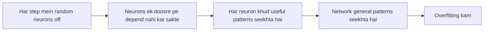

**Ek line mein:** <mark>dropout ek regularization technique hai jo training ke dauran kuch neurons ko randomly OFF (drop) kar deti hai</mark>, isliye koi neuron apne padosi pe depend nahi kar sakta aur network training data ko ratta nahi maar sakta. <Cite id="class-dl-chp2" loc="slide 107" />

<Box kind="key">

**Har dropout question mein ye points likho:**

- <mark>Dropped neurons forward propagation, backpropagation ya weight updates mein hissa nahi lete.</mark> Har iteration mein alag set drop hota hai.
- <mark>Random drop, phir kam dependency, phir general patterns, phir overfitting kam.</mark>
- <mark>Dropout rate $p$ = kitne percent neurons OFF kiye; hidden layers ke liye $p = 0.5$ sabse common.</mark>
- <mark>Training: random neurons drop. Testing: saare neurons active.</mark>
- Advantages: **overfitting kam, generalization better, neuron dependency nahi, network robust, simple aur widely used.**
- Disadvantages: training thodi slow; bahut high rate se underfitting ho sakti hai.

</Box>

## Core answer (5 marks, yahan ke har question ke liye)

<Box kind="definition">

**Dropout** is a regularization technique that randomly turns OFF (drops) some neurons during training. The dropped neurons do not take part in forward propagation, backpropagation or weight updates. Each training iteration uses a slightly different network. <Cite id="class-dl-chp2" loc="slide 107" />

</Box>

**Kyun chahiye:** deep networks mein kuch neurons doosre neurons pe bahut depend ho jaate hain. Ek neuron galat pattern seekhe to kai aur bhi wahi seekh lete hain, aur network training data ratta maar leta hai (overfitting). <Cite id="class-dl-chp2" loc="slide 107" />

**Training versus testing:** training mein random neurons drop hote hain (rate $p$, aam taur par 0.5); testing mein **saare neurons active** hote hain. Textbook dropout ko kai thinned networks ke ensemble ki tarah dekhti hai jo weights share karte hain. <Cite id="class-dl-chp2" loc="slide 108" /> <Cite id="class-dl-m2" loc="p. 38" />

**Advantages:** overfitting kam, generalization better, neuron dependency nahi, network zyada robust, simple aur widely used. **Disadvantages:** training thodi slow; drop rate dhyaan se chunna padta hai aur bahut high rate se underfitting ho sakti hai. <Cite id="class-dl-chp2" loc="slide 108" />

**Conclusion:** dropout network ko kisi ek neuron pe kam depend karata hai, isliye wo unseen data pe better generalize karta hai. <Cite id="web-dl-1-paper-dropout" />

## Extended answer (10 marks): ye add karo

### 1. Dropout rate ka effect

| Rate $p$ | Effect |
|---|---|
| 0 | Koi neuron drop nahi; overfitting ka chance zyada |
| 0.2 | Kuch neurons drop; chhoti regularization |
| 0.5 | Aadhe drop; sabse common, achha balance |
| 0.8 | Zyadatar drop; network underfit kar sakta hai |

### 2. Training aur testing phases

Test time pe poora network use hota hai, lekin outputs ka size training jaisa hona chahiye. Original paper test time pe weights ko keep probability se multiply karta hai; zyadatar libraries training mein kept activations ko $1/(1 - p)$ se scale karti hain ("inverted dropout"), isliye test time pe kuch nahi badalta. Dono ka expected output same hai. <Cite id="web-dl-1-paper-dropout" /> <Cite id="web-dl-1-d2l-dropout" />

### 3. Chhota example (made up, inverted dropout)

<Sum>

<Given>

ek layer ke outputs $(2, 4, 6, 8)$; dropout rate $p = 0.5$; is step mein random mask neuron 1 aur 3 ko rakhta hai.

</Given>

<Find>

training aur testing mein agli layer ko jaane wale outputs.

</Find>

<Steps>

1. **Mask:** $(1, 0, 1, 0)$, isliye dropped neurons 0 dete hain.
2. **Kept neurons ko scale karo** $1/(1 - 0.5) = 2$ se: $(2 \times 2, 0, 6 \times 2, 0) = (4, 0, 12, 0)$.
3. **Testing:** saare neurons on aur koi scaling nahi, isliye output $(2, 4, 6, 8)$.

</Steps>

<Answer>

Training output $(4, 0, 12, 0)$; testing output $(2, 4, 6, 8)$.

</Answer>

<Box kind="verify">

Kai random masks ke baad har neuron aadhi baar kept hota hai aur kept hone par double hota hai, isliye uska average output $0.5 \times 2x = x$ hai. Training aur testing ke averages match karte hain.

</Box>

</Sum>

### 4. Pros aur cons ki table

| Advantages | Disadvantages |
|---|---|
| Overfitting kam | Training thodi slow |
| Generalization better | Drop rate achhe se chunna padta hai |
| Neurons ek doosre pe depend nahi | Bahut high rate se underfitting |
| Thinned networks ke ensemble jaisa | Chhote networks jo overfit nahi karte unke liye zaroori nahi |

<Cite id="class-dl-chp2" loc="slide 108" /> <Cite id="web-dl-1-gb-reg" loc="§7.12" />

## Har question mein kaise fit karein

- **"Explain dropout. How does it solve the problem of overfitting?"** (5 marks) <PYQ id="2023-12/q1c" />: definition, kyun chahiye, **overfitting chain** (random drop, kam dependency, general patterns) diagram ke saath, aur train versus test.
- **"Explain the dropout method and it's advantages."** (5 marks) <PYQ id="2024-05/q1c" /> <PYQ id="2024-12/q1c" />: definition, dropout picture, rate aur train versus test, phir **advantages list** (balance ke liye disadvantages bhi likho).

## Exam tips

- **Hamesha draw karo** network do baar: dropout ke bina aur kuch neurons cross karke.
- "**Testing mein saare neurons active**" zaroor likho; ye sabse zyada puchha jaane wala follow-up hai.
- Dhyaan do: class mein $p$ **drop** rate hai (0.5). Original paper mein $p$ keep probability hai.

Exam mein English mein likho.
