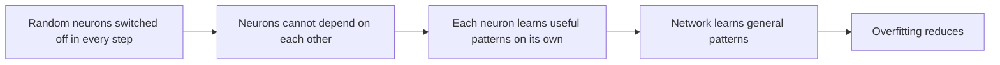

**In one line:** <mark>dropout is a regularization technique that randomly turns OFF (drops) some neurons during training</mark>, so no neuron can depend on its neighbours and the network cannot memorize the training data. <Cite id="class-dl-chp2" loc="slide 107" />

<Box kind="key">

**Key points to write (any dropout question):**

- <mark>Dropped neurons do not take part in forward propagation, backpropagation or weight updates.</mark> A different set is dropped in every iteration.
- <mark>Random drop, then less dependency, then general patterns, then overfitting reduces.</mark>
- <mark>Dropout rate $p$ = the percentage of neurons turned OFF; $p = 0.5$ is the most common for hidden layers.</mark>
- <mark>Training: random neurons dropped. Testing: all neurons are active.</mark>
- Advantages: **reduces overfitting, improves generalization, prevents neuron dependency, makes the network robust, simple and widely used.**
- Disadvantages: training is slightly slower; a very high rate may cause underfitting.

</Box>

## Core answer (5 marks, fits every question here)

<Box kind="definition">

**Dropout** is a regularization technique that randomly turns OFF (drops) some neurons during training. The dropped neurons do not take part in forward propagation, backpropagation or weight updates. Each training iteration uses a slightly different network. <Cite id="class-dl-chp2" loc="slide 107" />

</Box>

**Why it is needed:** in deep networks some neurons become too dependent on others. If one neuron learns a wrong pattern, many others learn it too, and the network memorizes the training data (overfitting). <Cite id="class-dl-chp2" loc="slide 107" />

**Training versus testing:** in training random neurons are dropped (rate $p$, usually 0.5); in testing **all neurons are active**. The textbook sees dropout as an ensemble of many thinned networks that share weights. <Cite id="class-dl-chp2" loc="slide 108" /> <Cite id="class-dl-m2" loc="p. 38" />

**Advantages:** reduces overfitting, improves generalization, prevents neuron dependency, makes the network more robust, simple and widely used. **Disadvantages:** training is slightly slower; choosing the drop rate needs care and a very high rate may cause underfitting. <Cite id="class-dl-chp2" loc="slide 108" />

**Conclusion:** dropout makes the network less dependent on any single neuron, so it generalizes better to unseen data. <Cite id="web-dl-1-paper-dropout" />

## Extended answer (10 marks): add these

### 1. Effect of the dropout rate

| Rate $p$ | Effect |
|---|---|
| 0 | No neurons dropped; higher chance of overfitting |
| 0.2 | A few neurons dropped; small regularization |
| 0.5 | Half dropped; the most common, a good balance |
| 0.8 | Most dropped; the network may underfit |

### 2. Training and testing phases

At test time the whole network is used, but the size of the outputs must match training. The original paper multiplies the weights by the keep probability at test time; most libraries instead scale the kept activations by $1/(1 - p)$ during training ("inverted dropout"), so nothing changes at test time. Both give the same expected output. <Cite id="web-dl-1-paper-dropout" /> <Cite id="web-dl-1-d2l-dropout" />

### 3. Tiny example (made up, inverted dropout)

<Sum>

<Given>

a layer outputs $(2, 4, 6, 8)$; dropout rate $p = 0.5$; this step the random mask keeps neurons 1 and 3.

</Given>

<Find>

the outputs sent to the next layer in training and in testing.

</Find>

<Steps>

1. **Mask:** $(1, 0, 1, 0)$, so the dropped neurons give 0.
2. **Scale the kept ones** by $1/(1 - 0.5) = 2$: $(2 \times 2, 0, 6 \times 2, 0) = (4, 0, 12, 0)$.
3. **Testing:** all neurons are on and nothing is scaled, so the output is $(2, 4, 6, 8)$.

</Steps>

<Answer>

Training output $(4, 0, 12, 0)$; testing output $(2, 4, 6, 8)$.

</Answer>

<Box kind="verify">

Over many random masks each neuron is kept half the time and doubled when kept, so its average output is $0.5 \times 2x = x$. The training and testing averages match.

</Box>

</Sum>

### 4. Pros and cons in a table

| Advantages | Disadvantages |
|---|---|
| Reduces overfitting | Training becomes slightly slower |
| Improves generalization | Drop rate must be chosen well |
| Neurons cannot depend on each other | Too high a rate causes underfitting |
| Works like an ensemble of thinned networks | Not needed for small networks that do not overfit |

<Cite id="class-dl-chp2" loc="slide 108" /> <Cite id="web-dl-1-gb-reg" loc="§7.12" />

## Fit it to each question

- **"Explain dropout. How does it solve the problem of overfitting?"** (5 marks) <PYQ id="2023-12/q1c" />: definition, why needed, the **overfitting chain** (random drop, less dependency, general patterns) with the diagram, and train versus test.
- **"Explain the dropout method and it's advantages."** (5 marks) <PYQ id="2024-05/q1c" /> <PYQ id="2024-12/q1c" />: definition, the dropout picture, rate and train versus test, and then the **advantages list** (also add the disadvantages for balance).

## Exam tips

- **Always draw** the network twice: without dropout and with some neurons crossed out.
- Say "**in testing all neurons are active**"; it is the most asked follow-up.
- Be careful: the class $p$ is the **drop** rate (0.5). In the original paper $p$ is the keep probability.
