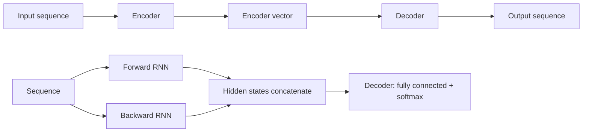

**Ek line mein:** <mark>encoder-decoder (sequence to sequence) RNN input sequence ko alag length ki output sequence mein map karta hai</mark> ek summary vector ke through, aur <mark>bidirectional RNN sequence ko forward aur backward dono padhta hai</mark> taaki har position past aur future dono dekhe. <Cite id="class-dl-m5" loc="p. 38" />

<Box kind="key">

**Encoder-decoder, bidirectional RNN ke har question mein ye points likho:**

- <mark>Sequence to sequence: input aur output sequences ki length alag ho sakti hai</mark> (translation, speech recognition, image captioning).
- <mark>Encoder input padhta hai; encoder vector (final hidden state) saare inputs ki information rakhta hai</mark>.
- <mark>Decoder encoder vector se shuru hoke output ek-ek element mein banata hai</mark>.
- Behtar performance ke liye LSTM ya GRU cells.
- <mark>Bidirectional RNN: do RNNs, ek left to right aur ek right to left; hidden states concatenate hote hain</mark>.
- Bidirectional RNN ki limits: <mark>poori sequence chahiye, real-time ya next-word prediction ke liye nahi, slow</mark>.

</Box>

## Core answer (5 marks, yahan ke har question ke liye)

<Box kind="definition">

A **sequence to sequence (encoder-decoder) model** maps an input sequence to an output sequence, where the lengths may differ. A **bidirectional RNN** processes the sequence in both directions, left to right and right to left, to use past and future context. <Cite id="class-dl-m5" loc="p. 38" /> <Cite id="class-dl-m5" loc="p. 32" />

</Box>

**Encoder-decoder ke parts:** <Cite id="class-dl-m5" loc="pp. 40-42" />

1. **Encoder:** recurrent units ka stack (LSTM ya GRU); har ek input ka ek element leta hai aur information aage bhejta hai.
2. **Encoder vector:** final hidden state; ye saare input elements ki information rakhta hai aur **decoder ka initial hidden state** hai.
3. **Decoder:** recurrent units ka stack, har ek output $y_t$ predict karta hai (softmax).

**Conclusion:** encoder-decoder alag length ki sequences map karta hai; bidirectional RNN context ki dono directions use karta hai.

## Extended answer (10 marks): ye add karo

### 1. Encoder-decoder detail mein

- **Example:** "What are you doing today?" (5 words) se 7 symbols ka Chinese sentence. Uses: machine translation, speech recognition, image captioning. <Cite id="class-dl-m5" loc="p. 38" />
- Encoder: $h_t = f(W^{(hh)} h_{t-1} + W^{(hx)} x_t)$. Decoder: $h_t = f(W^{(hh)} h_{t-1})$, $y_t = \text{softmax}(W^S h_t)$. <Cite id="class-dl-m5" loc="p. 40" /> <Cite id="class-dl-m5" loc="p. 42" />
- Is architecture ka general idea do parts hain: ek input ko state banata hai, doosra state ko output. <Cite id="web-dl-2-d2l-encoder-decoder" /> Sutskever et al. ne LSTMs ke saath translation ke liye ise dikhaya. <Cite id="web-dl-2-seq2seq-paper" />

### 2. Bidirectional RNN detail mein

Hum do alag sequences lete hain, ek left to right aur ek ulte order mein. "I love mango juice" ke liye backward layer "juice mango love I" padhti hai. Aam taur pe do RNNs use hote hain, unke hidden states concatenate hote hain, aur final hidden state decoder (jaise softmax wala fully connected network) ko jaata hai. <Cite id="class-dl-m5" loc="p. 32" /> <Cite id="class-dl-m5" loc="p. 33" /> <Cite id="web-dl-2-d2l-bi-rnn" />

### 3. Comparison

| | Encoder-decoder | Bidirectional RNN |
|---|---|---|
| Purpose | Ek sequence ko alag length ki sequence mein map karna | Past aur future context use karna |
| Parts | Encoder, encoder vector, decoder | Forward RNN, backward RNN, concatenation |
| Uses | Translation, captioning, speech recognition | Tagging, speech, text understanding |
| Limit | Ek vector ko poora input rakhna padta hai | Poori sequence chahiye; real-time ya next-word ke liye nahi; slow |

<Cite id="class-dl-m5" loc="p. 33" />

## Har question mein kaise fit karein

- **"Discuss the encoder decoder architecture of RNN / bidirectional RNN."** (10 marks) <PYQ id="assignment-2/q5d" />: dono parts likho: encoder-decoder diagram aur teen parts ke saath (core + section 1), phir bidirectional RNN example aur limits ke saath (section 2), end mein comparison table.

## Exam tips

- **Draw karo:** ek ke liye encoder cells, encoder vector aur decoder cells; doosre ke liye do arrows (forward aur backward).
- **Keywords:** encoder vector, initial hidden state of the decoder, sequence to sequence, concatenate, past aur future context.
- Common galti: bidirectional RNN ko real-time next-word prediction ke liye likhna; use poori sequence chahiye.

Exam mein English mein likho.
