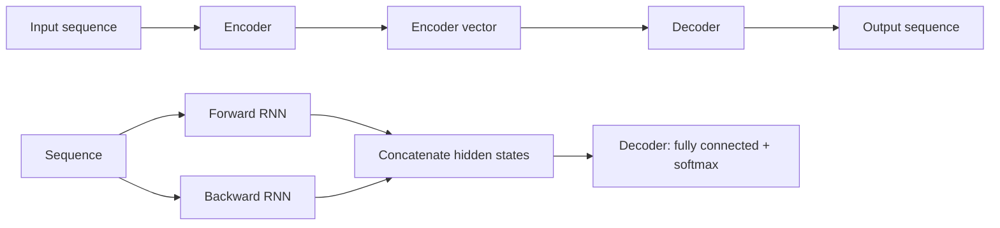

**In one line:** an <mark>encoder-decoder (sequence to sequence) RNN maps an input sequence to an output sequence of a different length</mark> through one summary vector, and a <mark>bidirectional RNN reads the sequence forward and backward</mark> so every position sees both past and future. <Cite id="class-dl-m5" loc="p. 38" />

<Box kind="key">

**Key points to write (encoder-decoder, bidirectional RNN):**

- <mark>Sequence to sequence: input and output sequences can have different lengths</mark> (translation, speech recognition, image captioning).
- <mark>Encoder reads the input; the encoder vector (final hidden state) holds the information of all inputs</mark>.
- <mark>Decoder starts from the encoder vector and produces the output one element at a time</mark>.
- Use LSTM or GRU cells for better performance.
- <mark>Bidirectional RNN: two RNNs, one left to right and one right to left; hidden states are concatenated</mark>.
- Limits of bidirectional RNN: <mark>whole sequence needed, not for real-time use or next-word prediction, slower</mark>.

</Box>

## Core answer (5 marks, fits every question here)

<Box kind="definition">

A **sequence to sequence (encoder-decoder) model** maps an input sequence to an output sequence, where the lengths may differ. A **bidirectional RNN** processes the sequence in both directions, left to right and right to left, to use past and future context. <Cite id="class-dl-m5" loc="p. 38" /> <Cite id="class-dl-m5" loc="p. 32" />

</Box>

**Encoder-decoder parts:** <Cite id="class-dl-m5" loc="pp. 40-42" />

1. **Encoder:** a stack of recurrent units (LSTM or GRU); each takes one input element and passes information forward.
2. **Encoder vector:** the final hidden state; it holds the information of all input elements and is the **initial hidden state of the decoder**.
3. **Decoder:** a stack of recurrent units, each predicting an output $y_t$ (softmax).

**Conclusion:** encoder-decoder maps sequences of different lengths; the bidirectional RNN uses both directions of context.

## Extended answer (10 marks): add these

### 1. Encoder-decoder in detail

- **Example:** "What are you doing today?" (5 words) becomes a Chinese sentence of 7 symbols. Uses: machine translation, speech recognition, image captioning. <Cite id="class-dl-m5" loc="p. 38" />
- Encoder: $h_t = f(W^{(hh)} h_{t-1} + W^{(hx)} x_t)$. Decoder: $h_t = f(W^{(hh)} h_{t-1})$, $y_t = \text{softmax}(W^S h_t)$. <Cite id="class-dl-m5" loc="p. 40" /> <Cite id="class-dl-m5" loc="p. 42" />
- The general idea of this architecture is two parts: one turns the input into a state, the other turns the state into the output. <Cite id="web-dl-2-d2l-encoder-decoder" /> It was shown for translation with LSTMs by Sutskever et al. <Cite id="web-dl-2-seq2seq-paper" />

### 2. Bidirectional RNN in detail

We use two separate sequences, one left to right and one in the reverse order. For "I love mango juice" the backward layer reads "juice mango love I". Typically two RNNs are used, their hidden states are concatenated, and the final hidden state goes to a decoder such as a fully connected network with softmax. <Cite id="class-dl-m5" loc="p. 32" /> <Cite id="class-dl-m5" loc="p. 33" /> <Cite id="web-dl-2-d2l-bi-rnn" />

### 3. Comparison

| | Encoder-decoder | Bidirectional RNN |
|---|---|---|
| Purpose | Map one sequence to another of a different length | Use past and future context |
| Parts | Encoder, encoder vector, decoder | Forward RNN, backward RNN, concatenation |
| Uses | Translation, captioning, speech recognition | Tagging, speech, text understanding |
| Limit | One vector must hold the whole input | Needs the whole sequence; not for real-time or next-word prediction; slower |

<Cite id="class-dl-m5" loc="p. 33" />

## Fit it to each question

- **"Discuss the encoder decoder architecture of RNN / bidirectional RNN."** (10 marks) <PYQ id="assignment-2/q5d" />: write both parts: encoder-decoder with the diagram and three parts (core + section 1), then the bidirectional RNN with the example and limits (section 2), end with the comparison table.

## Exam tips

- **Draw** encoder cells, the encoder vector and decoder cells for one, and two arrows (forward and backward) for the other.
- **Keywords:** encoder vector, initial hidden state of the decoder, sequence to sequence, concatenate, past and future context.
- Common mistake: saying a bidirectional RNN suits real-time next-word prediction; it needs the complete sequence.
