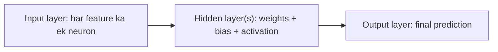
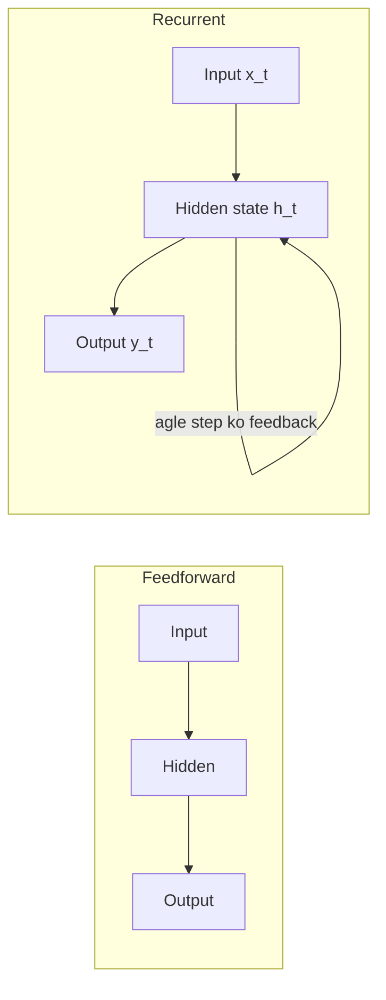

**Ek line mein:** <mark>feedforward neural network mein data sirf ek direction mein jaata hai, input layer se hidden layers ke through output layer tak, koi feedback ya loop nahi</mark>. <Cite id="class-dl-chp1" loc="slide 28" />

<Box kind="key">

**Har feedforward question mein ye points likho:**

- <mark>Data sirf ek direction mein: input layer, hidden layer(s), output layer. Koi feedback nahi, koi loop nahi.</mark>
- **Input layer:** har feature ke liye ek neuron, koi calculation nahi. **Hidden layers:** <mark>important patterns calculate aur learn karti hain</mark>. **Output layer:** final prediction.
- Har neuron: <mark>$z = \sum_i w_ix_i + b$ aur $a = f(z)$</mark> (weights, bias, activation function).
- <mark>Hidden units weights + activation apply karte hain aur non-linearity add karte hain</mark>, isliye network XOR solve kar sakta hai.
- Learning: error backpropagation se wapas jaata hai, weights gradient descent se update hote hain.
- Output sirf current input pe depend karta hai, isliye **memory nahi** (recurrent network feedback add karta hai).

</Box>

## Core answer (5 marks, yahan ke har question ke liye)

<Box kind="definition">

A **feedforward neural network (FFNN)** is a type of neural network where data moves only in one direction, from the input layer to the output layer. There is no feedback or loop in the network. <Cite id="class-dl-chp1" loc="slide 28" />

</Box>

**"Feedforward" kyun:** information $x$ se beech ki computations ke through output $y$ tak jaati hai. Feedback connections ho to wo recurrent network ban jaata hai. Goal ek function approximate karna hai: $y = f(x;\theta)$. <Cite id="class-dl-m1" loc="p. 10" />

**Working, step by step:** <Cite id="class-dl-chp1" loc="slide 28" />

1. Input, input layer ko diya jaata hai.
2. Inputs ko weights se multiply karte hain.
3. Bias add karte hain.
4. Activation function apply hota hai: $z = \sum_i w_ix_i + b$, $a = f(z)$.
5. Output agli layer ko jaata hai.
6. Final output milta hai.

| Layer | Function |
|---|---|
| Input | Input leti hai; har neuron ek feature. Calculation nahi. |
| Hidden | Important patterns calculate aur learn karti hain; deeper layers complex patterns. |
| Output | Final prediction deti hai; har output ka ek neuron. |

<Cite id="class-dl-m1" loc="p. 17" /> <Cite id="class-dl-chp1" loc="slide 22" />

**Conclusion:** feedforward network sabse simple neural network hai aur deep learning ka base; har layer ka apna kaam hai.

## Extended answer (10 marks): ye add karo

### 1. Hidden units: kya karte hain aur kyun

**Hidden units** hidden layers ke neurons hain. Har unit pichhli layer ke outputs ko weights se multiply karta hai, bias add karta hai aur activation function lagata hai. <Cite id="class-dl-chp1" loc="slide 28" />

- **Patterns seekhte hain:** pehli hidden layer edges, agli corners aur contours, agli object parts dhoondhti hai. <Cite id="class-dl-m1" loc="p. 12" />
- **Non-linearity add karte hain** activation function se, isliye XOR solve ho jaata hai. <Cite id="class-dl-chp1" loc="slide 22" />
- **"Hidden" isliye kehte hain** kyunki training data in layers ka desired output nahi dikhata. <Cite id="class-dl-m1" loc="p. 11" />
- **Default choice:** rectified linear units; best type validation set pe trial and error se milta hai. <Cite id="class-dl-m1" loc="p. 15" />

### 2. Architecture choices

Main choices hain **depth** (layers ki ginti) aur **width** (har layer ke units). Layers chain mein jude hote hain, $f(x) = f^{(3)}(f^{(2)}(f^{(1)}(x)))$, aur har unit agli layer ke har unit se judta hai. <Cite id="class-dl-m1" loc="p. 23" /> <Cite id="web-dl-1-gb-mlp" loc="§6.4" />

### 3. Chhota worked example (made up, sirf arithmetic dikhane ke liye)

<Sum>

<Given>

inputs $x = (2, 3)$, weights $w = (0.5, 0.4)$, bias $b = 0.1$, ReLU activation.

</Given>

<Find>

neuron ka output.

</Find>

<Steps>

1. $z = 0.5 \times 2 + 0.4 \times 3 + 0.1 = 1 + 1.2 + 0.1 = 2.3$.
2. ReLU: $a = \max(0, 2.3) = 2.3$, ye agli layer ko jaata hai.

</Steps>

<Answer>

$a = 2.3$

</Answer>

</Sum>

### 4. Learning aur limits

Output ko actual output se compare karte hain, error backpropagation se wapas jaata hai aur gradient descent weights adjust karta hai, baar baar jab tak error minimum na ho. <Cite id="class-dl-chp1" loc="slide 11" /> <Cite id="class-dl-chp2" loc="slide 59" />

| Feedforward | Recurrent |
|---|---|
| Data ek taraf, koi loop nahi | Hidden state wapas feed hoti hai |
| Memory nahi, fixed-size input | Pichhle inputs yaad, sequences |
| Tabular data, classification | Text, speech, time series |

<Cite id="class-dl-chp5" loc="slide 5" /> <Cite id="class-dl-m5" loc="p. 9" />

## Har question mein kaise fit karein

- **"What are Feed Forward Neural Network?"** (5 marks) <PYQ id="2024-05/q1a" />: definition, "why feedforward", diagram, key features (koi cycle nahi, output sirf current input pe) aur example jaise digit recognition.
- **"Explain basic architecture of feedforward neural network."** (5 marks) <PYQ id="2025-05/q1a" />: architecture diagram, teen layers ki table, chhe working steps aur depth-width choices.
- **"Discuss the working of Feed Forward and Recurrent Neural Networks."** (5 marks) <PYQ id="2026-05/q1b" />: core answer short mein, phir feedforward vs recurrent table aur diagram.
- **"Explain the architecture and working of a Feed Forward Neural Network with a neat diagram. Discuss the functions of input, hidden, and output layers."** (10 marks) <PYQ id="2026-05/q2a" />: poora core answer, plus worked example aur learning paragraph.
- **"Explain what are Hidden Units and their purpose in a Neural Network Architecture."** (5 marks) <PYQ id="assignment-1/q1a" />: section 1 likho (hidden unit kya karta hai, teen purposes) brain-hierarchy picture ke saath.
- **"Analyze the working of a Feed Forward Neural Network by explaining the role of each layer."** (10 marks) <PYQ id="assignment-1/q1b" />: layer-roles table, chhe working steps aur learning paragraph.

## Exam tips

- **Hamesha draw karo** teen-layer diagram, input, hidden, output label karo; formula $z = \sum w_ix_i + b$, $a = f(z)$ add karo.
- Pehli line mein "**no feedback or loop**" likho; FFNN ka keyword wahi hai.
- Ye mat likho ki input layer kuch calculate karti hai; wo sirf features leti hai.

Exam mein English mein likho.
