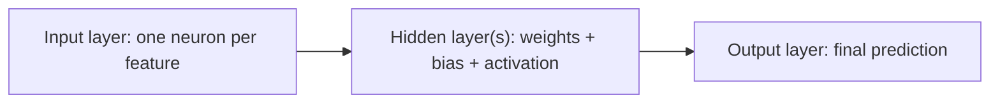
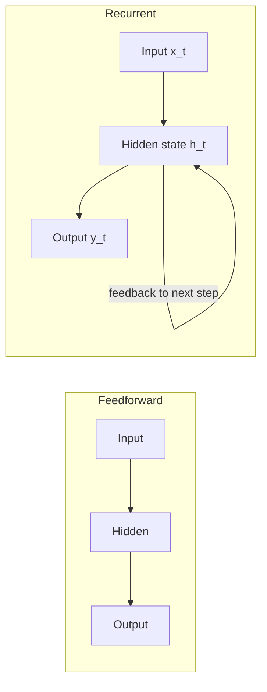

**In one line:** <mark>a feedforward neural network is a network where data moves only in one direction, from the input layer through the hidden layers to the output layer, with no feedback or loop</mark>. <Cite id="class-dl-chp1" loc="slide 28" />

<Box kind="key">

**Key points to write (any feedforward question):**

- <mark>Data moves in one direction only: input layer, hidden layer(s), output layer. No feedback, no loop.</mark>
- **Input layer:** one neuron per feature, no calculation. **Hidden layers:** <mark>calculate and learn important patterns</mark>. **Output layer:** final prediction.
- Each neuron: <mark>$z = \sum_i w_ix_i + b$ and $a = f(z)$</mark> (weights, bias, activation function).
- <mark>Hidden units apply weights + activation and add non-linearity</mark>, so the network can solve XOR.
- Learning: error is sent back by backpropagation, weights are updated by gradient descent.
- Output depends only on the current input, so there is **no memory** (a recurrent network adds feedback).

</Box>

## Core answer (5 marks, fits every question here)

<Box kind="definition">

A **feedforward neural network (FFNN)** is a type of neural network where data moves only in one direction, from the input layer to the output layer. There is no feedback or loop in the network. <Cite id="class-dl-chp1" loc="slide 28" />

</Box>

**Why "feedforward":** information flows from $x$ through the middle computations to the output $y$. With feedback connections it becomes a recurrent network. The goal is to approximate a function: $y = f(x;\theta)$. <Cite id="class-dl-m1" loc="p. 10" />

**Working, step by step:** <Cite id="class-dl-chp1" loc="slide 28" />

1. Input is given to the input layer.
2. Inputs are multiplied with weights.
3. Bias is added.
4. The activation function is applied: $z = \sum_i w_ix_i + b$, $a = f(z)$.
5. The output is passed to the next layer.
6. The final output is produced.

| Layer | Function |
|---|---|
| Input | Takes the input; each neuron is one feature. No calculation. |
| Hidden | Calculate and learn important patterns; deeper layers learn more complex ones. |
| Output | Gives the final prediction; one neuron per output. |

<Cite id="class-dl-m1" loc="p. 17" /> <Cite id="class-dl-chp1" loc="slide 22" />

**Conclusion:** a feedforward network is the simplest neural network and the base of deep learning; every layer has its own job.

## Extended answer (10 marks): add these

### 1. Hidden units: what they do and why

**Hidden units** are the neurons of the hidden layers. Each takes the outputs of the previous layer, multiplies them with weights, adds a bias and applies an activation function. <Cite id="class-dl-chp1" loc="slide 28" />

- **They learn patterns:** the first hidden layer finds edges, the next corners and contours, the next object parts. <Cite id="class-dl-m1" loc="p. 12" />
- **They add non-linearity** through the activation function, so XOR becomes solvable. <Cite id="class-dl-chp1" loc="slide 22" />
- **They are called "hidden"** because the training data does not show the desired output of these layers. <Cite id="class-dl-m1" loc="p. 11" />
- **Default choice:** rectified linear units; the best type is found by trial and error on a validation set. <Cite id="class-dl-m1" loc="p. 15" />

### 2. Architecture choices

The main choices are **depth** (number of layers) and **width** (units per layer). Layers are chained, $f(x) = f^{(3)}(f^{(2)}(f^{(1)}(x)))$, and every unit connects to every unit of the next layer. <Cite id="class-dl-m1" loc="p. 23" /> <Cite id="web-dl-1-gb-mlp" loc="§6.4" />

### 3. Tiny worked example (made up, to show the arithmetic)

<Sum>

<Given>

inputs $x = (2, 3)$, weights $w = (0.5, 0.4)$, bias $b = 0.1$, ReLU activation.

</Given>

<Find>

the output of the neuron.

</Find>

<Steps>

1. $z = 0.5 \times 2 + 0.4 \times 3 + 0.1 = 1 + 1.2 + 0.1 = 2.3$.
2. ReLU: $a = \max(0, 2.3) = 2.3$, which goes to the next layer.

</Steps>

<Answer>

$a = 2.3$

</Answer>

</Sum>

### 4. Learning and limits

The output is compared with the actual output, the error is sent back by backpropagation and gradient descent adjusts the weights, again and again until the error is minimum. <Cite id="class-dl-chp1" loc="slide 11" /> <Cite id="class-dl-chp2" loc="slide 59" />

| Feedforward | Recurrent |
|---|---|
| Data flows one way, no loop | Hidden state is fed back |
| No memory, fixed-size input | Remembers earlier inputs, sequences |
| Tabular data, classification | Text, speech, time series |

<Cite id="class-dl-chp5" loc="slide 5" /> <Cite id="class-dl-m5" loc="p. 9" />

## Fit it to each question

- **"What are Feed Forward Neural Network?"** (5 marks) <PYQ id="2024-05/q1a" />: definition, "why feedforward", the diagram, key features (no cycles, output depends only on the current input) and an example such as digit recognition.
- **"Explain basic architecture of feedforward neural network."** (5 marks) <PYQ id="2025-05/q1a" />: the architecture diagram, the three layers table, the six working steps and the depth and width choices.
- **"Discuss the working of Feed Forward and Recurrent Neural Networks."** (5 marks) <PYQ id="2026-05/q1b" />: core answer in short, then the feedforward vs recurrent table and diagram.
- **"Explain the architecture and working of a Feed Forward Neural Network with a neat diagram. Discuss the functions of input, hidden, and output layers."** (10 marks) <PYQ id="2026-05/q2a" />: core answer in full, plus the worked example and the learning paragraph.
- **"Explain what are Hidden Units and their purpose in a Neural Network Architecture."** (5 marks) <PYQ id="assignment-1/q1a" />: write section 1 (what a hidden unit does, three purposes) with the brain-hierarchy picture.
- **"Analyze the working of a Feed Forward Neural Network by explaining the role of each layer."** (10 marks) <PYQ id="assignment-1/q1b" />: the layer-roles table, six working steps, and the learning paragraph.

## Exam tips

- **Always draw** the three-layer diagram and label input, hidden and output; add the formula $z = \sum w_ix_i + b$, $a = f(z)$.
- Say "**no feedback or loop**" in the first line; it is the keyword for FFNN.
- Do not say the input layer calculates anything; it only takes the features.
