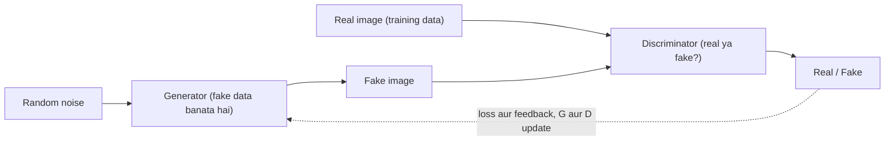
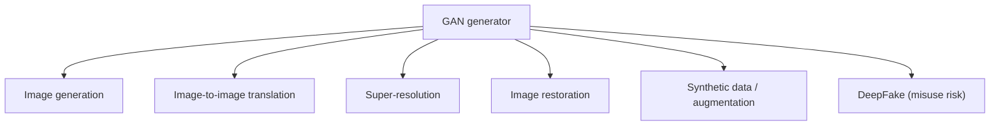

**Ek line mein:** <mark>Generative Adversarial Network (GAN) ek deep learning model hai jo real training data jaisa naya data generate karta hai</mark>; ismein <mark>do networks aapas mein compete karte hain: generator jo random noise se fake data banata hai, aur discriminator jo real ya fake decide karta hai</mark>. <Cite id="class-dl-chp6" loc="slide 3" />

<Box kind="key">

**GAN ke har question mein ye points likho:**

- <mark>GAN = generator (G) + discriminator (D), ek-dusre ke khilaaf train hote hain</mark>.
- <mark>Generator: input random noise, output fake sample; goal discriminator ko fool karna</mark> (forger ya artist ki tarah).
- <mark>Discriminator: input real ya generated sample, output REAL ya FAKE; goal dono mein farq pehchanna</mark> (examiner ya art critic ki tarah).
- <mark>Training loop: noise, fake sample, discriminator check, loss, backpropagation, dono update, repeat</mark>.
- <mark>Training ke baad sirf generator use hota hai</mark>: naya noise de to naya realistic sample milta hai.
- Applications: <mark>image generation, image-to-image translation, super-resolution, restoration, synthetic data, deepfake</mark>; problems: unstable training, mode collapse.

</Box>

## Core answer (5 marks, yahan ke har question ke liye)

<Box kind="definition">

A **Generative Adversarial Network (GAN)** is a deep learning model used to generate new data that looks similar to real training data. It is built from two networks: the **generator (G)**, which takes random noise and creates a fake sample, and the **discriminator (D)**, which looks at real and fake samples and predicts whether each is real or fake. <Cite id="class-dl-chp6" loc="slide 3" />

</Box>

**Working principle (competition):** <Cite id="class-dl-chp6" loc="slides 6, 10 and 11" />

1. Generator random noise leta hai aur fake sample banata hai.
2. Real aur fake samples discriminator ko jaate hain.
3. Loss calculate hota hai: discriminator galti kare to loss badhta hai; sahi ho to loss kam.
4. Backpropagation se dono networks parameters update karte hain: D behtar judge, G behtar forger.
5. Kai iterations repeat, jab tak G realistic samples na banaye. Training ke baad sirf G naye random noise ke saath use hota hai.

**Example (fake currency):** forger (generator) fake notes banata hai; examiner (discriminator) unhe check karta hai. Har side doosre ki wajah se improve hoti hai. <Cite id="class-dl-chp6" loc="slide 6" />

**Conclusion:** GAN real data se patterns seekhta hai aur generator se naye samples banata hai, jabki discriminator unki quality improve karta hai. <Cite id="class-dl-chp6" loc="slide 2" />

## Extended answer (10 marks): ye add karo

### 1. Components

| Component | Input | Output | Goal |
|---|---|---|---|
| Random noise | - | Random numbers ka vector, sirf starting point | Alag noise se alag images |
| Generator (G) | Random noise | Generated image | D ko fool karne layak real dikhna |
| Discriminator (D) | Real image ya generated image | REAL ya FAKE | Real aur fake ko sahi pehchanna |

<Cite id="class-dl-chp6" loc="slides 8 and 9" />

### 2. Training objective (ek line)

Original paper is contest ko two-player minimax game likhta hai: D apni accuracy maximize karna chahta hai aur G use minimize, $\min_G \max_D \; \mathbb{E}[\log D(x)] + \mathbb{E}[\log(1 - D(G(z)))]$, jahan $x$ real sample hai aur $z$ noise. <Cite id="web-dl-2-gan-paper" /> <Cite id="web-dl-2-d2l-gan" /> Goal tab poora hota hai jab D farq nahi bata pata. <Cite id="class-dl-chp6" loc="slide 10" />

### 3. Example: faces

Hazaron face images pe GAN train karo. Shuru mein generated face kharab hota hai aur D aasani se "fake" kehta hai. Feedback se faces behtar hote jaate hain aur aakhir mein realistic, isliye GAN aise naye faces banata hai jo training data mein the hi nahi. <Cite id="class-dl-chp6" loc="slide 11" />

### 4. Applications

<Cite id="class-dl-chp6" loc="slide 16" />

1. **Image generation:** naye faces, objects, scenery.
2. **Image-to-image translation:** sketch se realistic image, day se night.
3. **Super-resolution:** low resolution se high resolution.
4. **Image restoration:** noise hatana, missing parts bharna.
5. **Synthetic data ya data augmentation:** zyada training samples.
6. **Video generation, art, medical imaging (research ke liye synthetic images), text-to-image.**
7. **DeepFake:** face swapping; misinformation aur fraud jaise serious misuse risks. <Cite id="class-dl-chp6" loc="slide 14" />

### 5. Problems

Training unstable ho sakti hai aur **mode collapse** ho sakta hai (generator kuch similar outputs hi banata rehta hai). <Cite id="class-dl-chp6" loc="slide 13" /> Convolutional GANs (DCGAN) ne practice mein image GAN training zyada stable banayi. <Cite id="web-dl-2-dcgan-paper" /> Generative models ka textbook chapter GANs ko main families mein rakhta hai. <Cite id="web-dl-2-goodfellow-generative" />

## Har question mein kaise fit karein

- **"Explain the working of Generative Adversarial Network."** (10 marks) <PYQ id="2023-12/q4b" />: definition, diagram, 5 working steps, fake-currency aur faces examples, after-training line.
- **"What are Generative Adversarial Networks, comment on it's applications."** (10 marks) <PYQ id="2024-05/q6b" />: definition, components ke saath diagram, short working, phir applications list (section 4) DeepFake risk ke saath.
- **"Explain Generative Adversarial Networks Architecture and its applications."** (10 marks) <PYQ id="2024-12/q6b" />: architecture diagram, components table, training loop, applications (section 4).
- **"Explain architecture of GAN in detail. Also comment on applications of GAN."** (10 marks) <PYQ id="2025-05/q5b" />: upar jaisa, poore components section ke saath, phir applications.
- **"Explain the architecture and working principle of a Generative Adversarial Network with a labelled diagram."** (10 marks) <PYQ id="2026-05/q6a" />: pehle labelled diagram, components, 5 steps, problems (section 5) do lines mein.
- **"Explain the working principle of a GAN with a suitable example."** (10 marks) <PYQ id="assignment-2/q6a" />: working steps, phir dono examples (fake currency aur faces) aur after-training line.

## Exam tips

- **Draw karo:** noise, generator, fake image, real image, discriminator, "real or fake" aur feedback arrow; har box label karo.
- **Keywords:** generator, discriminator, random noise, adversarial, real or fake, loss, backpropagation, realistic samples.
- Common galtiyan: bhoolna ki discriminator **dono** real aur fake dekhta hai, ya likhna ki training ke baad images discriminator se generate hoti hain.

Exam mein English mein likho.
