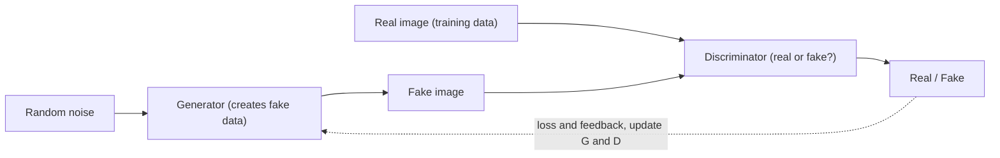
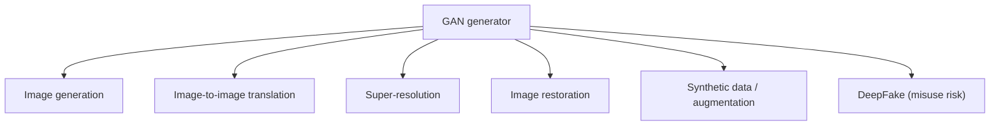

**In one line:** <mark>a Generative Adversarial Network (GAN) is a deep learning model used to generate new data that looks similar to real training data</mark>; it has <mark>two networks that compete: a generator that makes fake data from random noise and a discriminator that decides real or fake</mark>. <Cite id="class-dl-chp6" loc="slide 3" />

<Box kind="key">

**Key points to write (GAN):**

- <mark>GAN = generator (G) + discriminator (D), trained against each other</mark>.
- <mark>Generator: random noise in, fake sample out; goal is to fool the discriminator</mark> (like a forger or an artist).
- <mark>Discriminator: real or generated sample in, REAL or FAKE out; goal is to tell them apart</mark> (like an examiner or art critic).
- <mark>Training loop: noise, fake sample, discriminator checks, loss, backpropagation, update both, repeat</mark>.
- <mark>After training only the generator is used</mark>: new noise gives a new realistic sample.
- Applications: <mark>image generation, image-to-image translation, super-resolution, restoration, synthetic data, deepfake</mark>; problems: unstable training, mode collapse.

</Box>

## Core answer (5 marks, fits every question here)

<Box kind="definition">

A **Generative Adversarial Network (GAN)** is a deep learning model used to generate new data that looks similar to real training data. It is built from two networks: the **generator (G)**, which takes random noise and creates a fake sample, and the **discriminator (D)**, which looks at real and fake samples and predicts whether each is real or fake. <Cite id="class-dl-chp6" loc="slide 3" />

</Box>

**Working principle (the competition):** <Cite id="class-dl-chp6" loc="slides 6, 10 and 11" />

1. The generator receives random noise and creates a fake sample.
2. Real and fake samples are passed to the discriminator.
3. The loss is calculated: if the discriminator makes mistakes the loss increases; if it is correct the loss is low.
4. By backpropagation both networks update their parameters: D becomes a better judge, G a better forger.
5. Repeat for many iterations until G produces realistic samples. After training, only G is used with new random noise.

**Example (fake currency):** a forger (generator) makes fake notes; an examiner (discriminator) checks them. Each side improves because of the other. <Cite id="class-dl-chp6" loc="slide 6" />

**Conclusion:** a GAN learns patterns from real data and uses the generator to create new samples, while the discriminator improves their quality. <Cite id="class-dl-chp6" loc="slide 2" />

## Extended answer (10 marks): add these

### 1. Components

| Component | Input | Output | Goal |
|---|---|---|---|
| Random noise | - | Vector of random numbers, only a starting point | Different noise gives different images |
| Generator (G) | Random noise | Generated image | Look real enough to fool D |
| Discriminator (D) | Real image or generated image | REAL or FAKE | Tell real from fake correctly |

<Cite id="class-dl-chp6" loc="slides 8 and 9" />

### 2. Training objective (one line)

The original paper writes the contest as a two-player minimax game: D tries to maximize its accuracy and G tries to minimize it, $\min_G \max_D \; \mathbb{E}[\log D(x)] + \mathbb{E}[\log(1 - D(G(z)))]$, where $x$ is a real sample and $z$ is noise. <Cite id="web-dl-2-gan-paper" /> <Cite id="web-dl-2-d2l-gan" /> The goal is reached when D can no longer tell the difference. <Cite id="class-dl-chp6" loc="slide 10" />

### 3. Example: faces

Train a GAN on thousands of face images. At first the generated face is poor and D easily says "fake". With feedback the faces get better and finally realistic, so the GAN makes new faces that were not in the training data. <Cite id="class-dl-chp6" loc="slide 11" />

### 4. Applications

<Cite id="class-dl-chp6" loc="slide 16" />

1. **Image generation:** new faces, objects, scenery.
2. **Image-to-image translation:** sketch to realistic image, day to night.
3. **Super-resolution:** low resolution to high resolution.
4. **Image restoration:** remove noise, fill missing parts.
5. **Synthetic data or data augmentation:** more training samples.
6. **Video generation, art, medical imaging (synthetic images for research), text-to-image.**
7. **DeepFake:** face swapping; serious misuse risks such as misinformation and fraud. <Cite id="class-dl-chp6" loc="slide 14" />

### 5. Problems

Training can be unstable and **mode collapse** can occur (the generator keeps making a few similar outputs). <Cite id="class-dl-chp6" loc="slide 13" /> Convolutional GANs (DCGAN) made image GAN training more stable in practice. <Cite id="web-dl-2-dcgan-paper" /> The textbook chapter on generative models places GANs among the main families. <Cite id="web-dl-2-goodfellow-generative" />

## Fit it to each question

- **"Explain the working of Generative Adversarial Network."** (10 marks) <PYQ id="2023-12/q4b" />: definition, diagram, the 5 working steps, the fake-currency and faces examples, after-training line.
- **"What are Generative Adversarial Networks, comment on it's applications."** (10 marks) <PYQ id="2024-05/q6b" />: definition, diagram with components, short working, then the applications list (section 4) with the DeepFake risk.
- **"Explain Generative Adversarial Networks Architecture and its applications."** (10 marks) <PYQ id="2024-12/q6b" />: architecture diagram, components table, training loop, applications (section 4).
- **"Explain architecture of GAN in detail. Also comment on applications of GAN."** (10 marks) <PYQ id="2025-05/q5b" />: same as above with the full components section, then applications.
- **"Explain the architecture and working principle of a Generative Adversarial Network with a labelled diagram."** (10 marks) <PYQ id="2026-05/q6a" />: the labelled diagram first, components, the 5 steps, problems (section 5) in two lines.
- **"Explain the working principle of a GAN with a suitable example."** (10 marks) <PYQ id="assignment-2/q6a" />: working steps, then both examples (fake currency and faces) and the after-training line.

## Exam tips

- **Draw** noise, generator, fake image, real image, discriminator, "real or fake" and the feedback arrow; label every box.
- **Keywords:** generator, discriminator, random noise, adversarial, real or fake, loss, backpropagation, realistic samples.
- Common mistakes: forgetting that the discriminator sees **both** real and fake, or saying the discriminator is used to generate images after training.
