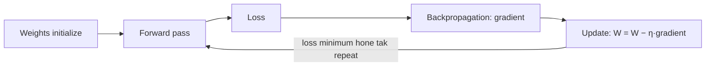
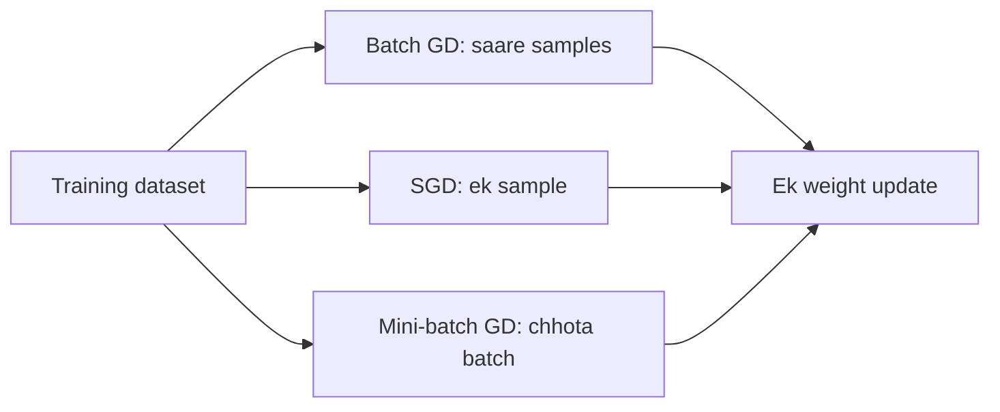

**Ek line mein:** <mark>Gradient Descent ek optimization algorithm hai jo loss kam karne ke liye weights aur biases ko update karta hai</mark>. Ye har weight ko gradient ke **ulte direction** (neeche ki taraf) chhota step leke move karta hai, baar baar, jab tak loss minimum na ho jaye. <Cite id="class-dl-chp2" loc="slide 60" />

<Box kind="key">

**Har GD question mein ye points likho:**

- <mark>Goal: minimum loss dhoondhna</mark>, weights ko sahi direction mein move karke.
- <mark>Update rule: $W_{new} = W_{old} - \eta \dfrac{\partial L}{\partial W}$</mark>, $\eta$ = learning rate, $\dfrac{\partial L}{\partial W}$ = gradient (slope).
- Minus sign: gradient upar (uphill) point karta hai, isliye hum ulti taraf step lete hain (**steepest descent**).
- Learning rate: <mark>small = slow, large = minimum skip, proper = fast aur stable</mark>.
- Types mein farq sirf itna hai ki **ek update ke liye kitna data** use hota hai: <mark>Batch (saara), SGD (ek sample), Mini-batch (chhota batch)</mark>.
- Momentum <mark>pichhla update yaad rakhta hai</mark>, isliye path smooth aur fast hota hai.

</Box>

## Core answer (5 marks, yahan ke har question ke liye)

<Box kind="definition">

**Gradient Descent (GD)** is an optimization algorithm that updates the weights and biases to reduce the loss. Its goal is to find the minimum loss by moving the weights in the correct direction. <Cite id="class-dl-chp2" loc="slide 60" />

</Box>

**Kyun chahiye:** galat prediction ke baad network ko pata nahi hota ki **kaunsa** weight badlna hai, use **badhana ya ghatana** hai, aur **kitna**. GD gradient se teeno ka jawab deta hai. <Cite id="class-dl-chp2" loc="slide 60" />

**Kaise kaam karta hai:** <Cite id="class-dl-chp2" loc="slide 63" />

1. Weights randomly initialize karo.
2. Forward propagation se prediction aata hai.
3. Loss calculate karo.
4. Backpropagation gradients nikalta hai.
5. Weights update karo: $W_{new} = W_{old} - \eta \dfrac{\partial L}{\partial W}$.
6. Loss minimum hone tak repeat karo.

Gradient us direction mein point karta hai jahan loss sabse tez **badhta** hai, isliye **negative** gradient ki direction mein jaane se loss sabse tez ghatta hai; isi liye GD ko **steepest descent** bhi kehte hain. <Cite id="web-dl-goodfellow-numerical" loc="§4.3" /> <Cite id="web-dl-d2l-gd" />

| Learning rate $\eta$ | Kya hota hai |
|---|---|
| Small | Slow learning (chhote steps) |
| Large | Minimum skip (overshoot) ho sakta hai |
| Proper | Fast aur stable learning |

<Cite id="class-dl-chp2" loc="slide 63" />

**Conclusion:** <mark>GD neural network ka basic learning engine hai</mark>: backpropagation gradient nikalta hai, GD usse weights badalta hai.

## Extended answer (10 marks): ye add karo

### 1. Gradient descent ke types

Teeno types mein farq sirf **ek weight update ke liye kitna data** use hota hai. <Cite id="class-dl-m1" loc="p. 34" />

- **Batch GD:** ek update ke liye **poora training dataset**. Smooth aur stable, lekin slow aur zyada memory. <Cite id="class-dl-chp2" loc="slide 68" />
- **Stochastic GD (SGD):** <mark>ek time pe sirf ek training sample process karke weights update karta hai</mark>. Fast, kam memory, kuch local minima se nikal sakta hai, lekin path noisy (zig-zag). Formula: $W_{new} = W_{old} - \eta \dfrac{\partial L_i}{\partial W}$ (ek sample ka loss). <Cite id="class-dl-chp2" loc="slide 68" /> <Cite id="class-dl-chp2" loc="slide 69" />
- **Mini-batch GD:** <mark>training dataset ko chhote groups (mini-batches) mein divide karta hai</mark> aur har batch ke baad update karta hai (batch size 16, 32, 64, 128). Batch GD se fast, SGD se stable, isliye <mark>deep learning mein sabse zyada use hota hai</mark>. <Cite id="class-dl-chp2" loc="slide 71" /> <Cite id="class-dl-chp2" loc="slide 73" />

| Feature | Batch GD | SGD | Mini-batch GD |
|---|---|---|---|
| Ek update ka data | Poora dataset | Ek sample | Chhota batch |
| Speed | Slow | Bahut fast | Fast |
| Path | Smooth | Zig-zag | Thoda zig-zag |
| Memory | Zyada | Kam | Medium |
| Updates per epoch | Ek | Har sample pe ek | Har batch pe ek |

<Cite id="class-dl-chp2" loc="slide 72" />

### 2. Momentum-based gradient descent

<Box kind="definition">

**Momentum GD** improves GD by <mark>remembering the previous weight update</mark>. It uses the current gradient **and** the previous direction, so it moves faster in the correct direction and reduces zig-zag movement. <Cite id="class-dl-chp2" loc="slide 74" />

</Box>

- Velocity: $V_t = \beta V_{t-1} - \eta \dfrac{\partial L}{\partial W}$, weight: $W_{new} = W_{old} + V_t$, $\beta$ usually **0.9**. <Cite id="class-dl-chp2" loc="slide 75" />
- Example: bhari shopping cart ek baar speed pakad le to chhote bumps pe bhi usi direction mein chalti rehti hai. <Cite id="class-dl-chp2" loc="slide 74" />
- Momentum steady direction mein speed badhata hai aur narrow valley mein **oscillations kam** karta hai. <Cite id="web-dl-ruder-gd" loc="§4.1" />

### 3. Advantages aur disadvantages

| Advantages | Disadvantages |
|---|---|
| Learning ki sahi direction batata hai | Gradient bahut chhota: learning slow (vanishing gradient) |
| Loss step by step kam karta hai | Gradient bahut bada: unstable (exploding gradient) |
| Lagbhag har optimizer use karta hai | Achha learning rate chahiye; local minimum mein ruk sakta hai |

<Cite id="class-dl-chp2" loc="slide 58" />

### 4. Ek quick worked step ("with example" pucha ho to)

<Sum>

<Given>

$W_{old} = 5$, $\eta = 0.1$, gradient $= 3$.

</Given>

<Find>

$W_{new}$.

</Find>

<Steps>

1. Step size $= 0.1 \times 3 = 0.3$.
2. Gradient positive hai, isliye neeche jao: $W_{new} = 5 - 0.3 = 4.7$.

</Steps>

<Answer>

$W_{new} = 4.7$

</Answer>

</Sum>

## Har question mein kaise fit karein

- **"Explain Gradient Descent in Deep Learning"** (5 marks) <PYQ id="2024-05/q1b" /> <PYQ id="2024-12/q1b" />: sirf **core answer** likho.
- **"Discuss the role of gradient descent in neural network learning"** (5 marks) <PYQ id="2026-05/q1a" />: core answer, aur loop diagram pe zor do: backpropagation gradient deta hai, GD weights badalta hai, repeat.
- **"Types of gradient descent, explain any three"** (10 marks) <PYQ id="2024-05/q3a" /> <PYQ id="2024-12/q3a" />: definition + update rule (3 lines), phir **Batch, SGD, Mini-batch** har ek ki definition, steps, formula, pros aur cons, phir comparison table.
- **"Gradient descent algorithm and types in detail"** (10 marks) <PYQ id="2025-05/q2a" />: poora core answer + section 1 + table.
- **"SGD and momentum-based GD"** (10 marks) <PYQ id="2023-12/q5a" />: GD pe do lines, phir SGD (section 1) aur momentum (section 2) detail mein, end mein GD vs momentum comparison.

## Exam tips

- **Hamesha draw karo:** GD loop diagram, aur 10-marker mein batch/SGD/mini-batch comparison table.
- Update rule mein **minus sign kabhi mat bhoolo**; ye sabse common galti hai.
- Question mein "algorithm" likha ho to steps 1 se 6 exactly core answer jaise number karo.

Exam mein English mein likho.
