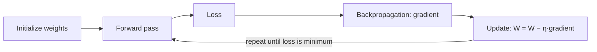
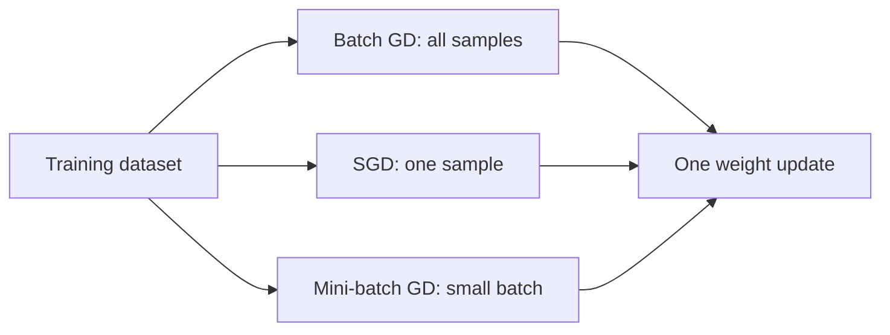

**In one line:** <mark>Gradient Descent is an optimization algorithm that updates the weights and biases to reduce the loss</mark>. It moves every weight a small step **opposite to the gradient** (downhill), again and again, until the loss is minimum. <Cite id="class-dl-chp2" loc="slide 60" />

<Box kind="key">

**Key points to write (any GD question):**

- <mark>Goal: find the minimum loss</mark> by moving the weights in the correct direction.
- <mark>Update rule: $W_{new} = W_{old} - \eta \dfrac{\partial L}{\partial W}$</mark>, $\eta$ = learning rate, $\dfrac{\partial L}{\partial W}$ = gradient (slope).
- Minus sign: the gradient points uphill, so we step the other way (the direction of **steepest descent**).
- Learning rate: <mark>small = slow, large = overshoots, proper = fast and stable</mark>.
- Types differ only in **how much data is used for one update**: <mark>Batch (all), SGD (one sample), Mini-batch (small batch)</mark>.
- Momentum <mark>remembers the previous update</mark>, so the path is smoother and faster.

</Box>

## Core answer (5 marks, fits every question here)

<Box kind="definition">

**Gradient Descent (GD)** is an optimization algorithm that updates the weights and biases to reduce the loss. Its goal is to find the minimum loss by moving the weights in the correct direction. <Cite id="class-dl-chp2" loc="slide 60" />

</Box>

**Why it is needed:** after a wrong prediction the network does not know **which** weight to change, whether to **increase or decrease** it, and **by how much**. GD answers all three using the gradient. <Cite id="class-dl-chp2" loc="slide 60" />

**How it works:** <Cite id="class-dl-chp2" loc="slide 63" />

1. Initialize the weights randomly.
2. Forward propagation gives a prediction.
3. Calculate the loss.
4. Backpropagation calculates the gradients.
5. Update the weights: $W_{new} = W_{old} - \eta \dfrac{\partial L}{\partial W}$.
6. Repeat until the loss becomes minimum.

The gradient points in the direction where the loss **increases** fastest, so moving in the **negative** gradient direction decreases it fastest; this is why GD is also called the method of **steepest descent**. <Cite id="web-dl-goodfellow-numerical" loc="§4.3" /> <Cite id="web-dl-d2l-gd" />

| Learning rate $\eta$ | What happens |
|---|---|
| Small | Slow learning (tiny steps) |
| Large | May skip (overshoot) the minimum |
| Proper | Fast and stable learning |

<Cite id="class-dl-chp2" loc="slide 63" />

**Conclusion:** <mark>GD is the basic learning engine of a neural network</mark>: backpropagation finds the gradient, GD uses it to change the weights.

## Extended answer (10 marks): add these

### 1. Types of gradient descent

The three types differ only in **how much data is used for one weight update**. <Cite id="class-dl-m1" loc="p. 34" />

- **Batch GD:** uses the **entire training dataset** for one update. Smooth and stable, but slow and needs a lot of memory. <Cite id="class-dl-chp2" loc="slide 68" />
- **Stochastic GD (SGD):** <mark>updates the weights after processing only one training sample at a time</mark>. Fast, low memory, can escape some local minima, but the path is noisy (zig-zag). Formula: $W_{new} = W_{old} - \eta \dfrac{\partial L_i}{\partial W}$ (loss of one sample). <Cite id="class-dl-chp2" loc="slide 68" /> <Cite id="class-dl-chp2" loc="slide 69" />
- **Mini-batch GD:** <mark>divides the training dataset into small groups called mini-batches</mark> and updates after each one (batch size 16, 32, 64, 128). Faster than batch GD and more stable than SGD, so it is <mark>the most widely used in deep learning</mark>. <Cite id="class-dl-chp2" loc="slide 71" /> <Cite id="class-dl-chp2" loc="slide 73" />

| Feature | Batch GD | SGD | Mini-batch GD |
|---|---|---|---|
| Data per update | Entire dataset | One sample | Small batch |
| Speed | Slow | Very fast | Fast |
| Path | Smooth | Zig-zag | Slight zig-zag |
| Memory | High | Low | Medium |
| Updates per epoch | One | One per sample | One per batch |

<Cite id="class-dl-chp2" loc="slide 72" />

### 2. Momentum-based gradient descent

<Box kind="definition">

**Momentum GD** improves GD by <mark>remembering the previous weight update</mark>. It uses the current gradient **and** the previous direction, so it moves faster in the correct direction and reduces zig-zag movement. <Cite id="class-dl-chp2" loc="slide 74" />

</Box>

- Velocity: $V_t = \beta V_{t-1} - \eta \dfrac{\partial L}{\partial W}$, weight: $W_{new} = W_{old} + V_t$, with $\beta$ usually **0.9**. <Cite id="class-dl-chp2" loc="slide 75" />
- Example to write: a heavy shopping cart keeps rolling in the same direction once it gains speed, even over small bumps. <Cite id="class-dl-chp2" loc="slide 74" />
- Momentum speeds up movement along the steady direction and **dampens the oscillations** across a narrow valley. <Cite id="web-dl-ruder-gd" loc="§4.1" />

### 3. Advantages and disadvantages

| Advantages | Disadvantages |
|---|---|
| Shows the correct direction for learning | Gradient too small: learning slows (vanishing gradient) |
| Reduces the loss step by step | Gradient too large: unstable (exploding gradient) |
| Used by almost all optimizers | Needs a good learning rate; can stop in a local minimum |

<Cite id="class-dl-chp2" loc="slide 58" />

### 4. One quick worked step (if asked "with example")

<Sum>

<Given>

$W_{old} = 5$, $\eta = 0.1$, gradient $= 3$.

</Given>

<Find>

$W_{new}$.

</Find>

<Steps>

1. Step size $= 0.1 \times 3 = 0.3$.
2. Gradient is positive, so move down: $W_{new} = 5 - 0.3 = 4.7$.

</Steps>

<Answer>

$W_{new} = 4.7$

</Answer>

</Sum>

## Fit it to each question

- **"Explain Gradient Descent in Deep Learning"** (5 marks) <PYQ id="2024-05/q1b" /> <PYQ id="2024-12/q1b" />: write the **core answer** only.
- **"Discuss the role of gradient descent in neural network learning"** (5 marks) <PYQ id="2026-05/q1a" />: core answer, and stress the loop diagram: backpropagation gives the gradient, GD changes the weights, repeat.
- **"Types of gradient descent, explain any three"** (10 marks) <PYQ id="2024-05/q3a" /> <PYQ id="2024-12/q3a" />: definition + update rule (3 lines), then **Batch, SGD, Mini-batch** each with definition, steps, formula, pros and cons, then the comparison table.
- **"Gradient descent algorithm and types in detail"** (10 marks) <PYQ id="2025-05/q2a" />: full core answer + section 1 + table.
- **"SGD and momentum-based GD"** (10 marks) <PYQ id="2023-12/q5a" />: two lines on GD, then SGD (section 1) and momentum (section 2) in detail, end with a GD vs momentum comparison.

## Exam tips

- **Always draw:** the GD loop diagram, and the batch/SGD/mini-batch comparison table for a 10-marker.
- **Never forget the minus sign** in the update rule; it is the most common mistake.
- If the question says "algorithm", number the steps 1 to 6 exactly as in the core answer.
