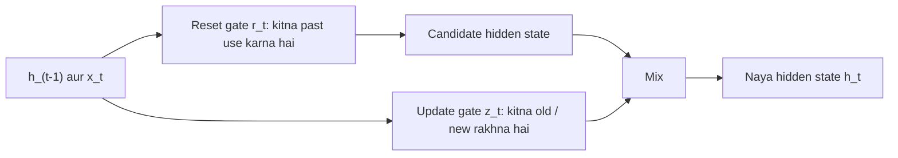

**Ek line mein:** <mark>GRU (Gated Recurrent Unit) ek RNN type hai jo information control karne ke liye do gates use karta hai: reset gate aur update gate</mark>; reset gate tay karta hai <mark>kitni past information use karni hai</mark> aur update gate tay karta hai <mark>kitni old information rakhni hai aur kitni nayi leni hai</mark>. <Cite id="class-dl-chp5" loc="slide 20" />

<Box kind="key">

**GRU ke har question mein ye points likho:**

- <mark>GRU gates se information control karta hai aur long-term dependencies handle karta hai</mark>; vanishing gradient mein madad karta hai.
- <mark>Alag cell state nahi; hidden state hi memory hai</mark>.
- <mark>Reset gate $r_t$: pichhli state kitni use karni hai; short-term dependencies pakadne mein madad</mark>.
- <mark>Update gate $z_t$: nayi state kitni old state ki copy hai; long-term dependencies pakadne mein madad</mark>.
- <mark>$h_t = z_t \odot h_{t-1} + (1 - z_t) \odot \tilde{h}_t$</mark>; dono gates sigmoid use karte hain, isliye values 0 se 1 ke beech.
- GRU ke parameters LSTM se kam hain, isliye bade models ban sakte hain.

</Box>

## Core answer (5 marks, yahan ke har question ke liye)

<Box kind="definition">

**GRU** is another type of RNN that uses gates to control information and handle long-term dependencies. GRUs are a modified form of RNNs, highly effective at capturing much longer range dependencies, and they help with the vanishing gradient problem. <Cite id="class-dl-chp5" loc="slide 20" /> <Cite id="class-dl-m5" loc="p. 27" />

</Box>

**Idea:** LSTM ke teen gates ki jagah do gates, **reset gate** aur **update gate**, dono sigmoid ke saath. **Alag cell state nahi.** <Cite id="class-dl-m5" loc="p. 28" />

| Gate | Kis sawaal ka jawab | Kis mein madad |
|---|---|---|
| Reset $r_t$ | Past kitna use karun? | Short-term dependencies |
| Update $z_t$ | Kitna old rakhun, kitna naya lun? | Long-term dependencies |

<Cite id="class-dl-m5" loc="p. 30" />

**Conclusion:** GRU = do gates, cell state nahi, LSTM se kam cost mein long-term memory.

## Extended answer (10 marks): ye add karo

### 1. Equations step by step

<Cite id="class-dl-m5" loc="p. 26" />

1. **Reset gate:** $r_t = \sigma(W_r[x_t, h_{t-1}] + b_r)$. 0 zyadatar previous information ignore karta hai, 1 zyadatar use karta hai.
2. **Update gate:** $z_t = \sigma(W_z[x_t, h_{t-1}] + b_z)$.
3. **Candidate state:** $\tilde{h}_t = \tanh(W_h[x_t, r_t \odot h_{t-1}] + b_h)$. Reset gate tay karta hai ki $h_{t-1}$ ka kitna hissa naye candidate mein jaye.
4. **Naya hidden state:** $h_t = z_t \odot h_{t-1} + (1 - z_t) \odot \tilde{h}_t$. $z_t$ 1 ke paas ho to old state copy hoti hai; 0 ke paas ho to candidate usse replace karta hai.

Ye idea Cho et al. (2014) ne introduce kiya. <Cite id="web-dl-2-gru-paper" /> <Cite id="web-dl-2-d2l-gru" />

### 2. Worked step

<Sum>

<Given>

$h_{t-1} = 10$, candidate $\tilde{h}_t = 4$, update gate $z = 0.7$.

</Given>

<Find>

naya hidden state $h_t$.

</Find>

<Steps>

1. **Old part:** $z \times h_{t-1} = 0.7 \times 10 = 7$.
2. **New part:** $(1 - z) \times \tilde{h}_t = 0.3 \times 4 = 1.2$.
3. **Add karo:** $h_t = 7 + 1.2 = 8.2$.

</Steps>

<Answer>

$h_t = 8.2$

</Answer>

</Sum>

<Cite id="class-dl-chp5" loc="slide 21" />

### 3. Advantages aur uses

- **Advantages:** LSTM se simple architecture aur kam parameters, isliye bade models ban sakte hain. **Applications:** text generation, translation, speech recognition, time series. <Cite id="class-dl-m5" loc="p. 31" />
- LSTM ke saath: 3 gates aur do memories ki jagah 2 gates aur ek memory. <Cite id="web-dl-2-colah-lstm" />

## Har question mein kaise fit karein

- **"Explain Gated Recurrent Unit in detail."** (10 marks) <PYQ id="2023-12/q2a" />: definition, idea, cell diagram, equations (section 1), worked step (section 2), advantages aur applications.
- **"What are the use of Update gate and reset gate in GRU?"** (10 marks) <PYQ id="assignment-2/q5c" />: gate table, phir har gate ka meaning, equation aur kis mein madad (short ya long term), worked step aur flow diagram.

## Exam tips

- **Draw karo:** GRU cell, candidate se pehle reset gate aur old-new mix karta update gate.
- **Keywords:** reset gate, update gate, candidate hidden state, no cell state, sigmoid, short-term aur long-term dependencies.
- Common galti: dono ke roles ulat dena; **reset = past use (short term)**, **update = old rakho ya naya lo (long term)**.

Exam mein English mein likho.
