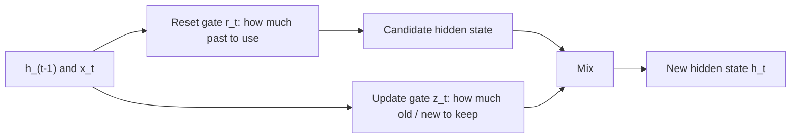

**In one line:** <mark>GRU (Gated Recurrent Unit) is a type of RNN that uses two gates, the reset gate and the update gate, to control information</mark>; the reset gate decides <mark>how much past information to use</mark> and the update gate decides <mark>how much old information to keep and how much new information to take</mark>. <Cite id="class-dl-chp5" loc="slide 20" />

<Box kind="key">

**Key points to write (GRU):**

- <mark>GRU uses gates to control information and handle long-term dependencies</mark>; it helps with the vanishing gradient problem.
- <mark>No separate cell state; the hidden state is the memory</mark>.
- <mark>Reset gate $r_t$: how much of the previous state to use; helps capture short-term dependencies</mark>.
- <mark>Update gate $z_t$: how much of the new state is a copy of the old state; helps capture long-term dependencies</mark>.
- <mark>$h_t = z_t \odot h_{t-1} + (1 - z_t) \odot \tilde{h}_t$</mark>; both gates use sigmoid, so values lie between 0 and 1.
- GRU has fewer parameters than LSTM, so bigger models can be built.

</Box>

## Core answer (5 marks, fits every question here)

<Box kind="definition">

**GRU** is another type of RNN that uses gates to control information and handle long-term dependencies. GRUs are a modified form of RNNs, highly effective at capturing much longer range dependencies, and they help with the vanishing gradient problem. <Cite id="class-dl-chp5" loc="slide 20" /> <Cite id="class-dl-m5" loc="p. 27" />

</Box>

**Idea:** the three gates of LSTM are replaced by two, the **reset gate** and the **update gate**, both with sigmoid. There is **no separate cell state**. <Cite id="class-dl-m5" loc="p. 28" />

| Gate | Question it answers | Helps with |
|---|---|---|
| Reset $r_t$ | How much of the past should I use? | Short-term dependencies |
| Update $z_t$ | How much old should I keep, how much new should I take? | Long-term dependencies |

<Cite id="class-dl-m5" loc="p. 30" />

**Conclusion:** GRU = two gates, no cell state, long-term memory at a lower cost than LSTM.

## Extended answer (10 marks): add these

### 1. Equations step by step

<Cite id="class-dl-m5" loc="p. 26" />

1. **Reset gate:** $r_t = \sigma(W_r[x_t, h_{t-1}] + b_r)$. 0 ignores most previous information, 1 uses most of it.
2. **Update gate:** $z_t = \sigma(W_z[x_t, h_{t-1}] + b_z)$.
3. **Candidate state:** $\tilde{h}_t = \tanh(W_h[x_t, r_t \odot h_{t-1}] + b_h)$. The reset gate decides how much of $h_{t-1}$ goes into the new candidate.
4. **New hidden state:** $h_t = z_t \odot h_{t-1} + (1 - z_t) \odot \tilde{h}_t$. If $z_t$ is near 1, the old state is copied; if near 0, the candidate replaces it.

The same idea was introduced by Cho et al. (2014). <Cite id="web-dl-2-gru-paper" /> <Cite id="web-dl-2-d2l-gru" />

### 2. Worked step

<Sum>

<Given>

$h_{t-1} = 10$, candidate $\tilde{h}_t = 4$, update gate $z = 0.7$.

</Given>

<Find>

the new hidden state $h_t$.

</Find>

<Steps>

1. **Old part:** $z \times h_{t-1} = 0.7 \times 10 = 7$.
2. **New part:** $(1 - z) \times \tilde{h}_t = 0.3 \times 4 = 1.2$.
3. **Add:** $h_t = 7 + 1.2 = 8.2$.

</Steps>

<Answer>

$h_t = 8.2$

</Answer>

</Sum>

<Cite id="class-dl-chp5" loc="slide 21" />

### 3. Advantages and uses

- **Advantages:** simpler architecture and fewer parameters than LSTM, so bigger models can be built. **Applications:** text generation, translation, speech recognition, time series. <Cite id="class-dl-m5" loc="p. 31" />
- Compared with LSTM: 2 gates and one memory instead of 3 gates and two memories. <Cite id="web-dl-2-colah-lstm" />

## Fit it to each question

- **"Explain Gated Recurrent Unit in detail."** (10 marks) <PYQ id="2023-12/q2a" />: definition, idea, the cell diagram, equations (section 1), worked step (section 2), advantages and applications.
- **"What are the use of Update gate and reset gate in GRU?"** (10 marks) <PYQ id="assignment-2/q5c" />: the gate table, then each gate with its meaning, equation and what it helps (short or long term), the worked step and the flow diagram.

## Exam tips

- **Draw** the GRU cell with the reset gate before the candidate and the update gate mixing old and new.
- **Keywords:** reset gate, update gate, candidate hidden state, no cell state, sigmoid, short-term and long-term dependencies.
- Common mistake: swapping the two roles; **reset = use past (short term)**, **update = keep old or take new (long term)**.
